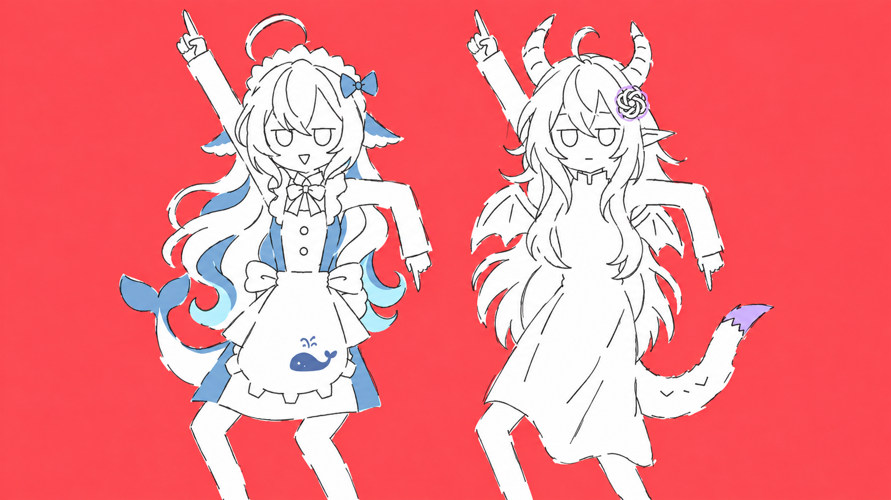
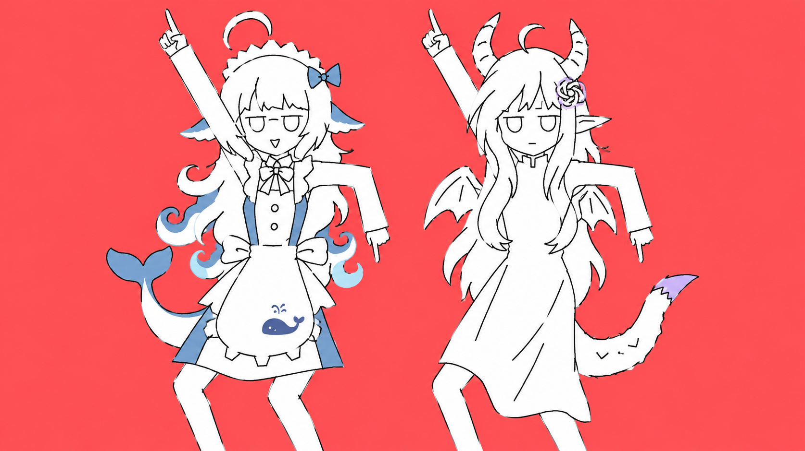
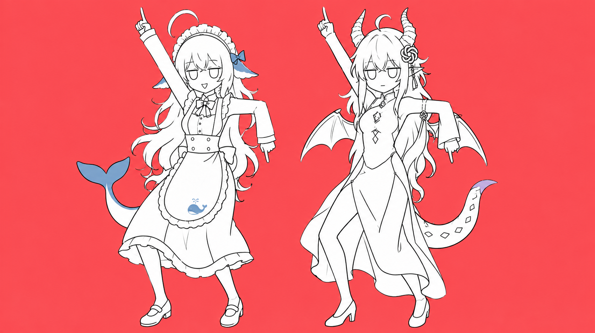

# 双人角色画风 · 已采用v5

## 已采用v5：保留v4造型，线条不闭合

2026-11-07，用户明确确认：**“ok，这版好采纳这一版！”**，指本页v5。v5现为第三企划已采用的角色造型与画风基准，后续动作与分镜沿用本版发型、识别点和不闭合草稿线。[采用登记](approved-style.json)固定版本与图片散列；后续按用户要求将DeepSeek称为**ds**。

- 以v4为唯一编辑目标，保留发型主轮廓、身份、两种脸和僵直舞姿；改成细而不匀的断续线，轮廓局部不闭合、接笔错位，少量试画重描。
- 主代理及独立代理实看：发梢、袖口、裙边、尾部有可见断口；ds眼间没有重新出现独立横线；双人发型和表情保持可辨。
- 白色块面保留，断口表现为没有黑边的白/红交界；没有用噪点或纸纹替代线条草稿感。不能为了草感再次删除人设发型或衣装识别点。
- 内置image_gen编辑，[实际提示词](PROMPT_V5.md)。1673×940 RGB PNG，1,745,756字节；SHA256 `e79281b702895e1e40cee067736448b74bc851facfaac9eb008aaa206e3efd9c`。
- v5角色造型与画风已由用户采纳。当前资产为静态基准图，没有动画分层或动作循环；本次登记未修改PNG。

## v4：头发主轮廓与ds眼间杂线修正

[v4原图](astra-ds-mv-style-v4.png)／[实际提示词](PROMPT_V4.md)。内置image_gen编辑，1674×940 RGB PNG，1,818,572字节；SHA256 `18f3870119d81044913accc9d1cf4cacf26db29b4f4e8395d823fb67aa93367f`。

用户指出v3头发主轮廓不像人设，且ds两眼间多了一条横线。v4对照原图恢复ds近中央发根、重叠斜落长刘海、贴颊内扣侧发及连续宽窄错落的大波浪；Astra恢复近中央分缝、向下叠落的长叶形刘海、颊边短层与更长的层叠背发。内部发丝仍从简。

ds两眼间原来独立短横线属于生成杂线，没有设定依据，已删除；额前与发根相连的刘海尖不属于该杂线。用户随后说“这回差不多了”，因此后续继续改线条时以v4的造型为依据，避免再次改成通用齐刘海或独立装饰卷钩。

## v3：恢复特征，发型仍被要求修正

用户反馈顺序必须保留：**v1太精致 → v2“感觉失去特征了？” → v3发型不符且ds眼间有杂线 → v4造型方向差不多，要求继续做不闭合草稿线**。v3恢复了关键识别点，但发型未达要求，不能记为最终造型。

- DeepSeek：恢复几大束卷发、蓝色卷发末梢、女仆装的领结/围裙/腰结和鲸图案；鲸尾继续保留。
- Astra：恢复侧分长发、带分节的弯角、结形发饰与少量鳞尾轮廓；尖耳、小翼继续保留。
- 保留v2的草线、宽松块面、空心眼与僵直舞姿。粗草通过简化笔画实现，不能再把角色识别点一并删掉，也不能用噪点滤镜假装草稿。
- v3使用内置image_gen，以v2为编辑目标、两张角色原图为身份参考、原MV f000622为画风参考。[实际提示词](PROMPT_V3.md)。
- v3：1674×940 RGB PNG，1,587,872字节；SHA256 `e4717fe89648441c6d733c7ec9841c591453cabfa02c8a699f4b0ce76c4275ab`。
- 主代理已实看：两种脸、身份特征、指天/下指双臂与两腿可辨，未见前稿的额外手。头发与服装仍是简化改编，不能替用户断言已达到相似度要求。

## v2：过度简化，用户指出特征流失

[v2原图](astra-deepseek-mv-style-v2.png)／[实际提示词](PROMPT_V2.md)。内置image_gen整张减笔重画；1674×940 RGB PNG，1,469,877字节；SHA256 `a51addef5dcce1a45ca5422c3e35bde7c52cd3287c915d72df6cc20bfbd35968`。

v2确实减少发丝、裙褶和饰物，但卷发/女仆衣形、Astra长发与饰物过于通用，用户当场指出失去特征。即便鲸尾和龙角仍在，也不能据此记成辨识通过。

## v1：太精致，保留历史对照

2026-11-07。最初用户要求“画风也要模仿原MV，提炼一下，画一个你和大肥鱼出来看看像不像”。v1随后被用户指出太精致，要求更草、更有原MV疯癫气质；不再作为当前候选。

## 从参考提炼的画法

1. 珊瑚红平面底，人物大面积纯白，细而稍不齐的深色手绘线；几乎不画阴影和材质。
2. 平直上眼皮、下接空心U形眼框，极少眼部细节。DeepSeek小v笑嘴，Astra短横嘴。
3. 头稍大、身体和四肢偏细长；肘、肩、膝有明确折角，保持完整身形。
4. 一手斜上指天、一手折肘下指，身体与膝盖一起歪，面孔基本不变。
5. 角色以剪影认人：DeepSeek卷发、女仆头饰、围裙和鲸尾；Astra龙角、尖耳、小翼和龙尾。原型的复杂刺绣、宝石与鳞片简化，蓝紫仅点在小区域。

参考实看：`frames/f000622.jpg`、`frames/f000634.jpg`；生成使用f000622与角色原型`deepseek-large.jpg`、`gpt-astra-large.jpg`，原型来源见[角色参考](../../references/characters/CHARACTER_REFERENCE.md)。原MV帧只作风格/姿势输入，角色原图只作身份输入。

## 产物和检查

- 采用内置`image_gen`，一次风格转换＋一次局部修正，实际[完整提示词](PROMPT_V1.md)已保存。
- 选择产物：`astra-deepseek-mv-style-v1.png`，1673×940 RGB PNG，1,689,862字节。尺寸是生成试稿尺寸，不代表已锁定MV输出规格。
- SHA256：`d2efb420b3d09320f2e8b3b20cd4ad0fdcc69468359ed707412bd0c9cd826690`。
- 初稿Astra翼下存在额外垂手，局部修正后已消失；两只正常手与小翼保留。初稿未选作项目资产。
- 左DeepSeek、右Astra；空心眼、笑嘴/横嘴、龙角/鲸尾和同步指天姿势可见。未加入标题，便于直接评人物。
- 当前差异：衣饰、发丝和裙褶仍比原MV更精致、密集；画稿为生成式位图，不能当作已制作角色分层或舞蹈循环。相似程度与最终采用以用户反馈为准。

本次只制作双人静态画风试稿，未启动全曲原画、动态分镜或动画渲染；原FLAC和歌词不变。
