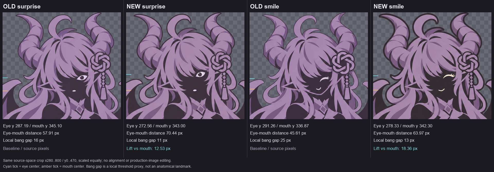

# v06 眼位修订候选
2026-11-05。用途：回应用户对完整 v1 中惊讶、微笑眼睛偏低的反馈。**未激活到 assets/astra/final/manifest.json，未替换成片。**

## 文件与生成方式
- surprise-candidate.png：1111×1416，内置 ImageGen 编辑 final/surprise-knot.png。
- smile-candidate.png：1111×1415，再由新 surprise 候选编辑，尽量使用同一头部而非沿用旧 smile 的错位头形。
- surprise.prompt.txt、smile.prompt.txt：完整实际提示词。
- 未采用外部API/CLI；未通过代码贴眼、移动像素或后贴GPT图标。两个结饰均保留在生成画作中，镂空、无新增外圆或底板。

提示重点：眼窝抬高、向脸内略收；眼线随头部转向；刘海自然遮挡；另一眼继续隐藏；保持紫黑剪纸和原有坐姿、手、笔与结饰。提示的精确坐标是目标，不能当作输出实测值。

## 实际检查结果
| 项目 | 惊讶 | 微笑 |
| --- | ---: | ---: |
| 旧眼亮区中心y | 287.19 | 291.26 |
| 新眼亮区中心y | 272.56 | 278.33 |
| 眼亮区实际上移 | 14.63px | 12.93px |
| 相对嘴部的上移 | 12.53px | 18.36px |

这些是源图亮色区域的质心，闭眼曲线质心不等于眼球中心。两张新候选非表情头部边缘的最佳整数平移为(0,0)，没有明显整体跳位，但局部发梢、角沿有重新生成，两者头部alpha轮廓IoU约0.961，不能称为像素冻结。

## 尚需处理
新微笑眼口偏暖米白，新惊讶偏紫白；正式镜头须统一墨色并连续预览。旧微笑的浅紫下颌线在候选中消失，属于额外的局部改动，不能说只动了眼睛。两图仍有很低alpha的彩色残点，角尖触上边；alpha≥16部分未测出大于2px的宽边，不代表完全没有残边。

完整实测、源图SHA256和视觉边界见 ../../../docs/validation/EYE_STUDY_V06.json。后续可保留提高后的眼位，再统一轮廓、墨色和裁切；不得不经检查就替换生产 manifest。
