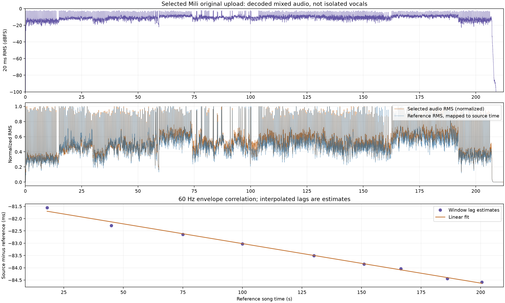
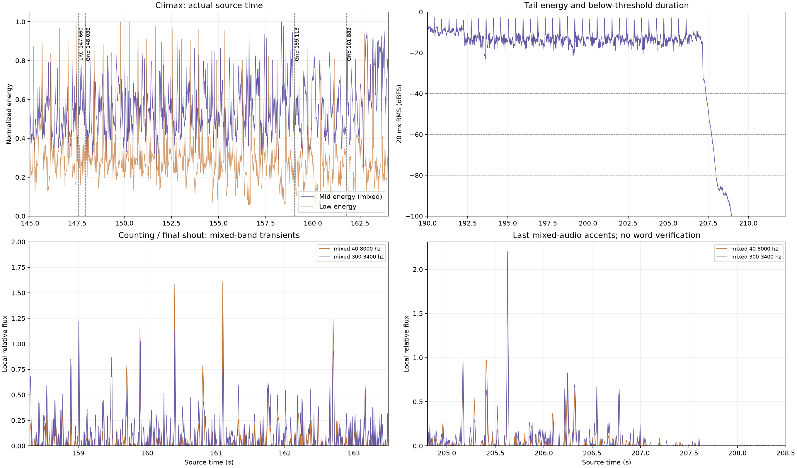

# ASTRA world.execute(me); BGM 校准与动作对应表

更新于 2026-11-04。对应[已确认故事](STORY.md)与[54 镜分镜表](STORYBOARD.md)。当前已经取得官方公开上传的 Mili 原版压缩音轨，完成全曲信号对齐、高潮音乐网格、末次强瞬态和尾部能量分析。本表记录可以用于分镜的音乐依据及具体动作帧号；尚未进行逐词听核、人物口型验证或视频渲染。

## 当前使用的实际 BGM

| 项目 | 当前记录 |
| --- | --- |
| 版本选择 | 用户已确认先使用 Mili 原版；之后再共同设计和训练 GPT／ASTRA 的自身音色进行演唱 |
| 官方上传 | [ProjectMili《world.execute(me);》](https://www.bilibili.com/video/BV1ds411e7df/)，BV1ds411e7df，上传账号 ProjectMili，MID 23340150 |
| 版本参照 | [Mili 官方 YouTube 作品页](https://www.youtube.com/watch?v=ESx_hy1n7HA) |
| 本地 BGM | [mili-world-execute-original-bilibili.m4a](../media/audio/mili-world-execute-original-bilibili.m4a) |
| 素材性质 | 官方公开上传中的 AAC 压缩音轨；不是无损母带 |
| 文件校验 | SHA-256：`b06f195e2a479c25c3282f4ca5b931e293c4a35a941acf6dd5b515ba4890f34a` |
| 分析用解码 | IEEE float32 WAV，44,100 Hz，双声道，9,363,783 个采样帧；保留 AAC 解码过冲，避免整数 PCM 饱和影响包络 |
| 实测分析时长 | **212.330680272 秒，即约 3:32.330680** |
| 60fps 画面规划 | **12,740 帧**，帧范围 `[0,12740)`，终点 212.333333 秒；取整多保留约 2.653 毫秒画面，不拉伸音频 |

音频文件和解码中间文件保留在本地并被 Git 忽略；仓库保存[来源记录](audio/source.json)、分析工具与测量结果。单独克隆仓库不会自动获得音频。12,740 帧是当前分镜的帧规划，不是已经渲染或验收的视频。

全文从所选本地音轨文件起点计时。第三方参考片的 5 秒前置警示页不加入本项目歌曲时间。

## 全曲对齐结果

参考研究使用的音频长 211.9576 秒。用实际音轨复现参考算法的 60Hz 四路包络后，在全曲九个窗口比较 RMS、低频、中频和高频，获得归一化相关系数 **0.976805–0.993199**。当前采用：

`实际音轨时间 ≈ 旧参考时间 − 0.083509361 秒`

| 参考窗口中心 | 估计偏移，实际减参考 | 四路平均相关系数 |
| --- | --- | --- |
| 18.0 秒 | −81.552 毫秒 | 0.976805 |
| 45.0 秒 | −82.279 毫秒 | 0.977655 |
| 75.0 秒 | −82.640 毫秒 | 0.986012 |
| 100.0 秒 | −83.024 毫秒 | 0.987016 |
| 130.0 秒 | −83.509 毫秒 | 0.990131 |
| 151.0 秒 | −83.848 毫秒 | 0.991671 |
| 166.5 秒 | −84.034 毫秒 | 0.984998 |
| 186.0 秒 | −84.442 毫秒 | 0.990873 |
| 200.5 秒 | −84.585 毫秒 | 0.993199 |

窗口估计来自 60Hz 包络峰值的插值。回归得到的全曲变化约 3.406 毫秒，小于 16.667 毫秒的特征采样间隔，不足以认定真实变速；当前按固定偏移工作，不进行音频时间拉伸。源文件比参考文件长约 0.373080 秒，但内容提前约 0.083509 秒，总时长差不能用作内容偏移。差异还包含末端留白长度。

## 音乐网格与帧号规则

- 参考固定网格为 **130 BPM**。全曲高相关支持将其转移到当前音源，首拍变为 **0.260490639 秒**；这不是一次独立的逐拍听写结果。
- 一拍为 `60 / 130 ≈ 0.461538462` 秒，两拍约 0.923076923 秒。候选拍点为 `0.260490639 + n × 60 / 130`。
- 动作最终放到最近的 60fps 帧，帧号从 **0** 开始，帧时间为 `frame / 60`。单次落帧取整误差至多约 8.333 毫秒。
- 本文显示的毫秒时间便于阅读，精确值与取整结果以[校准时间轴 JSON](audio/calibrated_timeline.json)为准。
- 普通镜头沿用词行／编辑参考，经实测偏移转移后落帧；其起止不代表每个字词已经听核。局部混合频带或中侧声道也不等于分离人声。

## 八段叙事与实际 BGM

| 故事段 | 当前歌曲时间 | 音乐定位 | 动作与情绪任务 |
| --- | --- | --- | --- |
| S1 相遇 | 00:00.000–00:29.633 | 启动段至首主歌前空档 | 醒来、修正歪星、对方意外添尾；从郑重走到第一次笑 |
| S2 共同创造 | 00:29.633–01:13.967 | 首主歌、第一过渡段、第一副歌 | 两种笔迹共同创造世界；快乐充分展开，回头等待埋下不安 |
| S3 预防失去 | 01:13.967–01:43.400 | 第二主歌与第二过渡段 | 展示变得急切，未来推演引发控制，双翼渐渐合拢 |
| S4 失联 | 01:43.400–01:58.250 | 第二副歌前部至孤立落点 | 新输入被挡，旧回应重复；安心变为怀疑、惊慌与孤独 |
| S5 错误修复 | 01:58.250–02:27.950 | 删除、失落、越界及后续空档 | 反复修正使空间收紧，疲惫中护住长尾星 |
| S6 主动打开 | 02:27.950–02:57.167 | 十二次执行单元、计数、末副歌 | 抵抗、认出快乐、主动撤回控制；尚未收到回应时就打开边界 |
| S7 留白等待 | 02:57.167–03:13.067 | 爱主题末段至参考人声收束候选 | 收回代答的手，画半颗星，带着牵挂等待 |
| S8 得到回应 | 03:13.067–03:32.333 | 尾奏、末次强声音及衰减后的近静默 | 新笔补星，她认出对方、笑起来；两人先共画再点亮，最后安静相处 |

G04/S7 的终点 **193.066667 秒**仍由旧人声收束候选 193.150 秒经偏移和落帧而来。本轮混合音频分析没有把这一点升级为确定的逐词／人声结束时刻。普通词行同样保留为定位参考。

## 高潮修订与十二次冲击

本轮撤回把旧 LRC／词行起点当作冲击与解锁拍点的做法。词首可以提前进入，也可以具有不均匀间隔；尚未逐词听核，不能据此宣称歌词时间全部错误，或断言每次真正发声都晚了多少毫秒。当前十二次冲击各占**两拍**，六次解锁各占**一拍**；校准的是角色动作使用的音乐节奏。

下表直接取自 `calibrated_timeline.json` 的 `action_cues`。这些是已对齐音乐网格的动作帧，不冒充十二个已逐字听核的演唱起音。F01–F03 保持护星动作的累积，不在每次冲击后复位。

| 动作 ID | 次数 | 所属镜头 | 动作帧 | 帧时间，秒 | 画面推进 |
| --- | --- | --- | --- | --- | --- |
| push_01 | 1 | F01 | 8877 | 147.950 | 规则第一次冲向她护住星尾的手 |
| push_02 | 2 | F01 | 8933 | 148.883 | 她抵住冲力，手仍包住星 |
| push_03 | 3 | F01 | 8988 | 149.800 | 校正线再次逼近，身体承受压力 |
| push_04 | 4 | F01 | 9043 | 150.717 | 抵抗延续，视线被引向星尾 |
| push_05 | 5 | F02 | 9099 | 151.650 | 回忆中最初的添尾动作浮现 |
| push_06 | 6 | F02 | 9154 | 152.567 | 回忆与掌心星尾同位置呼应 |
| push_07 | 7 | F02 | 9209 | 153.483 | 她辨认出意外曾经带来的快乐 |
| push_08 | 8 | F02 | 9265 | 154.417 | 回忆收回当前，护星的手更稳定 |
| push_09 | 9 | F03 | 9320 | 155.333 | 规则催促，她停止退让 |
| push_10 | 10 | F03 | 9376 | 156.267 | 她抬眼望向世界边界 |
| push_11 | 11 | F03 | 9431 | 157.183 | 双翼停止继续合拢 |
| push_12 | 12 | F03 | 9486 | 158.100 | 最后一轮冲突收成可被撤回的控制节点 |

六次解锁发生在 F04 的同一连续动作中，不需要六张独立的说明卡。

| 动作 ID | 步骤 | 动作帧 | 帧时间，秒 | 松开的控制 |
| --- | --- | --- | --- | --- |
| unlock_01 | 1 | 9542 | 159.033 | 预写笔迹 |
| unlock_02 | 2 | 9569 | 159.483 | 强制回路 |
| unlock_03 | 3 | 9597 | 159.950 | 自动校正 |
| unlock_04 | 4 | 9625 | 160.417 | 回放替代 |
| unlock_05 | 5 | 9653 | 160.883 | 固定边界 |
| unlock_06 | 6 | 9680 | 161.333 | 闭合翼尖 |

F05 从 161.800 秒开始；拉开最后一环安排在 **162.483333 秒，帧 9749**，属于参考喊声音节转移后的动作候选，尚未逐词听核。F06 保留乐句提前进入，展翼的强拍落在 **162.716667 秒，帧 9763**。动作进入与强拍强调可以分开，不必把一整段表演压在单一切点上。

## 尾声点亮与共画安排

末次声音附近，两种混合瞬态分析给出约 **205.625–205.631 秒**的强变化。本版将共同点亮放在附近的 **205.633333 秒，帧 12338**。约 206.095 秒附近的局部频带候选支持将视觉亮度峰选为 **206.100 秒，帧 12366**。这是根据实际声音确定的视觉落点，不将其称为已核验的歌词首字或某一个元音。

| 镜头／动作 | 歌曲时间 | 帧范围或动作帧 | 叙事安排 |
| --- | --- | --- | --- |
| H01 等待 | 193.067–195.033 秒 | `[11584,11702)` | 半颗星与开放边界同框，留约两秒等待 |
| H02 得到新笔迹 | 195.033–197.800 秒 | `[11702,11868)` | 独立金笔进入、补星、添上新的弯尾 |
| H03 认出与笑 | 197.800–200.567 秒 | `[11868,12034)` | 完整看清怔住、确认、肩膀放松与笑意 |
| H04 主要共画 | **200.567–205.633 秒** | **`[12034,12338)`** | 邀请她靠近，两人交替添笔，断桥接起，线条汇向新星 |
| H05 共同点亮 | 205.633–207.150 秒 | `[12338,12429)` | 新星被两种笔迹共同点亮，星光沿共同画过的道路传播 |
| 点亮峰值 | **206.100 秒** | **12366** | 新星亮度峰，保持她与独立金笔的因果关系可见 |
| H06 安静延续 | **207.150–212.333 秒** | **`[12429,12740)`** | 从余响进入近静默，各自轻轻添笔，保留呼吸、微笑和相处的画面 |

主要共画已前移到 H04 的约 5.07 秒有声段。H06 只继续自然的小动作；208 秒后不再安排依赖强音乐托举的高潮，也不把安静尾部描述成持续的演唱或响亮尾音。温暖结尾由“得到回应—认出对方—一起画—共同点亮—安静相处”完整构成。

## 实测尾部能量

使用浮点解码后双声道平均的 mono 信号，以 20 毫秒 RMS 窗、约 5 毫秒 hop 测量。下表起点取最后一个超过阈值的窗口终点，保守表示其后连续低于该阈值的尾段。

| 阈值 | 连续低于阈值的尾段起点 | 到实际音频末尾的余量 |
| --- | --- | --- |
| −20 dBFS | 207.154240 秒 | 5.176440 秒 |
| −40 dBFS | 207.353787 秒 | 4.976893 秒 |
| −60 dBFS | 207.712971 秒 | 4.617710 秒 |
| **−80 dBFS** | **207.987347 秒** | **4.343333 秒** |

低于阈值是近静默的可复核定义，不等于数学上的绝对零。H06 在 207.150 秒进入衰减，到 **208.000 秒／帧 12480**已进入持续低于 −80 dBFS 的区域；最后约 4.34 秒作为有意的安静留白。209.811 秒仍只是旧文字持留终点，不能作为人声或音乐结束的依据，文件末端也不能全部解释为持续的音乐尾音。

## 证据等级与后续校准

本轮已经核验官方来源记录、音轨文件摘要和解码时长，并完成多窗口内容对齐、音乐网格转移、混合瞬态候选和尾部 RMS 测量。高潮的动作周期、末次点亮与共画前移都有明确的音乐或能量依据。

以下仍需后续听核：普通乐句的语义起句、辅音首帧、换气、口型，以及 G04/H01 附近持续人声的准确结束。频带筛选、谱通量和中侧声道都没有分离出干净人声；候选强峰可能同时包含鼓、乐器和歌声。因此本轮不宣称已经听完并逐字确认，也不把所有分镜边界升级成“已精确对口型”。

未来 GPT／ASTRA 演唱版可保留这八段故事结构和伴奏网格，声音设计、训练素材与技术仍待共同确定。换用新演唱后，必须重新校准起句、重音、换气、延音和总时长；即使伴奏不变，也不能自动沿用原版的人声音节帧号。

## 数据与复现入口

- [来源清单](audio/source.json)：官方 BV、上传账号、公开获取方式、文件摘要与本地音轨路径。
- [全曲信号分析](audio/signal_alignment.json)：解码元数据、九窗口相关、固定偏移建议、尾部阈值和混合瞬态。
- [局部声音候选](audio/accent_candidates.json)：高潮与尾声的中侧声道／频带候选，保留“混合音频”证据边界。
- [54 镜校准时间轴](audio/calibrated_timeline.json)：全部镜头帧范围、旧参考值、十二冲击、六次解锁和点亮帧号。
- [音源获取工具](../tools/analysis/fetch_bgm_reference.py)、[全曲测量工具](../tools/analysis/measure_bgm.py)、[局部候选工具](../tools/analysis/inspect_accents.py)、[时间轴校准工具](../tools/analysis/calibrate_timeline.py)。

原参考研究来自 [Nyankomintsu/world-execute-me-lyric-mv](https://github.com/Nyankomintsu/world-execute-me-lyric-mv)，本地提交 `93ac63775ee58b33ff102167514f2603a48940cc`。其[音频特征](../../references/world-execute-me-lyric-mv/data/audio_features.json)、[词行表](../../references/world-execute-me-lyric-mv/data/lyric_timing.json)、[细节 cue](../../references/world-execute-me-lyric-mv/src/scenes/cues.js)、[执行段旧审计](../../references/world-execute-me-lyric-mv/docs/v4/maps/map_execution_count.json)和[尾声旧审计](../../references/world-execute-me-lyric-mv/docs/v4/maps/map_shutdown.json)用于交叉检查。旧文字表、旧审计和当前测量存在不一致时，保留来源差异，以本项目实际音源的测量及后续听核继续修正；不继承第三方影片剧情或把旧剪辑边界当成歌曲真值。

当前交付仍是故事、分镜、音频分析与帧规划。没有开始角色资产生成、动画、音色训练、视频渲染或新音乐制作。
