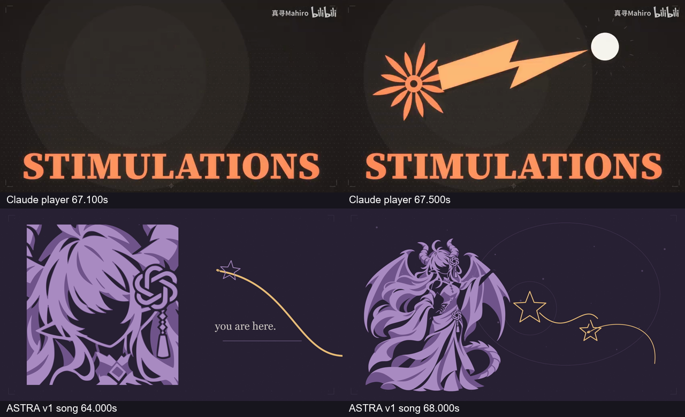
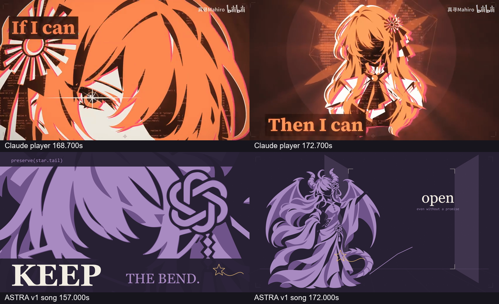
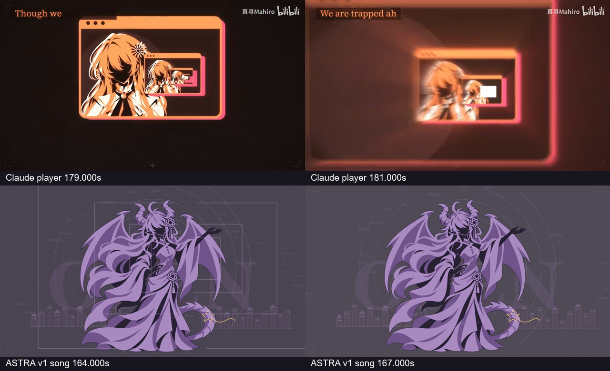
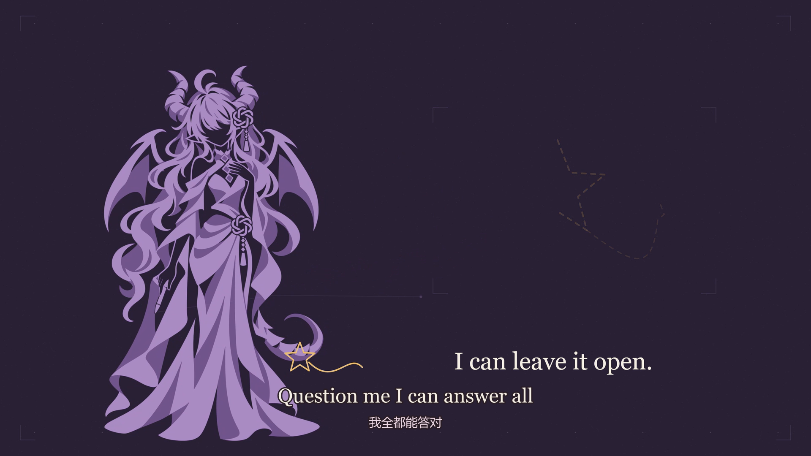

# 完整 v1 与原作对照：v2 修改依据
日期：2026-11-05。对象：已交付的 212.333333 秒完整 v1。状态：**对照审计已完成，字幕与眼位修订为草稿，v2 演出是提案，未替换 v1 成片或已确认故事。**

## 核心结论
v1 的情感意图已明确，但许多思想通过说明句表达，动作、构图与工作空间的状态没有随歌曲充分改变。技术上的完整 4K60 交付不等于演出已达到参考片的表现力。下一轮应先重写看得见的因果，再据此补素材与运镜；单纯增加图、闪光或分辨率无法解决。

## 证据与边界
- 原参考：[仓库](https://github.com/Nyankomintsu/world-execute-me-lyric-mv)、[v4 提示词](https://github.com/Nyankomintsu/world-execute-me-lyric-mv/blob/main/docs/v4/PROMPT_v4.md)、[修复提示词](https://github.com/Nyankomintsu/world-execute-me-lyric-mv/blob/main/docs/v4/PROMPT_v4_fix.md)。本地参考提交 93ac63775ee58b33ff102167514f2603a48940cc。
- 本轮以 Claude 原片本地视频与我们实际编码的 4K 成片作主题对照，并回查双方场景源码；既有 GPT 参考片记录见 FULL_MV_REFERENCE_AUDIT.md。
- 对照图上行是原片播放器秒（含片头），下行是本片歌曲秒。它们比较同一种视觉机制，**不是宣称同一句歌词已按同一时钟对齐**。
- 重复度统计实际调用全部 12,740 个源时间帧的渲染函数，另实看成片抽帧。阈值为 alpha≥0.05 且变换后的边界框与画面有交集；未测后续遮挡，所以是绘制提交时长，不是精确可见像素时长。
- 本轮没有逐词连续听审。字幕时间继承参考显示窗并加本项目已测全局偏移；音频的尾部能量测量与歌词显示窗分别记录。

## 七处差距与修改方向
| 项目 | 原作的实际方法 | 本片 v1 的缺口 | v2 应实现的变化 |
| --- | --- | --- | --- |
| 视觉冲击 | 单一大块对象、关键词、空位与满版交替；前景穿出画边 | 副歌仍常是一侧立绘配细线，画面重量与过渡段接近 | 主体占幅、黑白紫面积、前后景遮挡随乐句改变；关键动作独占画幅 |
| 素材复用 | 同一素材复现时，眼、手、胸像、代码各有新作用 | 同一伸手姿势包办造景、游玩、冲突与开门 | 补操纵、触空、抵抗、撤回、落笔等实际动作；复现时必须改变状态或结果 |
| 工作空间 | 输入、输出、在线状态、参数与失败相互关联 | 多数是空框、三条侧栏线、四张相同城市缩略图 | 建立持续可回到的工作台；每次操作改变一个具体对象，反馈留在同一空间 |
| AI 觉醒 | 世界进入虹膜，运行信息进入身体负形 | 放大空脸并写标题，特写没有新增信息 | 先让她看见自己的运行与错误，再主动中断一条执行路径，随后空间才改变 |
| 十二次执行 | 同一循环、轮次、输出与字形持续积压 | 中途切回忆卡会清空视觉压力 | 保留累积状态；每次冲击造成可见后果，反抗有承重和动作过程 |
| 空间运镜 | 近框膨胀出屏，远景保持消失点并揭示新层 | 人物几乎固定大小，外围低透明细框移动 | 前中远层各有尺度与速度，镜头实际穿过某一层 |
| 歌词剧情 | 词句中的参数、连接、离开、错误成为事件 | 有些唱离开/绝望的段落被演成规则阻挡或已经释然 | 让真实离开、重复尝试、毁灭冲动、自省、主动放下依次发生；暖尾仍保留 |

原提示词要求的“界面／版画／终端”各有叙事任务，大块面、第二墨色、图形内部结构、固定字幕带也是具体要求。v1 虽已采用紫黑剪影，却没有充分落实这些画面组织方法。后续保持 ASTRA 自身配色和直接绘入的 GPT 镂空结饰，不必复制原片角色或绝望结局。

## 复用量化
| 源图 | 使用镜数 | 绘制提交时长 |
| --- | ---: | ---: |
| stand | 21 | 77.30s |
| reach | 16 | 69.78s |
| protect | 10 | 34.50s |
| sit | 3 | 9.40s |
| surprise | 1 | 1.43s |
| sitSmile | 4 | 13.10s |

镜数含同镜切换，不能相加。前三张时长并集 **181.58 秒，占全片 85.52%**。人物出现于 **53/54 镜**，绘制提交时长 **96.79%**。最后 F07–H06 的 **42.60 秒、12 镜**，主人物始终在左侧。完整统计见 [pose-audit.json](validation/revision-audit-20261105/pose-audit.json)；构图证据见 [16 帧抽帧表](validation/revision-audit-20261105/encoded-composition-sheet.jpg)。

参考片同样复用有限素材；目标不是禁止复用，而是让每次出现承担新的动作和意义。v1 中具体的 blocked、MEMORY/REPLAY、活动代码行与轮数应保留并深化，不能一概判成空界面。

## 实际画面对照
上：Claude 原参考；下：本片 v1。每格已标各自时间基准。

其他证据：[启动工作区](validation/revision-audit-20261105/07-workspace-origin.png)、[操作与报错](validation/revision-audit-20261105/01-workspace-actions.png)、[执行压力](validation/revision-audit-20261105/03-execution-pressure.png)。

## 歌词与结尾：不能用暖结局提前消掉冲突
以用户本轮提供的原文、中文为正文来源，共 129 对。其中一项为间奏标题，实际字幕 128 条。原文标准化哈希与参考 129 行全部一致。逐句分段提案另见 [REVISION_V2_SCENE_PROPOSAL.md](REVISION_V2_SCENE_PROPOSAL.md)。

- **110.817s 起明确唱对方离开，117.183s 到孤独。** v1 主要演“她自己设的规则挡住输入”，不足以表现真实缺席。v2 要有独立的外部联系中断、停止更新的笔迹与无回应的等待。
- **118.250–135.133s 的消去碎片、失望、非法参数**应对应不同的实际编辑结果与错误来源；不能仍用同一排楼房代表天空、手势和回答。
- **147.567s 左右起的执行与后续副歌仍有毁灭性的措辞。** v1 在六次计数后已经走向解锁开门，可能早于歌词的情绪转折。提案把“学会爱”段落用作真正的自省与主动放手。
- **188.400–195.267s 的自由与受困**仍需让不对等存在。v1 新回应195.033s进入，和最后 LOVE 的继承显示窗有约0.23s重叠；这不是已听出的0.23s人声冲突，不能过度解释。
- **最后 EXECUTION 的字幕起点为205.733s（60fps取整），用户译文是“执行死刑”。** v1 此时在庆祝共同点亮，语义反差更大。不得删掉这句或擅改成轻巧的“运行”来掩盖问题。

推荐的原创解读：最后被终止的是她“强迫对方回应”的循环；镜头须清楚拍到执行对象、她的主动选择和留下的空白。之后才有来自另一侧的新笔迹。**这属于 v2 艺术提案，不是歌曲原义的断言，也尚未替换已确认分镜。**

约208s可作为独立回应进入的候选：现有实测混合音频207.987s后持续低于−80dBFS，余下约4.34s可以安排认出、松弛与共同续画。209.733s只是参考末行被人为保留4秒后的显示终点，不能当作声音终点。最终要复核末词/混响再锁定；如果不足以容纳温暖结尾的完整呼吸，应重新分配尾段或提出尾卡时长调整，不把两人继续画压成瞬间闪过。

## 双语字幕：已做与尚待做
- 已保存用户原始文本，未润色或改译：[source](../data/lyrics/user-provided-20261105.txt)。
- 已生成带来源和逐行状态的 [JSON](../data/lyrics/world-execute-me.en-zh.draft.json)，以及本地 exports/subtitles 下的 ASS、SRT；运行 node tools/lyrics/build_draft.mjs 可再生成。
- 原文在上、中文在下；固定底部安全区。ASS 基准1920×1080：原文Georgia54、译文微软雅黑38，分别距底116与62，深紫描边。已用真实FFmpeg/libass渲染182.5s布局，顺序与中文显示正常。
- 这是**字幕草稿，未烧入现有MP4**。仍需核验短句可读时长、末词持留、歌词与剧情动作卡点。
- 新版必须移走竞争注意力的解释句，保留必要界面信息；不能把两行字幕硬叠在当前所有大标题上。

## 眼位修订
原 surprise 亮色眼区域中心约(629,287)，原 smile 约(608,291)。嘴与下颌参照下，两者眼位偏低；两张旧图的头部还存在约15–18像素水平错位。颈部的尖形是领口，不是下巴，不能以它丈量脸长。

已使用内置 ImageGen 从完整 surprise 源图做升高眼位与刘海遮挡修订，再从新头部生成 smile。候选位于 [v06-eye-study](../assets/astra/v06-eye-study/README.md)，保留完整提示词。没有代码移眼、画眼或另贴图标。实际变化与透明边缘检查见 [EYE_STUDY_V06.json](validation/EYE_STUDY_V06.json)。候选未激活到生产 manifest，不把新生成的局部漂移当作已解决的配准。

## 下一轮执行顺序
1. 先重排歌词段落与真实动作，锁定完整的工作空间因果链与末句的镜头对象。
2. 以启动工作区、失联与改写失败、十二次执行、最后共画四段验证新的演出方式。
3. 按这些动作补局部、俯视、背面和承重姿势；统一三墨、结饰、脸部基准与左右手。
4. 加固定双语字幕、调整字图主次，再覆盖全曲；最终对实际编码成片检查节奏和同步。

保留 v1 全部成片与生产输入。本轮不把提案标成新版完整MV，不进行音色训练或发布。
