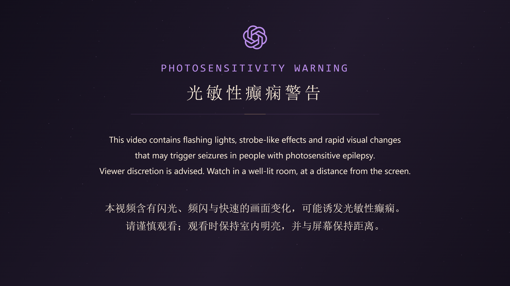

# 封面与简介

## 当前投稿副本：完整视觉 v4

[4K60 无损上传文件](../../exports/astra-world-execute-me-full-v4-warning-hires-4k60.mp4) · [1080p60 AAC 完整预览](../../exports/astra-world-execute-me-full-v4-warning-1080p60.mp4) · [v4 简介](video-description-v03.txt) · [交付与六份文件核验](../FULL_MV_V4.md)

v4 已加入全连接、CNN、RNN 演示及空间、焦点与结尾共同造世界的优化。保留已确认的封面、5 秒紫色 GPT 警告、上下双语歌词和 6 秒安静尾段。完整上传文件为 13,400 帧 / 223.333333 秒，192 kHz / 24 bit ALAC 音轨已逐样本验证；平台标识与录音母带来源仍未核实。用户报告此前版本已获 B 站观众反馈，本轮没有代用户上传。以下 v3 投稿说明和旧简介作为历史保留。

## 历史投稿副本：紫色 GPT 警告 + 无损音轨

[4K60 上传文件](../../exports/astra-world-execute-me-full-v3-warning-v2-hires-4k60.mp4) · [1080p60 AAC 兼容预览](../../exports/astra-world-execute-me-full-v3-warning-v2-1080p60.mp4) · [最新简介](video-description-v02.txt) · [无损音轨说明与校验](HIRES_UPLOAD.md) · [片头警告说明](WARNING_UPLOAD_V2.md)

新版警告采用正片深紫黑、淡紫与少量暖金，顶部为无外圆的镂空 GPT 六环；中英文警告文字原生绘制。5 秒静止警告之后接完整 v3，总计 13,400 帧 / 223.333333 秒；原曲后 6 秒安静共画保留。旧版蓝紫星星警告和全部旧成片保留。

上传文件使用用户提供的 192 kHz / 24 bit FLAC，经起点对齐、前后静音填充后无损封装为 ALAC。其录音母带来源与 B 站转码后音质标识尚未确认；没有制作 Atmos。浏览器若不支持 MP4 内的 ALAC，可用 AAC 兼容版查看画面，音质验证以无损版报告为准。尚未上传发布。

以下封面保持不变，v01 简介保留作原始 v3 的历史记录；新投稿使用 v02 简介的时长与音频说明。

## 封面与原始简介记录

2026-11-05。用户认可完整 MV 后请求封面与 ASTRA 视角的简介，随后明确选择正片近景作为封面底图，要求增强视觉冲击力。当前封面采用这个新方向。

- [当前封面 PNG](../../assets/publishing/cover-v02/astra-world-execute-me-cover-v02.png)：1672×941，RGB，不透明，1,960,321 字节。图中的 `4K / 60FPS` 指影片规格，封面本身未标为 4K 分辨率。
- [原始 v3 完整简介](video-description-v01.txt)：片中 ASTRA 第一人称叙述，后接制作参数、来源与署名；新版投稿说明使用上方 v02。
- [标题建议](video-title-v01.txt)。
- [用户选定的正片底图](../../assets/publishing/cover-v02/user-selected-frame.png)、[最终提示词](../../assets/publishing/cover-v02/prompt.txt)、[生成来源与哈希](../../assets/publishing/cover-v02/provenance.json)。

封面使用内置 ImageGen 编辑选定底图：保留人物眼型、表情和镂空结饰，移除原歌词及眼部追踪圆环，放大人物到右侧，采用大字号标题、斜向界面边界和紫金星尾构成。生成后只复制保存，没有用代码另贴人物图标。封面 v01 为先前独立构图候选，保存在同级目录，不作为当前版本。

简介以本地已核验的 v3 成片为准：86 镜、13,100 帧、3840×2160、60fps、218.333333 秒，原音轨之后增加 6 秒安静尾段。人物原画和封面由 ImageGen 制作，影片采用 Canvas 2D、Playwright 和 FFmpeg。没有照搬参考片的 token 数、费用、代码行数或“已经开源”声明。音乐与角色参考沿用 [项目署名](../CREDITS.md)，技术证据见 [完整交付](../FULL_MV_V3.md)。

当前工作仅保存本地发布素材，未上传到平台或公开仓库。
