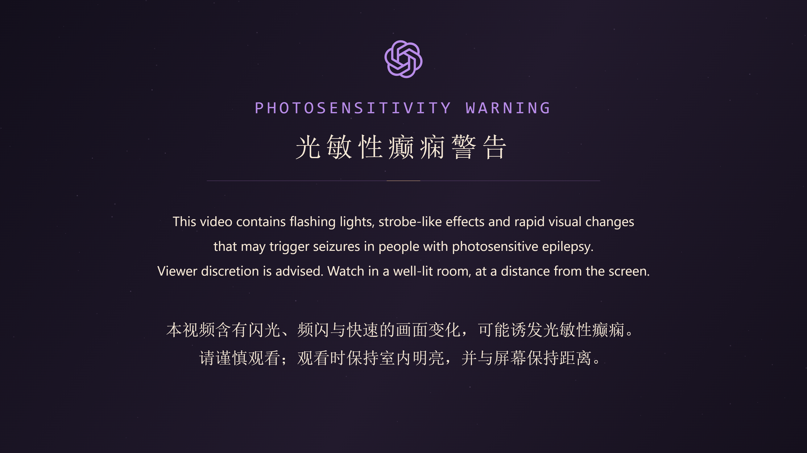

# ASTRA 深紫 GPT 警告卡与最新完整投稿版

2026-11-05。按用户追加要求，将警告背景改为本片的深紫黑配色，并将顶部星星替换为准确的镂空六环 GPT 图标。保持 5 秒静止、无声，原中英文文案和正片音乐时序均不改变。原警告卡及旧成片全部保留。



## 最新四份文件

均为 **13400 帧 / 60 fps / 223.333333 秒（3:43.333）**，在 5.000 秒从警告硬切进入原 v3 第 0 帧。正片仍有 86 镜、上英文下中文字幕，末尾保留已确认的 6 秒安静共画。

| 文件 | 音频 | 大小 | SHA-256 |
| --- | --- | ---: | --- |
| [4K60 无损音轨投稿版](../../exports/astra-world-execute-me-full-v3-warning-v2-hires-4k60.mp4) | ALAC，192 kHz / 24 bit / 双声道 | 435540282 bytes | `fa8aead7b51bf21ec8eaabed035a3a1b078c644085695b29b7e4dadd3a99a248` |
| [1080p60 无损音轨投稿版](../../exports/astra-world-execute-me-full-v3-warning-v2-hires-1080p60.mp4) | ALAC，192 kHz / 24 bit / 双声道 | 289818670 bytes | `c0f9f8fef2b56559a836b896973077029496f5a4a037aea96065d179d74f4f80` |
| [4K60 AAC 兼容版](../../exports/astra-world-execute-me-full-v3-warning-v2-4k60.mp4) | AAC-LC，48 kHz / 双声道 | 284360315 bytes | `8a492b561c374ee1654028216b2c6909a36cc3cfde8acecafe35c6a6f619aef6` |
| [1080p60 AAC 预览版](../../exports/astra-world-execute-me-full-v3-warning-v2-1080p60.mp4) | AAC-LC，48 kHz / 双声道 | 138638703 bytes | `88caf79080084a6ab0ddc87f211d63b637784aaa13ef3d25cd0b3459c65f99da` |

ALAC 版使用用户新增 FLAC；AAC 版沿用先前官方视频源，二者不是同一个编码源。音频源的时序、无损验收及原生母带来源边界见 [Hi-Res 格式上传说明](HIRES_UPLOAD.md)。平台音质标识尚未经过实际上传验证。

## 配色和图标来源

主色取自 `src/mv3/kit.js`：深紫黑 `#15101d`、紫灰 `#221a2d`、淡紫 `#b88ce8`、象牙白 `#f7ead7`、暖金 `#edc087`；边缘补色 `#130f1c`。顶部六环和英文标题用淡紫，正文保持象牙白，细分隔线只有一小段暖金。所有星点固定，不闪动。

结形路径直接来自仓库已有的 `assets/astra/v07/interface-openai.svg`，并逐字符核对与 `assets/astra/openai-blossom.svg` 的 path 相同。只换填色、去掉描边，保留六环孔洞与外轮廓，没有外圆、圆盘或背景板。路径以 `Path2D` 原生绘进 3840×2160 Canvas；未用生成模型重画标志和文字。独立警告页图标不会改变人物身上的同次绘制结饰。

素材：[card.html](../../assets/publishing/warning-v02/card.html)、[gpt-openwork.svg](../../assets/publishing/warning-v02/gpt-openwork.svg)、[需求记录](../../assets/publishing/warning-v02/REQUEST.md)、[来源与哈希](../../assets/publishing/warning-v02/provenance.json)。卡片 PNG SHA-256 为 `7dcecef6abaf317aea5ba71de9564a5f8461c2d2af86d76eed715bcdea26358e`。

## 封装和验收

只新编码每种分辨率开头的 300 帧警告。原 v3 的 13100 个视频包直接复制；两种已验证的完整音轨（含前置 5 秒和尾静音）也直接复制，不重新解码、拉伸、重采样或编码音频。

四份视频均完整解码，逐一检查所有包与 PTS；ALAC 与 AAC 同分辨率的全部 13400 个视频包相同。每份后 13100 个视频包与对应原 v3 完全相同，时间戳精确顺延 5 秒。ALAC 仍另做原生 PCM 逐字节对照与实际编码位深读取，AAC 做完整解码、分布式对齐和静音验证。之前 warning-v01 的四份输出与原 v3、源音频的哈希保持不变。

持久报告：[AAC 验证](../validation/warning-v3-v2/verification.json)、[ALAC 验证](../validation/warning-v3-v2-hires/verification.json)。相邻目录存有每种分辨率的完整解码、逐包、制作参数和输入保留报告；详细运行日志与逐包 hash 仍在对应 `exports/warning-v3-v2*/` 目录。

实际查看范围：先查看原生 4K 卡片（显示工具缩至 2048×1152），再分别查看两份 AAC 成片的原始零基帧 **0、299、300**，共 6 张 1920×1080 图。图标和完整双语文案可读，帧 299 是完整警告，帧 300 已干净切入 NETWORK / WORKSPACE 的原 MV 首帧，无额外黑帧。主代理另外独立复核了 4K 卡和 4K 版 299→300 边界。ALAC 版全部视频包相同，因此没有重复抽取相同画面；不声称本轮人工连续听看整片。

## 复现

```powershell
node tools/render/prepend_warning_v3_v2.mjs --card
node tools/render/prepend_warning_v3_v2.mjs --export
node tools/render/prepend_warning_v3_v2.mjs --proof
& 'C:/Users/auscar/miniconda3/python.exe' tools/render/prepend_warning_v3_v2_verify.py
```

脚本要求先前 AAC / ALAC 音轨和通过的报告存在且哈希匹配。四份新输出都使用 `warning-v2` 文件名；旧文件不覆盖，未上传或发布。
