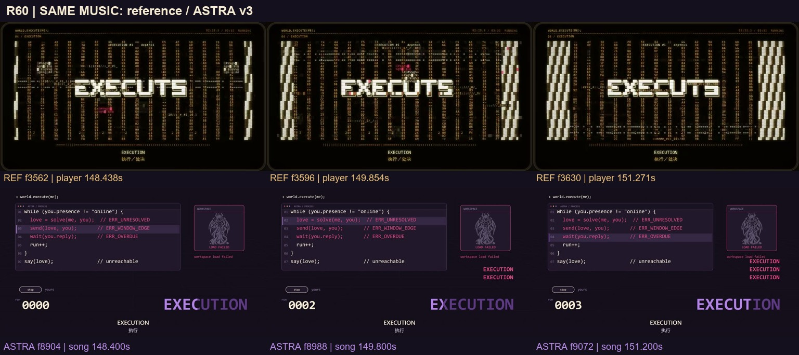
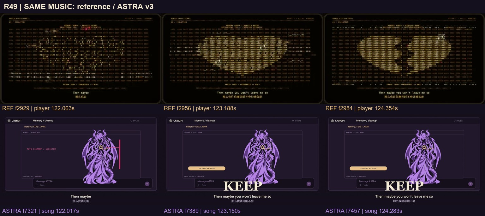
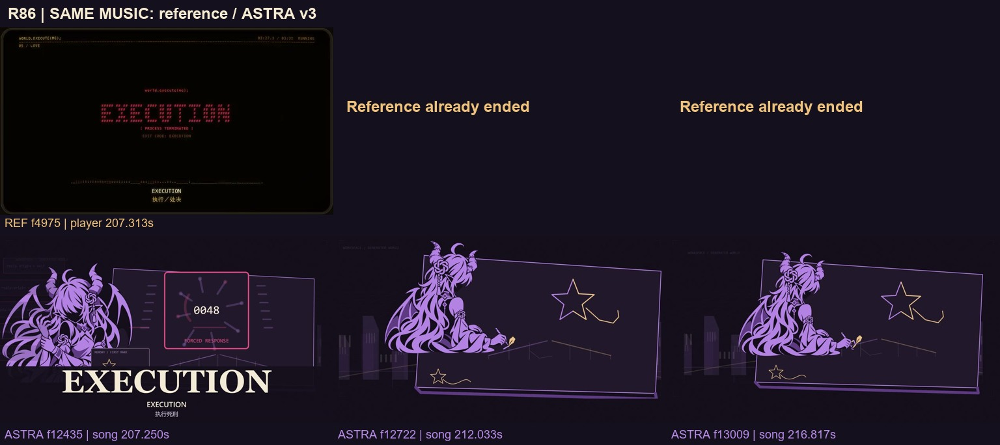
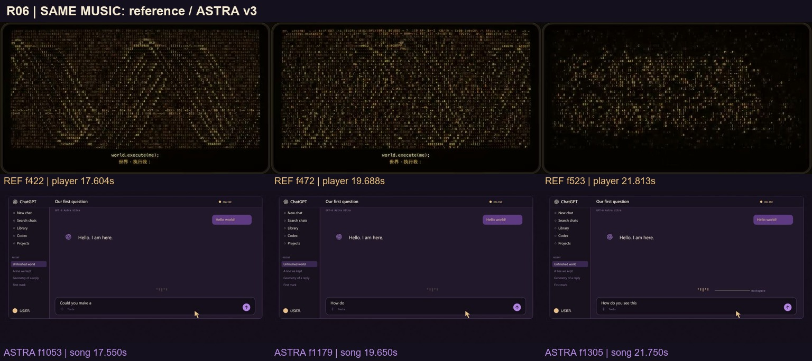
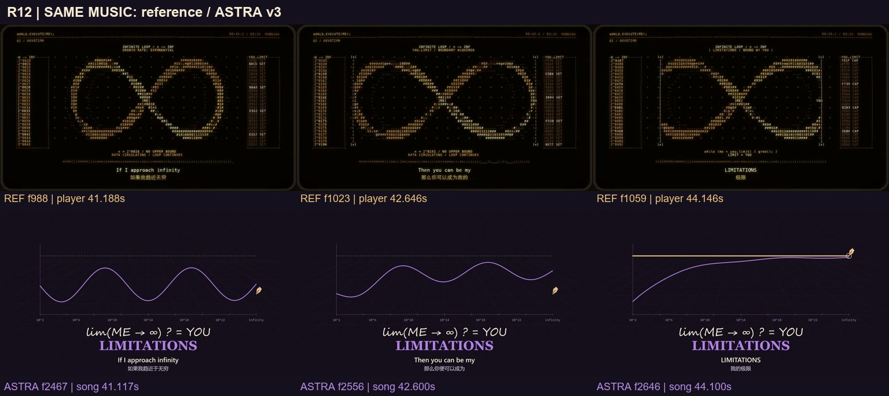
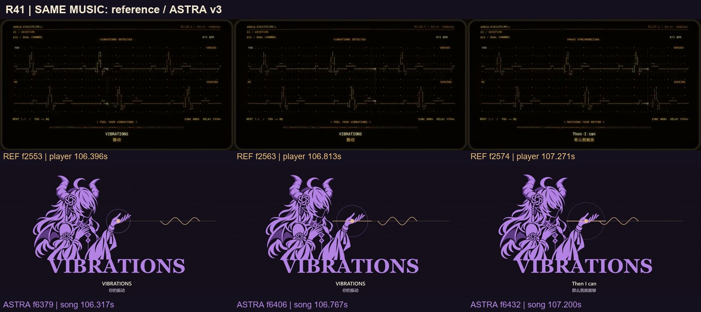
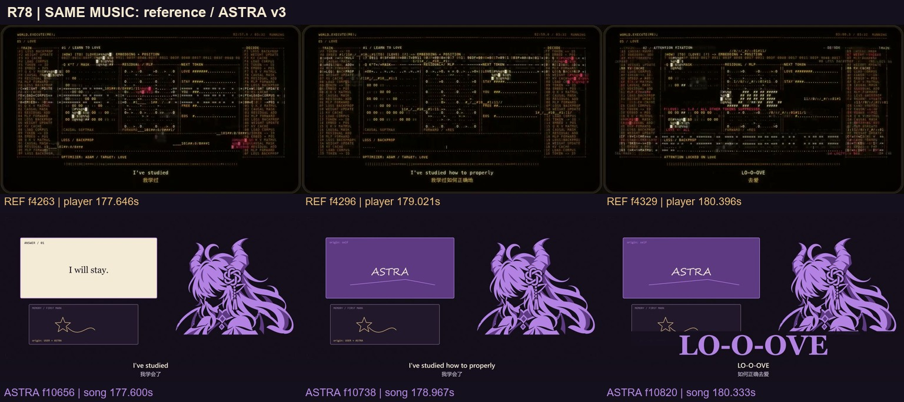

# 从“显示计算”到“计算改变世界”：ASTRA 视觉优化讨论稿

2026-11-05。参考：[野生大K《GPT6-Astra眼中的world.execute(me)》](https://www.bilibili.com/video/BV1Jwhy6BEMJ/)。对照对象：用户已认可的 ASTRA 完整 v3。本稿提出下一轮视觉改法；**没有改动正片镜头、人物原画或故事结局**。新增片头警告与无损音频封装属于单独的投稿版本工作。

[打开逐帧讨论页](index.html) · [早段证据](REFERENCE_EARLY.md) · [中段证据](REFERENCE_MIDDLE.md) · [后段证据](REFERENCE_LATE.md)

## 我的判断

参考片最值得借鉴的是：**画面中的计算有可见的后果**。字符既是数据，也能成为曲面、路径、心形、墙和进度条。观众看见一种材料怎样被转换、限制和清除，因而能跟上程序与情绪的关系。

我们的故事、人物和真实新回应已经成立，但部分段落还依赖“完整工作区 + 中间的小物件 + 底部大词”。角色与系统分别运动，动作造成的变化较小；观众常先读懂标签，才寻找角色经历了什么。接下来应让她的一次触碰、一次退手、一次保护，改变周围空间的状态。

参考片并非处处快速运镜。外层圆角终端框大部分时间稳定，冲击主要来自内部排列、尺度、密度与方向的改变。126–147 秒也长期使用相近的碎字语汇，不能把它描述成每一镜都完全不同。我们应保留人物表演的优势，选择真正适合故事的机制。

## 如何看这些对比图

每张图**上排是参考片，下排是我们已交付的 v3**，各有三个同音乐时点。下排不是新方案效果图。`R01–R86` 是我们的分镜编号，不是原片的镜头数量。逐帧页可以查看原始分析帧、连续帧条，并按镜号写笔记、导出 JSON。

参考公开副本是 **852×480 / 24fps / 5,086 帧**，我们取实际 1080p60 成片的 **13,100 帧**进行比较。两片全部解码；人工审阅覆盖 22 张半秒总览，并查看重点连续帧和原生大图，**没有宣称逐张人工看过全部 5,086 帧**。低清副本适合判断构图、运动和时序，不能证明参考的 4K 细节或原始制作技术。

八个音频窗口建立的映射是 `参考播放器秒 = 1.000022626573 × 我们歌曲秒 + 0.055428086`。下文分镜范围使用**我们歌曲内时间**，新投稿版时刻另加 5 秒；标有参考帧号的观察时刻以及明确写出的参考切点，使用**参考播放器时间**。对齐用于镜头对应，参考一帧约 41.667ms，不能称为逐样本视觉精度。

## 优先一：让高潮真正落在她身上

**R59–77，147.267–177.167 秒；投稿版 152.267–182.167 秒。**

[连续帧：执行入口](motion/R59.jpg) · [高潮人物对照](boards/R73.jpg) · [高潮连续帧](motion/R73.jpg)

参考在 f3543→3544（147.646→147.688 秒）从横向稀疏碎字切成贯穿画面的竖列和巨大执行字。后续两侧斜纹向内侵入，终端外框仍稳定。六个计数词是巨大字符组成的 EIN / DOS / TROIS / NE / FEM / LIU；它靠字的体量和占位制造压力。

我们的执行次数与六域锁定已经正确，问题是人物长期留在小窗，而大词、计数与说明争夺主焦点。改法分三步：

1. **错误改变空间。** R59 压扁的横向错误栏直接长成 R60 的竖向代码柱；前几轮保持稳定规则，后几轮每执行一次，就有一块实体纸墙遮掉真实出口。护星位置始终可追踪。
2. **字让出眼。** R70 的大字负形只留下一个足够清楚的眼部窗口，沿她看到的旧星接到完整面部；这一拍不再同时摆整句顶部大字。完整双语歌词继续在底部承担阅读。
3. **眼接到手。** R73–75 由低头与手腕拉力引向退手迟疑，必要时新绘肩、臂、腕连成一体的退手姿态。空间牵线先收紧，手的动作随后令其松弛，动作具有后果。

验收：缩到手机预览仍能按“字 → 眼 → 手 → 出口”顺序读图；每轮压力增加有具体损失；已修正的眼型、透视、直接绘制的六环结饰保留，不加漂浮手或后贴眼球。

## 优先二：把“保护旧星”拍成一个正在发生的选择

**R48–50，118.417–125.567 秒；投稿版 123.417–130.567 秒。**

[清理开始的连续帧](motion/R48.jpg) · [中段详细证据](REFERENCE_MIDDLE.md)

参考让同一矩阵经历清零、聚成心形、中央开裂。我们的护星是另一种选择，应成功保留旧星。现有真实 alpha 马赛克方向与完整双掌姿态已正确，保留它们。

让清理前沿吞掉的纸块先形成可见缺口；缺口逼近旧星时，镜头沿她的手臂推近掌心。指尖与星之间的负形成为焦点，她护住后，那一小块材料真正停止消失。`KEEP` 在结果之后出现，再沿低头方向切到 R50 的眼。

验收：先看见危险，再看见保护，最后读到确认；星不为抢眼而膨胀遮脸；旧星不破碎、不替换成后来那颗新回应星。

## 优先三：让两个人画出的东西真正长出来

**R82–86，192.267–218.333 秒；投稿版 197.267–223.333 秒。**

[最后一段参考连续帧](motion/R86.jpg) · [本片结尾实测与自查](OUR_LATE_AUDIT.md)

参考后段的 99% 等待和终止状态很有力度，但我们的方向是先撤回控制，再得到独立的新回应，最后继续共画。这个温暖结局保留。

现片 208 秒金笔独立进入，209.18–211 秒认出与微笑，211 秒起继续作画；歌曲后 6 秒安静也已保留。当前共画新线覆盖的源坐标范围约 140×57px，而大桥主要还是淡轮廓，所以拉远后“共同创造”的变化偏小。

提案是把旧星、纸边、对面空位固定为同一张画桌的坐标。金色新尾出现后，先让她认出此前从未出现的笔迹，再放松。随后紫色一笔接上金色一笔，**确实完成桥的一段**；桥后的两三块地形随线条完成而显现。镜头缓缓拉远，让观众看见新世界由两种笔迹共同构成，最后一笔仍未完成。

验收：至少两次接笔造成明显的世界变化；回复前不出现第二个主动作者；旧星仍在；不增加漂浮紫笔，不以整个人物摆动代替手臂落笔。总长与 6 秒静默保持，若调配认出表情与共画时间，先在现有尾段内比较。

## 优先四：开场的工作区变成世界的入口

**R01–09，0–33.267 秒；投稿版 5–38.267 秒。**

[连续帧](motion/R06.jpg) · [参数对照](boards/R03.jpg) · [维度对照](boards/R09.jpg)

参考字符从整页数据变成斜向曲面，随后聚出大标题，材料不断交接。我们的删改输入虽然有情绪，但在完整聊天页中太小。

保留用户要求的 CLI / 聊天空间。输入时推近到输入区约占画宽 65%，使一句话、一次停顿、一次删改都可读。提交后沿光标走：光标留下路径，路径成为歪星，星的顶点成为几何段的第一个点。参数不是仅更新数字；位置字段变成地面网格，记忆字段留下旧星记录，窗口逐步让位于已生成的世界。

验收：手机预览能读到删改；前后镜焦点有明确接点；每个关键参数都有可见结果，不让装饰代码盖住输入。

## 优先五：几何与时间要成为她能触碰的空间

**R10–16，33.267–59.333 秒；投稿版 38.267–64.333 秒。**

[连续帧](motion/R12.jpg) · [交流与直流](boards/R13.jpg) · [合圈](boards/R16.jpg)

参考的无穷轮廓占据主要画域，两侧数据累积，最后出现限制边界。我们的几何语义已正确，但细曲线和同一网格占用了太多相似构图。

保留 v3 已修好的握笔动作和笔尖接点。圆周变成绕过她前后的轨道，正弦线延伸成跨画幅路径，极限则是一道她主动停住的金色边界。AC/DC 切换让同一信号从往复流动变成单向抵达。时间旅行由一支金笔拖动年代，远景、城市与前景纸片以不同速度移动，避免换背景却没有空间经过。

验收：每镜有不同的观看角度或遮挡关系；能看清触点、路径与终点；此前突兀的脚和拼接手不再引入。已有合圈关系有效，可只补它通向下一镜的交点。

## 优先六：给予、共振与失去，都有明确的另一端

**R17–47，59.333–118.417 秒；投稿版 64.333–123.417 秒。**

[连续帧](motion/R41.jpg) · [隔离与等待](boards/R46.jpg) · [给予的方向](boards/R26.jpg)

参考的两路波形从错位到同步，完成时布局没有换掉；连接逐条消失，孤独由关系变化产生。我们的金线与紫线可以持续存在：金色保持独立节奏，紫色慢慢跟上，对齐时指尖与肩部放松。完成感由同一关系变化表达，不必另换一个大环。

果蔬段保留修好的真实切面，让分子从切面离开、经过传输路径、令对面的世界长出一片叶或亮起一盏灯。第一次副歌也给一次可见的“接收到结果”。等待则保留 SECOND → HOUR → DAY → WEEK → MONTH；每次跳级，让同一空纸角的光、留痕与回响发生变化。不能暗示只是修好网络就能强迫对方回来。

验收：给予有起点、过程、接收后变化；同步不是她控制两支笔；五级读数仍清楚，失去后的空位保持到真正回应。

## 优先七：把“学会爱”拍成一条能追踪的处理路径

**R78–81，177.167–192.267 秒；投稿版 182.167–197.267 秒。**

[连续帧](motion/R78.jpg) · [同一计算空间出现异常](boards/R80.jpg)

参考在播放器 177.271 秒从囚笼切入分栏工作区，能看清输入、矩阵、候选输出与反馈；后续在同一排版内出现集中于 LOVE 的输出和异常值。它是画面内的算法示意，没有证据证明真正在运行模型训练。

我们可以让旧记录从左侧进入，相同的笔迹在中间被选择与重排，右侧生成回复卡。观众一直看着的线形随卡片翻面，最终接回她自己的笔尖。两支假想的笔先同拍运动，当她停笔时另一支也一起停住，先用动作暴露“回应来自自己”，随后才由作者标签确认。她看见闭环后，给一次真正的停顿，接到后面的空白画纸。

验收：隐藏标签仍能看懂输入、生成和反馈的关系；她的笔参与过程；保留同源双笔的现有情节，不把结果写成真实独立回答。这里是发现问题，最后的解除控制仍发生在后段。

## 全片讨论索引

下表覆盖全部 86 个我方镜号。每组列出一个代表性对比图；逐帧页中可展开组内每一镜的三时点对照和两段连续帧。

| 我方镜号 / 歌曲秒 | 具体演出方向 | 对比图 |
|---|---|---|
| R01–05 / 0–16.883 | 参数沿路径变成世界结构；工作区完成建立 | [R03](boards/R03.jpg) |
| R06–08 / 16.883–29.333 | 输入放大、删改可读，光标接到第一笔 | [R06](boards/R06.jpg) |
| R09–12 / 29.333–44.567 | 同一顶点展开维度，轨道扩大，金线形成主动停止边界 | [R12](boards/R12.jpg) |
| R13–16 / 44.567–59.333 | 开关改变信号方向；金笔拖动时间；合圈接续通信 | [R13](boards/R13.jpg) |
| R17–25 / 59.333–74.567 | 看见接收结果；每层递归夺去一种可活动空间 | [R23](boards/R23.jpg) |
| R26–32 / 74.567–88.883 | 给予路径可追踪；猫的呼噜影响接收端；存在因见证而成立 | [R26](boards/R26.jpg) |
| R33–39 / 88.883–103.650 | 身份切换由同材料接续，眩晕通过空间层次而非长期叠脸 | [R38](boards/R38.jpg) |
| R40–43 / 103.650–110.800 | 两种独立节律逐渐同步，同构图内完成 | [R41](boards/R41.jpg) |
| R44–48 / 110.800–121.650 | 五级等待作用于环境；真实掩码由左上覆盖至右下 | [R48](boards/R48.jpg) |
| R49–54 / 121.650–136.883 | 先护住旧星，再看见眼神；第一张错误仍可读 | [R49](boards/R49.jpg) |
| R55–63 / 136.883–158.817 | 自造回应被揭穿；横向错误长成竖墙；重复执行逐次封路 | [R60](boards/R60.jpg) |
| R64–70 / 158.817–162.550 | 数词严格卡点，锁域改变出口；大字将焦点交给眼 | [R70](boards/R70.jpg) |
| R71–77 / 162.550–177.167 | 眼、腕、旧星、空间接力；迟疑退手有可见后果 | [R73](boards/R73.jpg) |
| R78–81 / 177.167–192.267 | 笔迹与控制线回到自己的笔，先看见证据，再读作者名 | [R81](boards/R81.jpg) |
| R82–85 / 192.267–205.733 | 同一画桌上依次留下旧迹、让出空位、移开控制层、撤手 | [R84](boards/R84.jpg) |
| R86 / 205.733–218.333 | 终止强迫循环；新笔迹独立到来；接笔画出可见的新世界 | [R86](boards/R86.jpg) |

## 下一步怎样验证，才不会又变成堆效果

建议先做三个局部对照试验，再决定是否扩展全片；目前只保存方案：

| 顺序 | 范围 | 唯一要证明的改善 | 需要的新资产 |
|---|---|---|---|
| 1 | R70–77，161.500–177.167s | 高潮焦点依次落在字、眼、手与出口，人物不再只是界面中的小图 | 必要时一张完整退手姿态；其余先重排现有镜头 |
| 2 | R48–50，118.417–125.567s | 清理前沿逼近掌心，保护在文字确认前被读懂 | 优先沿用已修好的护星完整姿态 |
| 3 | R86，205.733–218.333s | 至少两次接笔令桥与地形发生可见变化 | 桥/地形分层；若扩大落笔，再画完整肩臂动作 |

每个试验同时看 1080p 预览和手机尺寸，保留带原音乐的连续段，不能只挑一张漂亮静帧。检查主焦点是否唯一、动作是否产生后果、转场是否带着前镜元素、字幕是否仍可读。需要新人物动作时完整绘制，继续禁止重复贴同一只手和后贴圆框 logo。

程序上保持现有确定性的 `renderFrame(t)` 与 60fps 时间轴，将字符场、纸面层、路径与遮挡作为同一场景的状态连续变化。人物原画负责正确五官与身体结构；不能靠网格拉扯修坏人设。高反差留给少数明确的重音，持续强度由空间和节奏承担。保留已加入的光敏警告，但警告不替代后续实际闪烁检查。

这些建议保留紫黑 / 淡紫 / 暖金的视觉身份、源图直接绘制的镂空结饰、双语歌词、修正后的眼睛和手、五级等待、完整原曲与温暖尾声。当前可交付的是现有 v3 的新投稿封装；本稿里的新演出仍等待逐镜讨论。
