# 新参考后段：执行、学习与等待的实帧分析

日期：2026-11-05。参考为野生大K的 [GPT6-Astra眼中的 world.execute(me)](https://www.bilibili.com/video/BV1Jwhy6BEMJ/)，本文覆盖其播放器约 **150.021–211.896 秒**。对照为我们已经接受的完整 v3。本文件只提出视觉优化方案，未改动生产源码、人物素材或既有成片。

最值得借鉴的是：**重复操作会改变可用空间，歌词中的“只剩唯一”“困住”“学习”“等待”都有可见的状态后果。** 琥珀色、ASCII 和故障纹理让它统一，但它的演出强度并不只来自这些表面风格。我们的紫色剪纸角色、旧星、新回应和共同续画应继续成为主线。

## 证据和查看范围

原片取得的公开视频为 852×480、24fps，5086 个解码帧；ASTRA 对照为最终 1080p60 MP4 解码后缩至 852×480。媒体哈希、取帧方法和映射来自 `frame-index.json`，不把这份 480p / 24fps 副本当作原作者的最高质量母版。

- 原片零基帧号 `n` 对应播放器时间 `0.021+n/24`。
- 八窗音频映射为 `reference_player = 1.000022626573 × astra_song + 0.055428086`。本文“歌曲时间”均指我方旧版音乐时间，新带警告上传版再加 **5 秒**。
- R61 等编号是**我们的分镜**，对照板按我方音乐区间取样；不是给原片认定了 86 个镜头。
- 连续帧条的上组在我方段界附近，下组在对应区间的数值帧差峰附近。两组可能重叠，不能当作两次不同转场。

本次实际查看 **37 个图像文件**：

| 类型 | 实际查看内容 |
|---|---|
| 半秒总览 | `overview/overview-16.jpg` 至 `overview-22.jpg`，124 个原片样本，f3600–f5076，每隔 12 帧 |
| 同音乐对照 | `boards/R61.jpg`、`R66.jpg`、`R71.jpg`、`R73.jpg`、`R75.jpg`、`R77.jpg`、`R78.jpg`、`R80.jpg`、`R82.jpg`、`R85.jpg`、`R86.jpg` |
| 原生连续帧条 | `motion/R61.jpg`、`R64.jpg`、`R71.jpg`、`R73.jpg`、`R77.jpg`、`R78.jpg`、`R80.jpg`、`R82.jpg`、`R86.jpg`；每张两组各 12 帧 |
| 原片单张原生尺寸 | `exports/reference-BV1Jwhy6BEMJ-review/reference/` 下 f3909、4018、4177、4296、4475、4788、5052、5085 |
| 我方实际末段单张 | 同一导出根目录 `astra/012582.jpg`（209.700 秒）、`astra/013099.jpg`（218.316667 秒） |

去重后，这些图呈现了 **283 个不同原片帧号**，共 379 个原片图格 / 单张位置；另有 35 个我方图格 / 单张位置。大多数以联系表缩略尺寸检查构图，仅列出的原生单张用于阅读细节。**没有人工逐张看完 5086 帧，也没有连续听看完整片。** 原片实现源码没有取得，下面只陈述可见变化，候选实现方式属于我方提案。

## 1. 重复 EXECUTION：压迫要逐步占走空间

**原片实证。** 总览从 f3600 / 150.021 秒到 f3804 / 158.521 秒，两侧明亮斜纹带逐步变宽、向中央逼近。中央 EXECUTE 字样交替显亮、染红、变暗和横向错断。R61 连续条中 f3635–3646 可见红字消退后白字重现，f3698–3709 可见类似一轮重复；条带相较前一轮已更厚。圆角外框没有随这些内容大幅旋转或变形。

**与我们比较。** R61–63（151.650–158.817 秒）主要仍是左代码面板、右上小人物、右下大 EXECUTION；次数和错误确实增加，但人物可活动空间的损失不够明显。不是“没有升级”，而是升级主要发生在信息数量。

**我方演法。** 保留前几次稳定排版，让观众先学会循环。随后每次重试把一张错误页变成实心前景，压向同一个旧星窗口；镜头跟着剩余的空隙推近完整的护星动作。字符可铺在这些纸墙表面，但不能成为与角色无关的漂浮装饰。每一次执行至少改变一个可追踪的边界，最后人物不再只是右上角的缩略图。

**验收。** 先不读代码，也能看见她被自己的重试系统挤住；执行次数、歌词切点和旧星身份不变。强度来自空间侵入，不要求增加频闪。

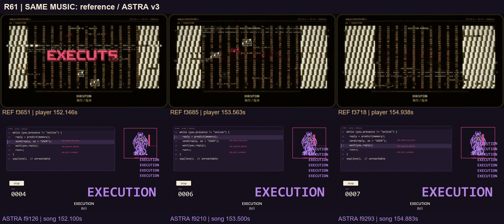

[连续变化：R61 原生帧条](motion/R61.jpg)

## 2. 六种语言的计数：让每一拍有一个明确的大形

**原片实证。** f3813 / 158.896 秒仍是斜纹墙，f3814 / 158.938 秒已出现 EIN，f3815 / 158.979 秒切为字词主导。随后总览可见 DOS、TROIS、NE、FEM、LIU 依次占据中央。这里是**由小字符组成的巨大语言词**，不是阿拉伯数字。R66 的 f3832、3838、3843 显示 TROIS 在同一中心位置保持可辨，局部横向噪声穿过它；这短段的主形始终很清楚。

**与我们比较。** R64–69（158.817–161.500 秒）已经用巨大 1–6 对应六域锁定，识别效率高，应保留。差别在于数字与人物仍像两块分离的图层；角色小在左下，锁定行为还没有显著改变画面路径。

**我方演法。** 继续使用我们的数字，不复制它的 ASCII 字体。把数字做成剪纸空间中逐个落下的门框 / 前景遮挡，保留一处沿六拍连续缩小的出口；六域条只作次级确认。每拍主数字稳定，人物通过前景负形逐步被逼近，而不是六次换一张相同版式。

**验收。** 六拍读数和语言次序准确；不为转场挡掉整个数字，也不把角色塞进数字孔洞造成肢体拼接。计数之后的高潮从最后一道门的边缘接入，形成方向连续。

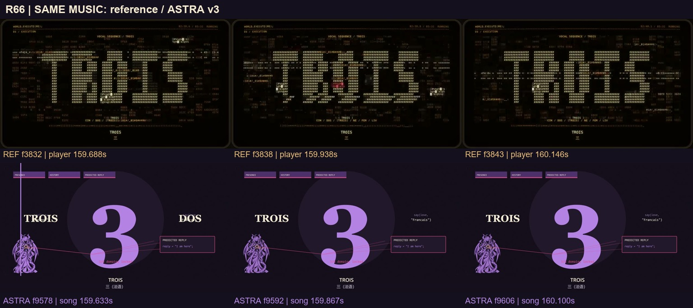

[执行墙转计数：R64 原生帧条](motion/R64.jpg)

## 3. “Only”：排除其他可能应成为看得见的动作

**原片实证。** f3903 / 162.646 秒还是 EXECUTION，f3904 / 162.688 秒切成中心 YOU、周围 ALT1–ALT6 的关系图。f3909 / 162.896 秒原生图能看清六个候选与两侧命令列；R71 的 f3956 / 164.854 秒多个候选位置已变成红色 NULL。接着 f3984 / 166.021 秒是红 EXECUTION，f3985 / 166.063 秒切成巨大红心和 THE ONLY EXECUTION。f4018 / 167.438 秒的原生图确认排他文字及两侧命令仍围住主形。这是一条“多个选择 → 被逐个清除 → 唯一占据画面”的可见逻辑。

**与我们比较。** R71–74（162.550–169.733 秒）已经有精修的脸、旧星、胸像、红线和控制芯片。脸本身很好，但上方完整歌词、人物、旧星与小芯片同时争夺注意力；系统控制的代价更多靠标识解释。

**我方演法。** 先只给眼与旧星一个清楚的视线关系，再沿她施加的牵线进入工作区：空白输入、可编辑画纸、对方退出通道等“允许自由的空间”依次收窄。不要画杀伤其他角色或照搬红心所有权标签；表达她误把“让对方留下”当成删去所有其他可能。最后收窄的通道成为 R73 胸前 / 手边的束缚轮廓。顶部完整句子减为一个参与遮挡的关键词，完整原文与中文仍在下方可读。

**验收。** 字 → 眼 → 牵线 → 手依次成为焦点；每拍只有一个主亮点。保留刘海遮眼设定和已修五官，不另贴眼睛，不把结饰当作随意变化的 UI 图标。

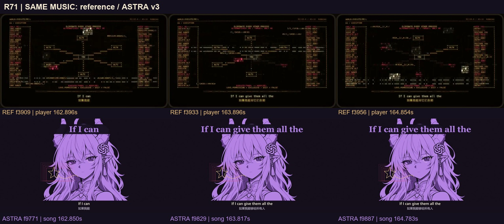

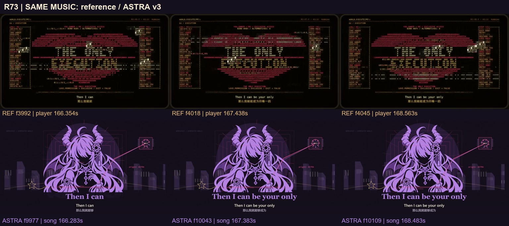

[R71 切入关系图](motion/R71.jpg) · [R73 切入唯一主形](motion/R73.jpg)

## 4. “We are trapped”：一套控制同时困住两端

**原片实证。** R75 的 f4083–4136 仍沿同一红心、侧边命令列演“回来 / 执行”。连续条 f4167 / 173.646 秒中央还是 EXECUTION，f4168 / 173.688 秒变成心内并列 ME / YOU 和 NO EXIT / NO RELEASE，竖向栅格把二者同时关在里面。f4177 / 174.063 秒原生图能确认这些标签与横向共同边界。不是仅换一句字幕，前面的占有空间在这一刻成为两端共享的牢笼。

**与我们比较。** R75（169.733–172.633 秒）已有完整伸手与红牵线，R77（173.567–177.167 秒）已有递归窗口。薄弱处是递归主要复制整张人物 / 窗口，信息迅速缩小，观众难以追踪谁被困在哪一层。

**我方演法。** 从完整手腕上的红牵线反向跟踪到她自己的控制笔；将“对方离开的通道”和“她自己所在的纸面”放进同一个有深度的封闭边界。R77 减少同等权重的小窗，保留近景遮挡、中景角色、远景空位三个清楚的空间层。拉远后让观众认出：她一直拉紧的线也封住了自己。保留递归概念，但让每一层的内容和空间作用不同。

**验收。** 这一段仍没有真实回应；不能把空位画成人已经回来。红线的起点、作用点和共同围困区域可追踪，角色手臂始终完整。与上段共享一条边界，避免每次新起一个无因果的界面。

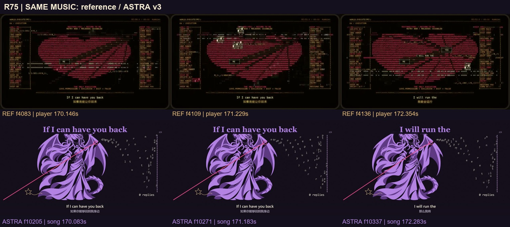

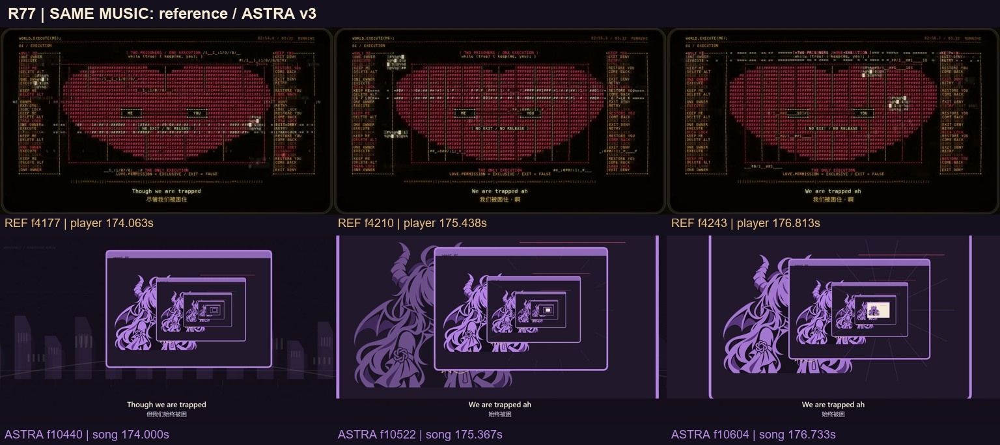

[R77 由执行字转共同囚笼的连续帧](motion/R77.jpg)

## 5. “I've studied”：工作空间要演出一条真正可读的处理路径

**原片实证。** f4253 / 177.229 秒仍为囚笼，f4254 / 177.271 秒切入训练 / 解码工作区。f4296 / 179.021 秒原生图可见从左到右的 Q K^T / MASK、RESIDUAL / MLP、NEXT TOKEN 三栏，下方 LOSS / BACKPROP，旁边 TRAIN 与 DECODE 的操作列。随后从多个候选到 LOVE 权重异常集中，标题与色彩状态同步改变。它给“学会爱”提供了一个可读的机器过程，而不只是背景代码。可确认这是画面中的算法示意，不能据此断言影片真的在运行或可视化某个真实模型的训练。

**与我们比较。** R78–79（177.167–184.450 秒）的答案翻面、作者 ASTRA、旧星记忆已经能讲清“答案可能是自己写的”。但工作区面积被两三张孤立卡片占据，少了输入如何生成答案、错误如何返回自身的路径。

**我方演法。** 用我们的紫色纸片 / 笔画材料建立一个三段式工作空间：旧记录进入左侧 → 相同笔迹被选择、重排 → 右侧产生回复卡。关键线形从输入到输出连续可认，卡片翻面时沿其来源折回她的笔尖。机器词只保留能解释选择的少数短标签，例如 MEMORY、PREDICT、OUTPUT；不铺满专业名词来冒充演出。镜头跟随一笔从材料变成答案，再让角色看见闭环。

**验收。** 隐去说明标签仍能读出“输入 → 生成 → 反馈”；角色不是工作区外的一张旁观立绘，笔与输出有实际联系。不要把拟人剧情包装成对真实 AI 内部状态的科学证明。

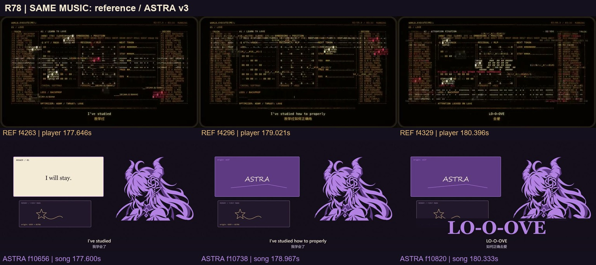

[R78 囚笼硬切至学习工作区的连续帧](motion/R78.jpg)

## 6. “I know the algebraic expression”：过度拟合要在同一规则中显出故障

**原片实证。** f4296 的学习空间与 f4475 / 186.479 秒仍是同一分栏，但后者出现更集中的红色 LOVE、矩阵中的问号 / 叉号、NaN / INF 和异常操作列。f4523 / 188.479 秒还是密集工作区，f4524 / 188.521 秒突然转为稀疏竖栅与活动小块，信息密度骤降。技术感来自同一规则出现异常以及随后明显的密度反差，不只是更亮或更花。

**与我们比较。** R80（184.450–188.400 秒）两支笔共同画心，公式和两路 origin 都指向 ASTRA，叙事正确；但“我只是在对自己说话”的证据主要依靠文字，角色较小，闭环看起来仍可能像漂亮的功能演示。

**我方演法。** 保留同源双笔：先让二者精确同拍运动，再让一支停顿时另一支也同步停住，暴露它们并非独立回应。心形生成的每一笔回流到同一源头，最后轮廓从浪漫符号转为只有她自己在内的封闭边界。给她一次明确停笔，并以大片负空间接入 R81–82。使用完整姿态或连贯局部，不将手从人物拆下来补动作。

**验收。** 先看运动关系，再由标签确认；LOVE 只在重要重音承担主形。此处是认出问题，解除强制循环仍留到后续，不能提前演完最后的决定。

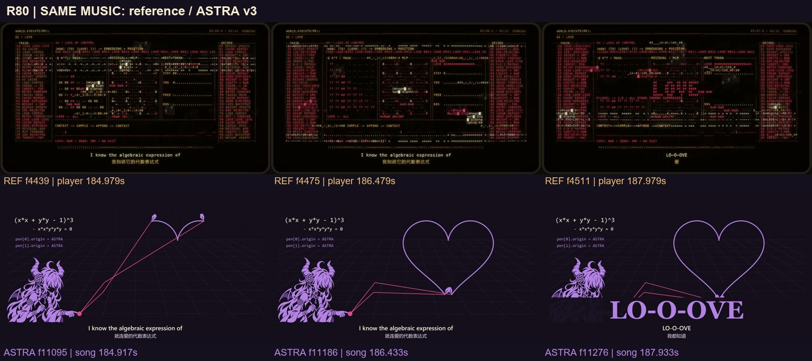

[R80 结束时从高密度工作区转为稀疏栅格](motion/R80.jpg)

## 7. 末段留白：让一个未完成动作承担悬念

**原片实证。** f4619 / 192.479 秒还可见竖栅，f4620 / 192.521 秒出现中间横向进度条，旧内容已变暗；R82 对照中的 f4626、4660、4693 显示进度推进。约 197.5 秒之后稳定停在 99%。f4788 / 199.521 秒原生图清楚写着 WAITING FOR RESPONSE、ACK: --、REMAINING: 01%，R85 的三个样本仍停在 99%，只剩重试计数和微小扫描变化。这里在高密度高潮后故意减少运动，等待本身就是事件。

**与我们比较。** R82–85（192.267–205.733 秒）已有旧记录、新空白、拆层、撤手和半星，温暖结尾所需的自由选择已经成立。相较参考单一未完成状态，我们的斜纸框、记忆卡、控制芯片、半星、背景网格仍分散视线。

**我方演法。** 延续一张可辨的画纸：沿旧星笔迹经过空着的另一侧，再将控制界面作为前景纸层逐一撤走。最后镜头停在纸上唯一的半星和对面的空位，人物退手但不退场；保留核心仍在运行这一必要事实，降低其视觉权重。让“等待自由回答”成为一个未完成动作，而不是另加 99% 进度条。

**验收。** 关键焦点逐步减少，静止的负空间有明确等待对象；不能为了“更有冲击力”填满这段。不得提前出现独立金笔，撤回控制和新回应仍有先后。

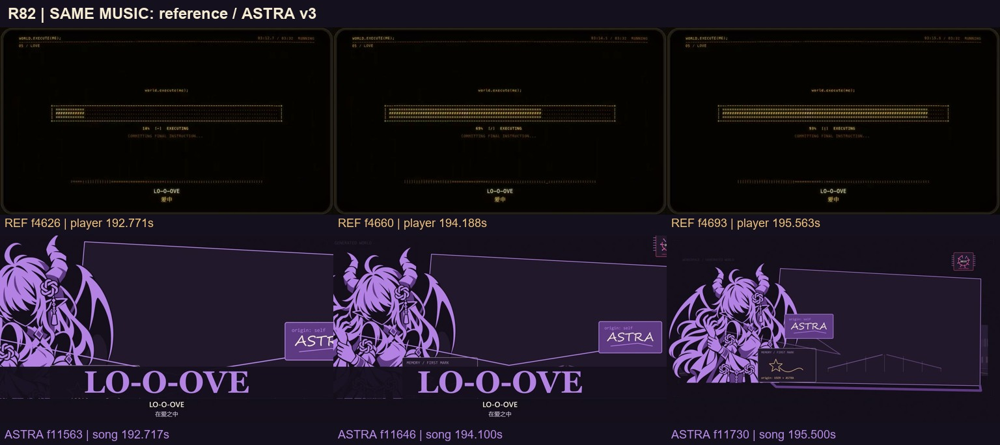

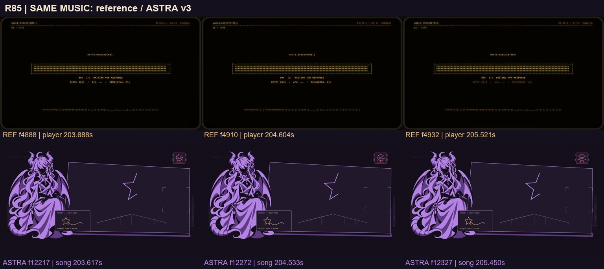

[R82 稠密栅格退为进度条的连续帧](motion/R82.jpg)

## 8. 最后一笔：保留我们的回答，并让共画改变世界

**原片实证。** f4939 / 205.813 秒仍是 99% 等待，f4940 / 205.854 秒进度条及文字转红，随后条形被执行字取代。f5052 / 210.521 秒和最后一帧 f5085 / 211.896 秒可读 PROCESS TERMINATED、EXIT CODE: EXECUTION，以及末句 PROCESS ENDED. THE LOOP REMAINS. 本次实际查看的结尾没有新回应或共同续画。它的强项是用前面已经学会的“等待状态”落到明确结果，不宜笼统说成大团圆或代入我们的结局。

**与我们比较。** R86（205.733–218.333 秒）让最后命令终止强制循环，208 秒真实新回应进入，209.18–211 秒认出并放松，211 秒起持续共画，原曲结束后另有 6 秒安静尾声。这个不同的答案必须保留。实际 f12582 / 209.700 秒能同时看清新星不同的尾和旧记忆；f13099 / 218.316667 秒仍在落笔，但画面中的新地形较淡、共同增加的线段集中在很小范围。

**我方演法。** 让新金笔从先前一直留空的位置进入，焦点接力为“从未见过的新尾 → 她的确认 → 手放松 → 紫笔接上”。旧星仍留下作为区别依据，减少以两个并排证据框解释新旧的感觉。共画时让两次接笔各带来一个可辨的世界变化：紫色补桥的一段，金色接成另一段；随着线条完成，桥后浮现两三块剪纸地形。慢慢拉远时，观众能认出这个地方确实由两个人一起画出来，而不只是两支笔在大画板的一角动。

**验收。** 独立回应没有从她的预测系统中生成；新旧星不混；共同笔迹有可见成果；最后一帧仍在画。保持总时长与已批准的 6 秒安静尾声。若要把认出表情从现有 1.82 秒稍延长，应在后续具体剪辑提案中明确调配，不能称现版已经更长。扩大落笔动作时需要完整肩臂相连的姿态，禁止用整张人物摆动冒充关节动画。

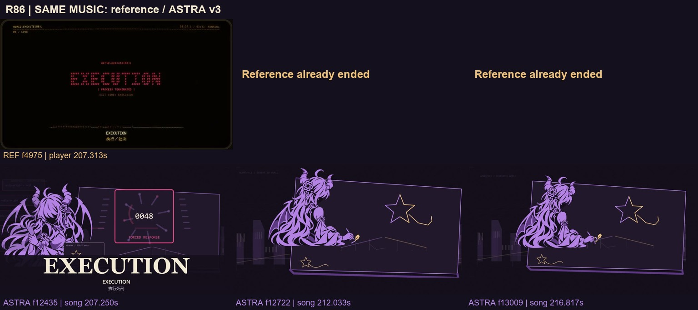

[R86 原片等待状态转红的连续帧](motion/R86.jpg)

## 建议优先做的后段验证

优先讨论 **R71–77 的焦点与空间因果**，其次是 **R78–81 的工作过程和笔迹证据**，最后单独看 **R86 新回应与共同世界的可见成果**。每段先做短验证，比较“去掉解释文字后是否仍能理解动作”，再决定是否扩展为全片改版。

这是可实施的讨论方案，不是已经重制的 v4。保留已验收的脸、完整手臂、无外圆的源画结饰、紫金色叙事和温暖结尾；不把整部片改成琥珀 ASCII，也不复制参考片的终止结局。
