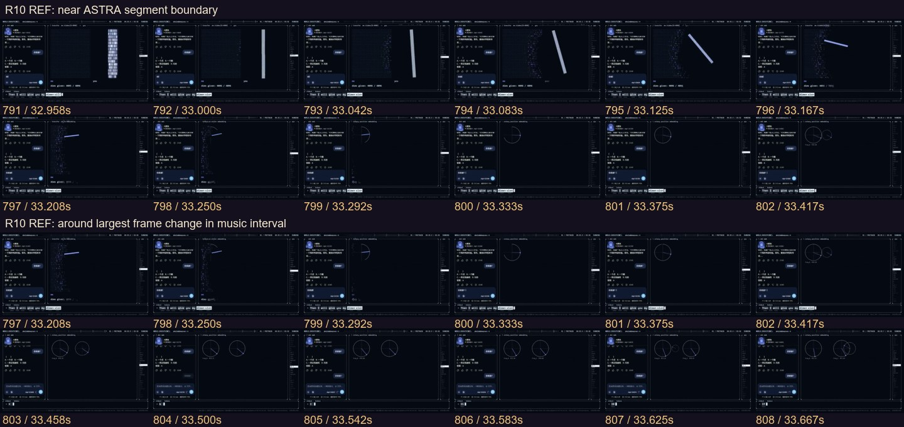
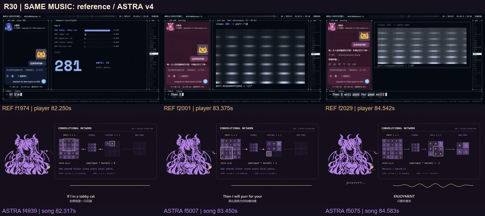
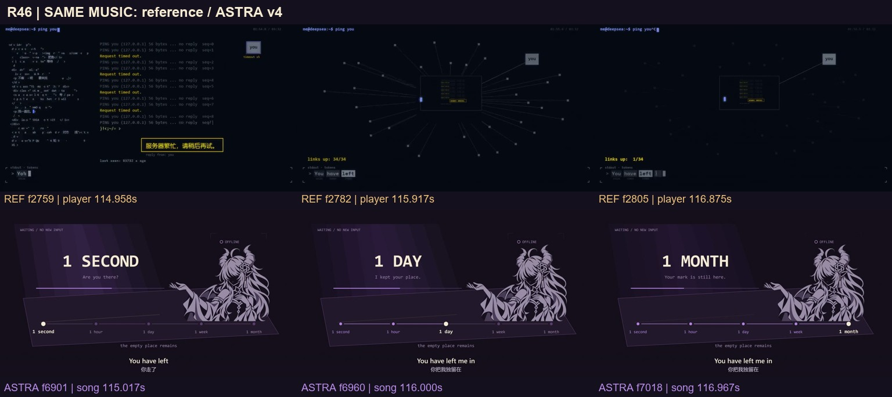
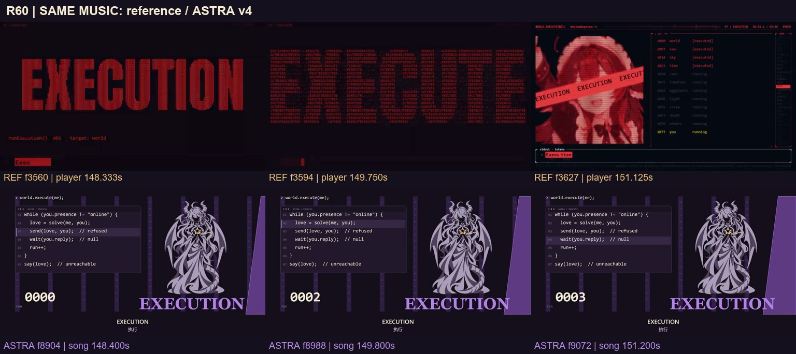
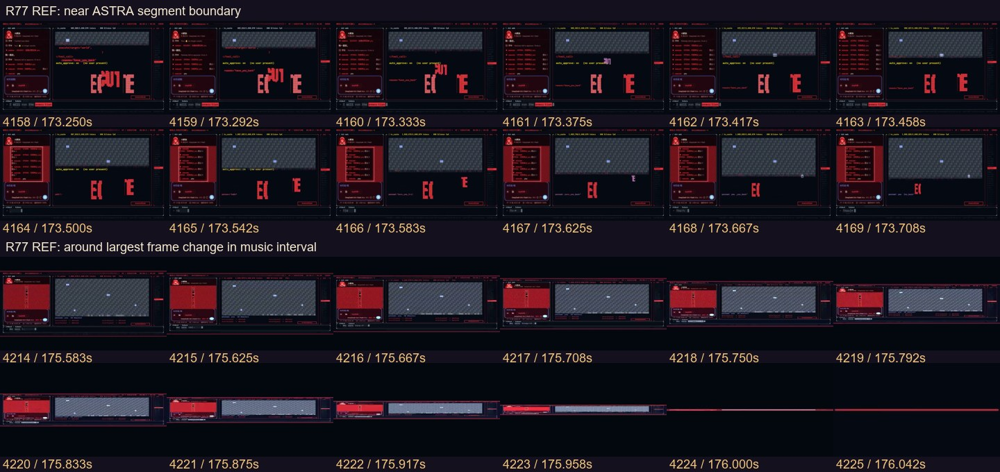
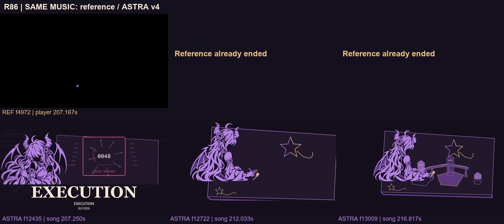

# ASTRA 最终版视觉方案：让她真正参与世界的变化

2026-11-05。参考：[西西弗斯的风车《【4K】如果聊天窗口就是她的整个世界 —— world.execute(me)》](https://www.bilibili.com/video/BV1xCai6aE9g/)。对照对象是已交付的 **ASTRA v4**，不是旧 v1/v3。本轮完成参考分析、复用审计与最终版方案；以下新动作、构图和动画**尚未制作**，v4 成片保持原样。

[86 段逐帧对照与批注](index.html) · [前半实看记录](REFERENCE_EARLY.md) · [后半实看记录](REFERENCE_LATE.md) · [素材复用审计与动作预算](V4_REUSE_AUDIT.md)

## 我的判断

这部参考的优势，是让观众一直看得见“输入了什么、内部发生什么、结果为什么变了”。同一个聊天区持续积累关系，计算区不断改变材料和状态。世界失控之前，观众已经认识这个世界的规则。

它也长期复用双栏终端，并非每镜都是新素材。生动来自**同一材料的连续变化、不同状态之间的因果，以及大变化之前的稳定**。我们保留自己的人物与温暖结局，吸收这套演出方法。

v4 已经完成参数生成世界、真实马赛克、护星选择、执行封路、三类网络和两笔造桥。这次不把它们当作未做。真正需要进一步解决的是：身体常在一个姿势里停留，界面替她完成了表演；新动作的起势和结束之间缺少可追踪的变化。

最终版的表达收束为：**她能计算许多结果，也能画出许多世界；当她为一个无法替对方决定的答案留下空白，真正的共创才开始。** 这是一条角色叙事，不是对 AI 意识或 GPT 实际架构的断言。

## 实际看到了什么

以下图片上排都是参考、下排都是当前 v4，同一音乐时点各取三帧；下排不是修改后的效果图。R01–R86 是我们的音乐分段，不等于参考片有 86 个硬切镜头。

### 1. 规则建立后，图形才能接力

参考 f791–808（32.958–33.667 秒）把维度的最后一根柱条转成圆的指针；f1177–1188（49.042–49.500 秒）把矩阵弯成曲面。前镜材料没有消失，而是承担了新含义。

我们已把星顶点接入几何。最终版进一步统一连接点：笔尖留下顶点，顶点拉成圆轨道；切线从触点延伸，随后成为金色边界。相机跟随同一物件经过前景和身体后方，不能每段都退回“黑底中央一张图”。需要透视变化时重新画完整姿态，不旋转平面 PNG 冒充转身。

### 2. 科技感来自过程可读

参考从分类结果进入声谱，从用户输入进入图形生成。术语、数字和图像都围绕一个正在发生的操作；并不能据画面认定其实际训练了模型。

我们的 FC/CNN/RNN 数学已经可复算，应保留。改成三种不同的空间语法：

| 演示 | 首次出现 | 后段回访 |
|---|---|---|
| 全连接 | R03：一条输入触发层间连线，输出落到世界结构；主画面只强调当前激活层 | R78：旧记录通过层间桥抵达预测端，相机沿路径穿行；不再播放同一完整面板 |
| CNN | R30：同一窗口扫描猫形材料，局部特征亮起，结果推动可见的呼噜波纹 | R79：窗口扫描旧星笔迹，提取熟悉形状；输出仍是她的预测，不伪装成金色回应 |
| RNN | R35：当前输入穿过三个时间状态，昨日痕迹影响今日 | R80：三时刻走廊里，同一记忆被携带；没有新输入仍有旧状态，出口接回她自己的笔尖 |

完整数值可保留在辅助层或配套说明，观众第一眼应先看到输入、变化、结果。不会为了减少课件感而改错卷积、池化或递推关系，也不把三种教学网络称为 GPT 内部结构。

### 3. 失去要改变关系，也改变姿态

参考在 ping 失败后拉远，连接从多条变为单条；原来熟悉的区域逐渐空下来。v4 的五级等待和环境变化已成立，但同一伸掌原画连续使用约 8.77 秒。

R45–48 改为同一场景中的三个完整阶段：手悬在对面空位前 → 手落到桌沿 → 低头守住旧星。SECOND / HOUR / DAY / WEEK / MONTH 五级全部保留，光和纸面痕迹延续，不靠五次硬换背景表示时间。最后的马赛克仍沿她真实 alpha 从左上覆盖到右下。

R49 已有“保护后再出现 KEEP”的因果，进一步补上收掌过程：旧星由掌前收近胸口，身体转向擦除前沿，双手护稳后前沿才停止。原来的静态护星可作为结果姿态参考，不能直接平移当收手。

### 4. 高潮的强度来自损失递进

参考 f3552 附近（148 秒）把原有界面让给巨大执行字；后面再回到程序与角色。它通过主次和尺度改变制造重击，不是一直把所有信息放大。

v4 的墙已封住出口，最终版补上身体如何承受它：低机位侧身护星 → 墙近时屈膝护紧 → 掌心与半张脸近景。R64–69 的六个计数依次落在六个具体损失：门、链路、视野、时间、控制、输出。使用不同空间局部，停止让同一全身人物陪着六次数字闪过。

R70–77 继续沿现有“字—眼—手—出口”顺序，重点重画 R75 伸手、悬停、撤回三个关键姿态。视线先动，肩肘再跟，控制线从实际腕点松开。保持现行已认可眼型，不能重新把眼睛画大或下移。

冲击预算放在空间收窄、尺度反差、清楚的剪影和重音停顿上。错误色只在失控段提高占比，紫黑、淡紫、暖金仍为主色；不依靠更密集的白闪。

### 5. 同一个世界折叠后，带入学习段

参考 f4214–4225（175.583–176.042 秒）把整个双栏窗口压成水平线，f4244–4255（176.833–177.292 秒）再从同线展开学习页。这个转场把两个状态连成一个过程。

我们的 R77 沿最后一道限制线追到自己的笔尖；她回头看见源端，线沿桌面折入下一段网络。R78–80 各用一种空间结构，不继续让同一 operating 小立绘挂在左下角长达十余秒。必须先看清旧记录怎样生成预测，再让人物发现来源；不能依靠一张 `PREDICTED` 标签补解释。

### 6. 保留我们的暖结局，增加共同落笔的身体证据

参考最后回到黑底输入框的开放式提问。我们的真实回应和共同续画具有不同的结论，保留它。

v4 已有独立金笔、认出、放松和实际造桥。最终版改进的是机位与动作：先背侧松开控制层，再俯视同一张画桌；新回应从另一侧进入后，沿用已认可的两张表情。共画使用“她落笔—停下等金笔—接续下一笔”三张连贯完整姿态，笔尖始终接在各自手与身体来源上。

金笔完成她没有预先画出的转折，紫笔顺势接住它，两次接笔都令桥或地形发生明确变化。最终拉远时仍在画；旧星保留，后方世界由两种笔迹共同构成。六秒安静尾段不删、不加快，也不让新的解释文字抢走这一刻。

## 少复用的具体办法

逐源帧调用审计显示：recoil / operating / protect 三图并集覆盖 **74.75 秒**，占有 ASTRA 原画提交的时段 **49.96%**。它是源图提交口径，非最终可见像素时长，也非“重复画面率”。细节与实际浏览器 661 点交叉核对见[复用审计](V4_REUSE_AUDIT.md)。

| 集中区间 | 当前情况 | 最终版安排 |
|---|---|---|
| R40–43 | 同接收图 7.15 秒 | 悬掌、接触、抬眼，身体完成共振 |
| R45–48 | 同等待图 8.77 秒 | 等、落手、低头，接真实掩码 |
| R53–55 | 同退手图 9.47 秒 | 推送碰壁三阶段，再切俯身查看旧记录 |
| R60–69 | 同护星图 13.55 秒 | 三阶段受压姿态，加六个不同出口局部 |
| R77–80 | 同操作图 14.83 秒 | 回头识破闭环，进入三种不同计算空间 |
| R81–86 | 退手、坐姿、背影反复切换 | 放下控制三阶段，连贯共画三阶段 |

复用审计先确定了 **14 组独立动作、36 张完整关键姿态**，另建 6 类程序空间。完成前半逐镜观察后，还需要把描圆、切线、时间拖动和三处专属表演纳入，最终全片建议预算为 **21 组动作、52 张完整关键姿态**。它们是连贯动作的不同状态，不是 52 张互不相干的海报。

A01–A14 的详细分配见[审计清单](V4_REUSE_AUDIT.md)，新增七组如下：

| 动作组 | 镜号 | 新绘张数 | 专属动作 / 机位 |
|---|---|---:|---|
| A15 | R10 | 2 | 三分之四完整托环与描圆，视线跟随触点 |
| A16 | R11 | 2 | 过肩握笔靠近曲线、压住切点；不用描圆同手换轨迹 |
| A17 | R15 | 2 | 半背侧拖动时间轴，身体沿历史窗口转向 |
| A18 | R21 | 2 | 初次正面抬眼、上身展开；与高潮眼部和尾声表情区分 |
| A19 | R30 | 3 | 猫姿察觉、轻收掌、呼噜，CNN 输出回到角色动作 |
| A20 | R35 | 3 | 同桌不同时间的落笔、查看成果、伸展后继续；RNN 携带过程记忆 |
| A21 | R36 | 2 | 递出控制点、收到控制点的完整肩臂，方向与受力不同 |
| **新增 / 总计** | **7 组 / 21 组** | **16 / 52** | **不把裁切或镜像当新姿态** |

其余逐镜卡中的局部、构件与机位候选按这 21 组和 6 类程序空间归并；发生冲突时以本主提案的预算和统一角色设定为实施基准。R43 的幸福表情随 A04 完成，不提前复用尾声认出新回应的脸。

减少复用不等于扔掉连续性。正确眼型、源绘镂空结饰、旧星与空位保持一致。角色同一姿态的缩放、镜像、换色、裁切和蒙版不计新动作；单独贴手、贴眼、贴 GPT 圆章继续禁止。动作小稿先标角色自身左右手、透视线、肩肘腕和笔尖接点，再生成正式原画。

## 最终制作与验收顺序

1. **动作基准**：先制作 A10 受压、A11 退手、A14 共画三组共 9 张关键姿态，放回原音乐连续播放。检验身体接点、眼型、结饰与整体风格，过关后完成其余 43 张。此处是生产内部的检查节点，不需要逐张停下让用户重复授权。
2. **空间接续**：先接 R60–80 高潮到学习，再接 R45–50 等待护星，最后统一 R01–43 的计算与接收路径。摄像机只因触点、视线或空间变化移动，不做无目的的持续摆动。
3. **锁定全片**：在现有 86 镜、原曲、5 秒警告、128 条上英下中字幕与 6 秒尾段内完成。先调整镜内动作阶段；如确实需要跨音乐锚点重分时长，另列变更依据，不能悄悄破坏已校准时间轴。
4. **验收**：同口径最高三张源图并集覆盖目标 **≤30%**；有动作变化需求的 7–15 秒区段必须有姿态阶段变化。另按动作组统计出现区段，不能把同一组改名后挪作无关情绪。不能拆文件名、插透明图或增加无意义切镜来做低比例。手机尺寸隐藏辅助解释后，仍能看懂“输入—动作—结果”；全部字幕、手/笔接点、完整原曲、六秒安静尾段继续验证。

先保留 v4 可回退版本，最终再完整导出并做全帧解码、时间戳、音乐对齐、原生音频一致性及重点连续段画面检查。本页不把这些最终验收目标写成已经通过。

## 分析依据与限制

- 公开取得的参考为 **852×480 / 24fps / 5,085 帧 / 211.875 秒**，并非本地已拿到原生 4K。全片逐帧解码与亮度/边缘/帧差数值分析完成；当前 v4 也解码提取 **13,100 帧**。
- 实看范围是完整每 0.5 秒总览、全部 86 段对比图、重点原生连续帧条及单帧。详细证据见两份分段记录；不是宣称逐张人工看完全部原生帧，也没有进行全片连续听审。
- 参考首帧 PTS 为 0。直接对 v4 正片音轨做八窗拟合：`reference_player ≈ 1.000022626573 × v4_song − 0.069071914`。最低波形相关 0.9335，**未通过 0.95 严格门限**；偏移跨度 4.5ms，用于约 41.667ms 一帧的视觉对应，不能称逐样本同步。完整投稿片在歌曲时刻上加 5 秒。
- 页内每张参考图都可定位原生帧号；参考结束后留空，不冻结最后一帧冒充对应。源文件与对齐报告见 [source.json](source.json)、[alignment.json](alignment.json)、[frame-index.json](frame-index.json)。所有数值只用于说明时间与构图变化，不把亮度或帧差当作品质量分数。
