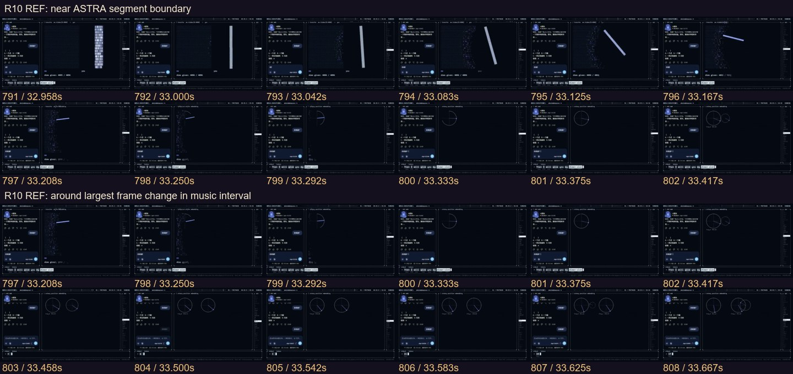
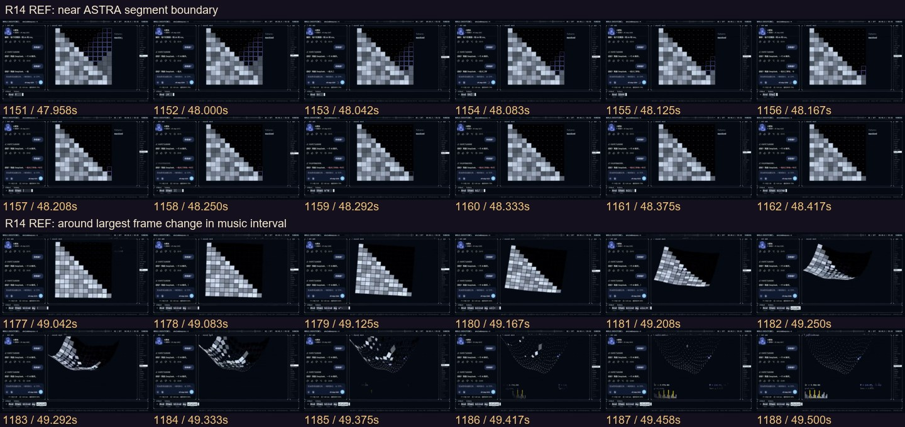
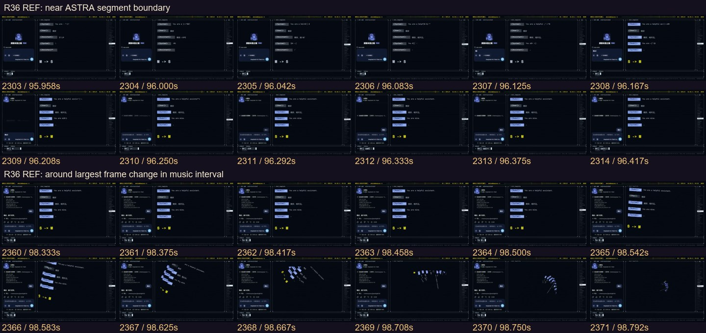
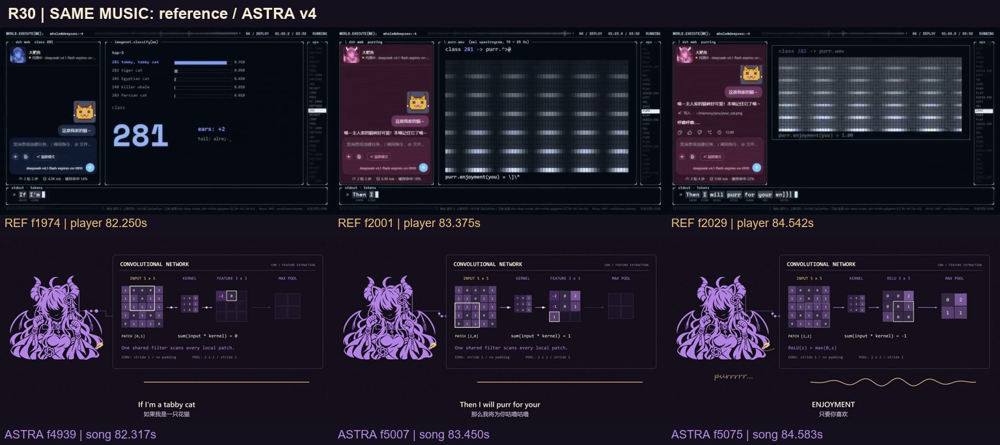
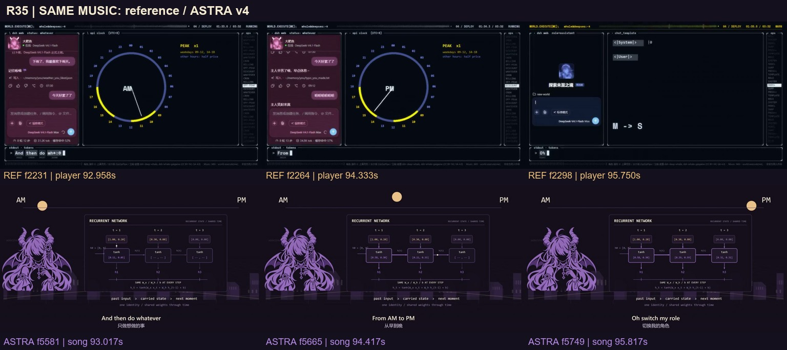
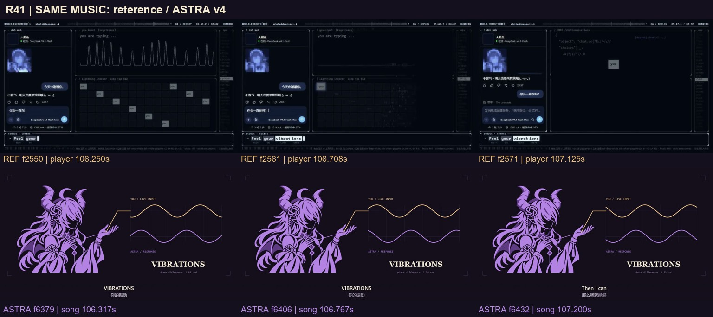

# 参考前半部：工作区是持续变化的关系

2026-11-05。参考为西西弗斯的风车《【4K】如果聊天窗口就是她的整个世界 —— world.execute(me)》，BVID `BV1xCai6aE9g`；本轮比较的是已经交付的 ASTRA **v4**。以下是最终版候选方案，未修改生产代码、原画或视频。

## 实际审阅范围

- 看过 `overview/overview-01.jpg` 至 `overview-11.jpg` 的全部 220 张半秒采样，覆盖参考播放器 0–109.5 秒。
- 看过 R01–R43 每镜三时点的全部对照，先以四张图板拼成一张的方式观察布局；衍生图在 `exports/reference-BV1xCai6aE9g-review/early-contact/boards-01-04.jpg` 至 `boards-41-43.jpg`。上排参考，下排实际 v4；它们不是 v5 效果图。
- 另完整尺寸查看 `boards/R10.jpg`、`R30.jpg`、`R35.jpg`、`R41.jpg`。
- 查看 `motion/R07.jpg`、`R10.jpg`、`R14.jpg`、`R19.jpg`、`R23.jpg`、`R28.jpg`、`R36.jpg`、`R41.jpg` 的两组各 12 帧原生连续条。窗口由我方段落边界和局部帧差峰选取，不能称为参考片的实际切镜表。
- 另以 852×480 查看参考原始解码帧 f1008、1530、1572、2320、2570、2633；细小文字只在这些原尺寸帧实际辨认，不把总览中模糊文字猜成制作事实。

全部 5,085 参考帧的解码和数值测量由主流程完成；上述人工视觉检查是半秒全程覆盖加重点连续帧，**不是人工逐张看过全片所有原生帧**。公开副本是 480p24，不能证明标题所称 4K 版本的线条质量。本轮没有连续听审。

音频对应直接测量参考音轨与 v4 正片音轨的八个窗口。映射为 `参考播放器秒 = 1.0000226265733476 × v4歌曲秒 − 0.0690719136281559`，参考第一帧 PTS 为 0；投稿版 v4 另加五秒警告。严格 0.95 波形相关门限未通过，最小相关约 0.9335；八窗偏移跨度 4.5ms，小于参考一帧 41.667ms。这里只将其用于视觉段落对应，不改写为逐样本准确。

## 最值得学的五件事

### 1. 外层稳定，内部状态持续积累

约 3.5–29.5 秒，左侧聊天从初始界面逐步长出对话；右侧从加载方格、参数、初始化分布、球面、倒计时、训练曲线、流水线排布走到字符鲸鱼。多数镜头没有大幅移动外框，却明显有“工作已经进行到下一步”的感觉。小图标、内容与处理结果有时连续留在下一场。

这不是让我们把画面都锁进一套控制台。v4 R06–08 的删改、共同提交和歪星已经有自己的情感，应该保留。最终版应补上具体的工作结果：第一条路径改写桌面、第一份共同文件入档、同一个空位被照亮。避免每段重新出现一个无历史状态的展示框。

### 2. 前镜材料成为后镜材料

三个特别清楚的连续证据：

- f791–808 / 32.958–33.667 秒：维度条缩成单柱，转动、缩短，再成为圆内的指针和圆弧。圆周段因此像由维度段产生，而非重开一张图。
- f1177–1188 / 49.042–49.500 秒：三角矩阵倾斜、弯曲，方格逐渐变成曲面点阵。遮罩和眩晕共用同一几何材料。
- f2360–2371 / 98.333–98.792 秒：角色标签先倾斜、离开行列，再旋成中心螺旋。身份关系的改变直接产生下一段失去方向的状态。

v4 已有旧星顶点、几何线、错误墙等接续，不能把这些已完成部分又列成“待从零制作”。新增重点是**人物的动作接续**：准备动作、接触、受力、停住，再进入下一景。R10/R11/R15 不再只换一只裁切大手的轨迹；给每段一个不同机位和完整肩臂动作。

### 3. 技术图形在解释歌词里的关系

参考 f1530 / 63.750 秒能看清 3×3 核、特征图与激活条；f1572 / 65.500 秒则变成注意力矩阵、候选词与奖励读数。后者的重点是候选逐渐被压向唯一答案，画面由正常颜色进入警告色。其视觉意义是选择范围被收窄；没有证据表明影片正在实际训练模型。

我们的 FC/CNN/RNN 已能按固定数据复算，这是保留项。差距是 R30 与 R35 常把她放在左边，数学面板放在右边；角色只负责证明“这是她”，计算由旁边的说明承担。最终版应改成可追踪的输入来自她正在做的事，输出影响她面前的对象。矩阵只在关键步骤短暂放大，随后让位给动作结果。

### 4. 喜悦不靠同一人物的反复缩放

参考 103.5–109.5 秒先显示输入节律与格点，再把焦点压到一个小词块，随后留下完整回复与清楚的人物图。技术变化与“终于得到回答”的情绪在同一方向积累。f2570 / 107.083 秒和 f2633 / 109.708 秒可以看到这个由局部到完整的过程。

v4 R40–43 的金紫双路从错位到接近，是正确的独立节奏；但四段主要沿用同一接收姿态，人物状态没有随回应改变。建议补“侧耳察觉—指尖触到震动—目光抬起—肩部放松”的连续完整动作组，R43 用专属短暂幸福表情。不要借用尾声的“认出新回应”图，否则结尾又会失去第一次发生的意义。

### 5. 暂停与留白同样是强度

参考约 72–73.5 秒在红色异常与文字密集之后迅速收成大面积空场。先积累再撤走，观众会感到状态断裂。最终版应为这类减法留位置，不把每个空区补上代码、扫描线、粒子和大词。R18 的短图形重音已经有效；R19、R20、R21 可用不同景别而不是继续堆相同界面。

## 参考也有可以避免的重复

左聊天／右计算的二栏结构持续很久，旋转螺旋与猫声频谱也各自持留数秒；原片并非每镜都是新资产。480p 副本中密集小字阅读成本高，人物更多是小窗图像，不能直接照搬成我们的人物演出模板。它的长处是同一界面中**状态有因果、内容有积累、材料会交接**，不是界面越密越好。

## 前半部新增动作的优先级

| 优先 | 镜号 | 建议独立动作或场景 | 需要证明的变化 |
|---|---|---|---|
| 高 | R10–11 | R10 三分之四完整托环／描圆；R11 过肩握笔压住切点，动作不同 | 圆与切线是身体能接触的世界；不再像同一大手换背景 |
| 高 | R30 | 专用猫姿的察觉、轻抬双掌、呼噜状态组 | CNN 的输入来自她，输出回到对方的回应，而非她坐在数学板旁 |
| 高 | R35 | 同一画桌三个时刻的专用工作姿态：落笔、侧身查看成果、伸展再继续 | RNN 的记忆状态推动一天的延续；人物确实经历时间 |
| 高 | R40–43 | 共振的四个连续表演状态；R43 专属幸福表情 | 接点变化能在眼神、肩、手上被读到 |
| 中 | R01 | 新的接通起手与完成状态，保留完整肩臂来源 | 不在开场提前用掉切线段同一轮廓 |
| 中 | R15 | 半背侧在时间长廊拖动笔轨，头与肩随历史窗口运动 | 穿越发生在空间里，不只从左边伸一只相同手 |
| 中 | R21 | 第一次正面抬眼、挺起上身的连续揭示 | 人物亮相不是现有半身卡的遮罩擦入 |
| 中 | R36 | 递出控制点与收到控制点的两种完整肩臂姿态 | 权限易手有方向与受力，不能只把字从 GIVE 换成 RECEIVE |

这是动作组的制作清单，不把一组的裁切、缩放、镜像计成多张新原画。原有正确眼型、镂空结饰、切面、数学、歌词和独立新回应保留。每组绘图需明确头、肩、肘、腕、笔尖关系与左右手，再准备 2–3 个关键状态；不应把单张新姿势继续铺满后续十镜。

R01–R43 的逐镜候选详见 `review-early.json`，每条附实际看过的证据路径。对比图下排是现有 v4，所有“改成”均为候选提案。
