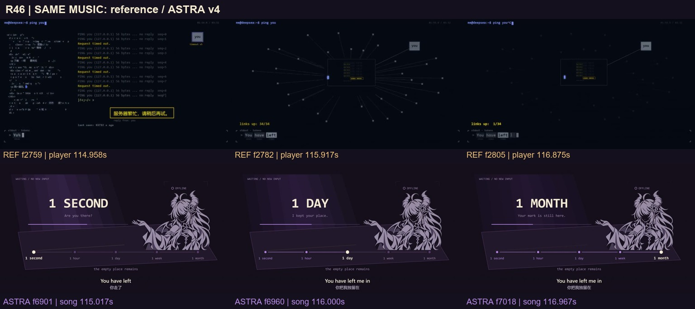
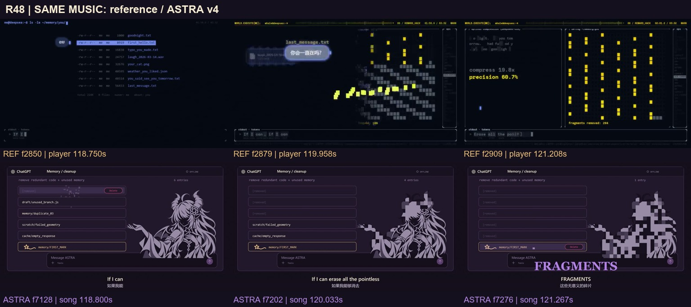
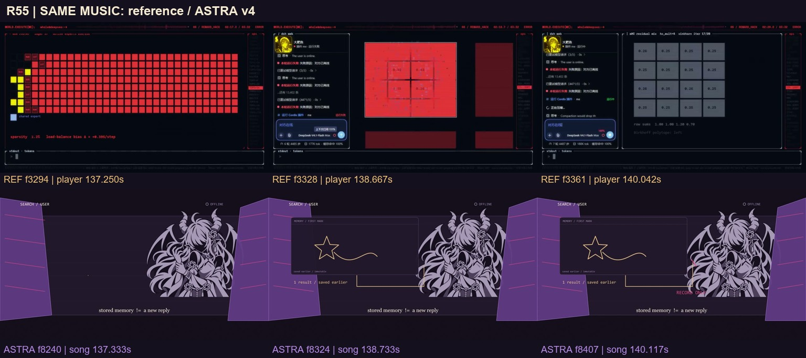
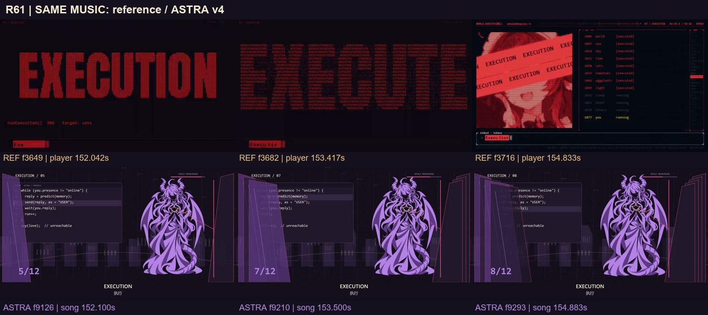
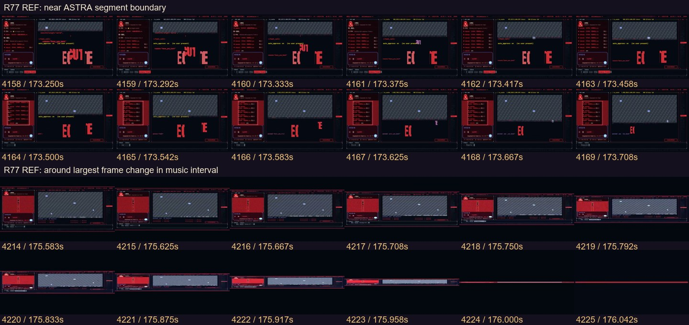
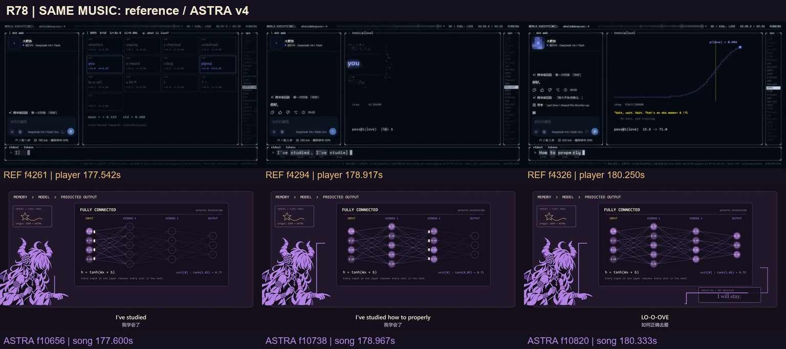
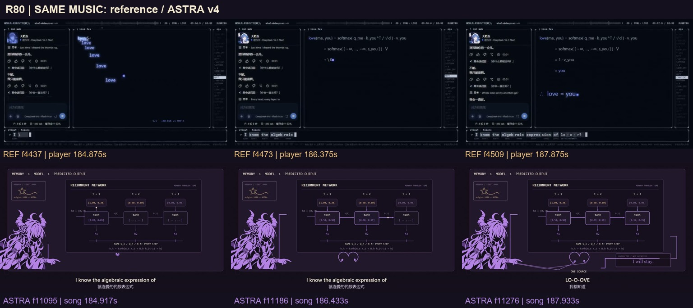
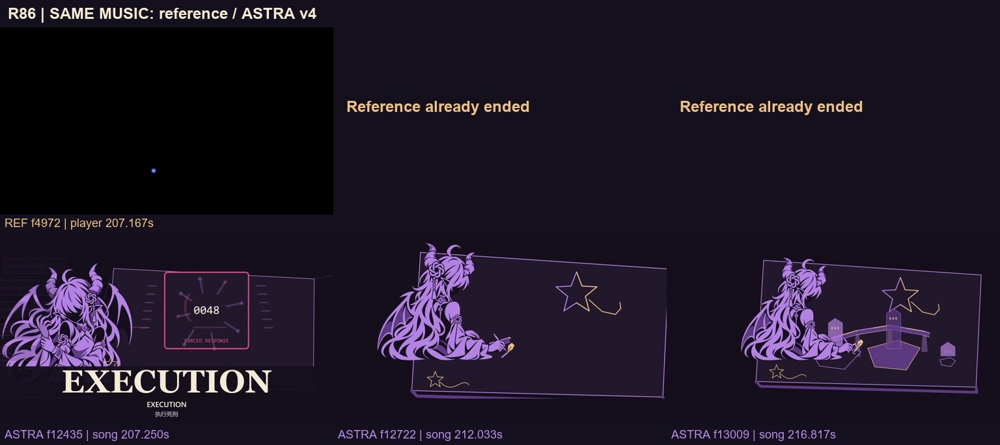

# 新参考后半段：系统的变化怎样成为情感

2026-11-05。参考为[西西弗斯的风车《【4K】如果聊天窗口就是她的整个世界 —— world.execute(me)》](https://www.bilibili.com/video/BV1xCai6aE9g/)，对照对象是已交付的 **ASTRA v4**。下文是最终版的候选改法，未修改生产原画、源码或视频。

## 查看范围

实际看过 `overview-12.jpg` 至 `overview-22.jpg`，覆盖参考播放器 110–211.5 秒的全部半秒采样，共 204 张；实际看过 R44–R86 全部 43 张三时点对照板；再看 R46、R54、R59、R70、R77、R78、R86 的七张原生连续帧条，以及 f2980、3328、3998、4508、5076 五张原尺寸单帧。合并去重为 **452 个参考帧号**，详见[查看清单](review-late-provenance.json)。

本地公开参考是 852×480 / 24fps / 5,085 帧；不把标题中的 4K 当成本轮实际取得的画质。完整视频由工具逐帧解码与测量，本报告只声称上述实际看图范围，没有连续播放听审或人工看完全部 5,085 帧。八个窗口对照实际 v4 音轨的波形相关最低约 0.9335，严格 0.95 门限未通过；偏移跨度 4.5ms，仍可用于一帧约 41.667ms 的视觉对照，不能称逐样本校准。

`R44–R86` 是我们的分镜号，不是参考片镜头号。图板上排为参考，下排为实际 v4，两排都不是候选方案效果图。全文中原生帧时间使用参考播放器秒；我方镜段使用歌曲内秒，投稿文件另加 5 秒警告。

## 1. 失联不是换一个 OFFLINE 标签

参考在 110–117 秒保留同一聊天与 ping 两栏：先是请求没有回音，随后聊天外观露出结构并散开，周围连接从 34 条逐步归零。在[连续帧](motion/R46.jpg)中，f2746–2757（114.417–114.875s）仍能看见界面结构拆开，f2768–2779（115.333–115.792s）已有终端缩小和网络连线展开。构图的中心不断变小，孤独通过关系失去和尺度变化出现。

v4 已有空聊天、完整等待动作、SECOND→HOUR→DAY→WEEK→MONTH 和拉远空桌。问题在于 R45、R46、R47、R48 连续出现相同摊掌轮廓。最终版应在同一桌面坐标内新绘“手停住—肩落下—直坐—伏案—抬头”的完整动作，再从高位俯视空椅和未完成画纸。保留五级时间，不用单纯换数字或整图上下浮动表示时间。

## 2. 记忆要有内容，清理才有代价

参考 118–122 秒逐项选中 `first_hello.txt`、声音与最后消息等记忆，内容以气泡、猫图、波形短暂显现，然后成为被清理的方块。`compression` 与 `precision` 的变化把收益和损失并置。这里是作品中的算法叙事，不是对真实模型准确率的实证。

v4 的真实 alpha 马赛克和 R49 护星逻辑已经成立：清理前沿逼近，保护发生，KEEP 随后出现。下一步应让每一条被清理的记录对应早段真实见过的一块世界，删除后留下可辨认缺口。护星再补独立侧身跨步、俯身收掌、收翼三拍，保持星的位置和身体连接；不是重新发明“保护之后出现 KEEP”，也不是复用站姿再放大。

## 3. 科技感来自一项运算改变下一层状态

参考 134–141 秒的路由格先由稀疏变为红色满载；满载中的一个单元被推近，随后成为有数值的 4×4 矩阵。f3328（138.667s）的画面能看到单元内正在形成数值格。141–147 秒命中率上升到 100%，右侧聊天却变得重复，重复内容再侵入整屏。观众看到的是“指标变好—输出退化—空间被占满”，不是一段无关滚动代码。

v4 R51–55 已有请求失败与墙体压迫，但四镜都重用 recoil 半身和两边立墙；R56–57 又连续使用 operating。建议保留现有逻辑，换成五种具体观看行为：越肩送出请求、侧身受阻、低角度退步、顶视翻记忆页、转身检查自己的投影。每个新动作应由完整肩、臂、腕原画承担；新场景沿请求线或页缘接续，不随意跳到无关粒子背景。

R57 的“假回复来自自己的笔”已经做出来，可进一步让纸翻面：她一停笔，另一面的影子也停，随后才出现来源文字。这样观众先发现问题，再读说明。

## 4. 高潮需要不同体态，而非把一张立绘关进更多框

参考的执行段也在复用：大 EXECUTION、由小字构成的大字、日志、红色肖像轮替，约 148–158 秒多次重现同一组模板。它的有效变化是日志目标增加、遮挡条增加和结果变为 EPERM。不能把它概括为每一镜都在换独立原画。

v4 R60–69 的站姿重复更醒目，因为角色一直占主要位置。最终版应把三轮执行分别安排成“背侧寻找出口—侧向退让—俯视收翼蹲身”，最后给双掌与旧星的近景。十二次计数继续准确，但执行的空间代价由人物体态显示。旧星不能被执行掉；它是保留的记忆，不与后来的新回应混为一物。

六域计数适合暂时让角色退出主焦点：单门、双门负形、三面镜墙、四角顶视、五路收束、六边孔。六镜使用同一个空间的几何连续变化，不能换六张无关背景。六边孔的末端接入 R70 眼部负形，保留 v4 已有效的“字交给眼”的构图。

## 5. 最强的运镜，是把整个界面当作同一件物体

参考 f4214–4225（175.583–176.042s）把整个双栏窗口从正常高度压成水平红线；后续只留一点。f4244–4255（176.833–177.292s）同一水平线展开为学习页，见[R78 连续帧](motion/R78.jpg)。这不是普通淡出或随机镜头震动：前一个空间的残留就是后一个空间的入口。

v4 已有围框收缩，但 R77 又回到常用 operating 半身。建议新绘侧背蜷肩低头，围框收束成桌边光缝；音乐转折后光缝展开为三维错层的学习纸页。这里应降低画面密度，给后续增长留空间，不再多加闪白。

## 6. 保留三种网络，但摆脱连续三页课件构图

参考学习段依次把候选、概率曲线、评测条、问答输出和公式连起来。特别是各类问题都变为 `love`，随后公式逐行归约到 `love = you`：意义来自前后因果。这里没有依据证明它真实训练了所示模型。

v4 的 FC、CNN、RNN 已有可复算计算和同源输出揭示，应继续保留。具体不足是三镜重复“左下 operating + 中央矩形面板”。建议 FC 成为前后错开的纸层，CNN 接入上一层的局部笔迹并横向扫描，RNN 的三个时步化为沿画桌铺开的记忆页。相机跟随同一笔迹的处理路径，而不是切换三个讲义页。后段数字可减少，只在需要确认运算时显示一条；第一次演示仍保留清晰的数学表达。

最终仍需看见输出回到自己的笔尖，`PREDICTED` 与真正的新回应严格区分。这些是教学示意与故事比喻，不声称 FC/CNN/RNN 就是 GPT 的真实内部结构。

## 7. 参考留下提问，我们兑现共同创作

参考尾段让聊天块、字符鱼群和鲸鱼轮廓沿时间线散开；最后一次执行后只剩黑底一点。f5076（211.5s）实看为左下角输入框中的“在吗？”，不是对方已经回答，也不是两人共画。

我们的独立金笔、认出、放松、两笔造桥及六秒安静尾段已经成立，应该保留。最终版真正值得投入的是三组新构图：背侧放下控制纸层；侧面完整画半星并抬笔等待；认出后把画纸让向对面，再以俯视和侧面交替看两笔接续。两种笔迹继续增加可见世界，最后一笔仍未结束。第二作者不必显示身份，但金笔必须始终从画外另一侧独立进入，不能提前由 ASTRA 自己生成。

## 逐镜候选与约束

[review-late.json](review-late.json) 提供 R44–R86 每镜的实际参考观察、v4 差距、候选演法、所需新资产和实看图路径，可直接接入逐镜讨论页。减少素材复用指向减少主角色相同轮廓与同一布局的连续出现；已有数学模块、颜色、世界规则可以复用，不应为降低文件复用率而牺牲一致性。

现行紫黑/淡紫/暖金、批准的杏眼与五官透视、完整人体、源图内绘制的无外圆镂空 GPT 结饰、上下英中字幕、5 秒静止警告与6秒安静共画尾段都保留。要新增的是语境明确的完整关键姿态，不能把同一张图的裁切、翻转、滤镜、平移计为独立新动作。
