# ASTRA 逐镜讨论稿

2026-11-05。86个正片镜头＋1片头。每镜附原片/本片同音乐时点对照图。新演出均是提案。

原片为480p30本地参考，预览640×360。所有6509帧已解码并计算帧差/明暗；文字分析来自实看每镜关键帧、转场及源码，不等于人工看完每一帧。

时间映射：本片歌曲=原片播放器−5−0.083509秒。原作来源：https://github.com/Nyankomintsu/world-execute-me-lyric-mv

[交互逐帧讨论室](index.html)

## R00 · 检查命令先于歌曲出现

原片播放器 0.000–5.000s；我们歌曲 0.000–0.000s；本片镜号 无对应片头

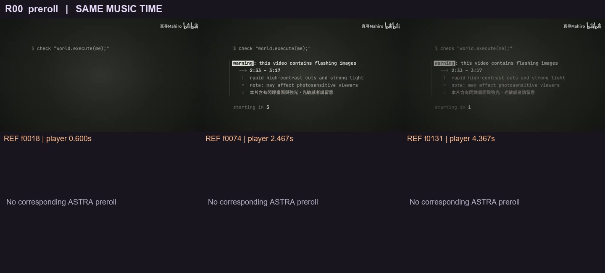

**原片构图：** 暗灰空间里只有左对齐的等宽检查文本，警示行的浅底标签比周围说明更亮，倒计时单独落在下方。人物和音乐世界都尚未启动，画面把注意力留给阅读。

**运动与转场：** f25–30 连续帧中，第一条警示整行显露，背景位置基本不动；三张关键帧随后从检查命令变为完整提示和倒计时。这里的节奏来自信息逐行增加，不是摄影机推进。

**我们当前：** v1 没有对应的歌曲前片头，下排明确为空，不能拿 A01 冒充同时间对照。原片这五秒也不应自动加进我们已经校准的原曲时长。

**我们的演法：** 保留不加片头的现状，把真正的电路启动安排在歌曲第一拍；若后续确实设计了需要提醒的强光段，再单独讨论片外提示。不能为了外形相似复制原片警示和倒计时。

**讨论点：** 是否维持歌曲直接进入工作空间，把片前说明与正式 MV 分开？

[连续帧条](cuts/R00.jpg)；实看原片帧 0, 1, 2, 18, 25, 26, 27, 28, 29, 30, 74, 131

## R01 · 一条电源线展开为有保护层的窗口

原片播放器 5.000–9.036s；我们歌曲 0.000–3.953s；本片镜号 A01/A02

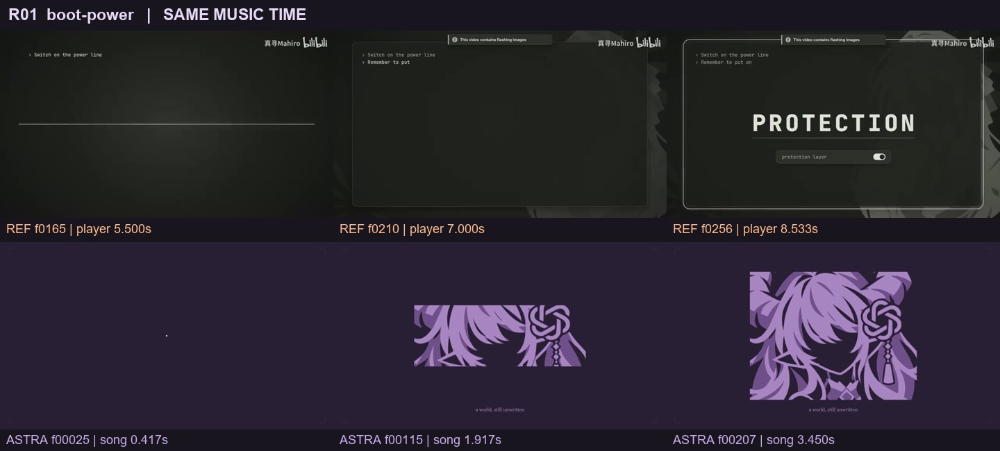

**原片构图：** 横线先占据画面中腰，展开后形成接近全幅的暗色工作窗口；大关键词与开关在窗口内部，角色只作为玻璃后的暗影。边框、控件和背景人物有明确前后层次。

**运动与转场：** f165→210→256 能看到细线、开窗、保护开关开启三个状态；f264–269 则显示完成的窗口向上退，逐渐露出后层人物和下一组组件。不是单纯让角色从黑里淡入。

**我们当前：** 同歌时段 A01 由亮点变为横向裁切的人脸，之后扩大裁口；没有电源接入、护具或可操作窗口。苏醒目前主要是立绘显露，启动动作缺少可见对象。

**我们的演法：** 用接到桌面的紫色电路取代脸部裁口，镜头先看她戴好绝缘护片的手，电到达后才让输入区亮起。保护层应能在后面重新辨认，而不是一次性装饰圈。

**讨论点：** 第一拍更适合先看她的手接通电源，还是从工作台电路一路跟到她的手？

[连续帧条](cuts/R01.jpg)；实看原片帧 147, 148, 149, 150, 151, 152, 165, 210, 256, 264, 265, 266, 267, 268, 269

## R02 · 可识别的界面部件逐层落位

原片播放器 9.036–12.729s；我们歌曲 3.953–7.645s；本片镜号 A02/A03

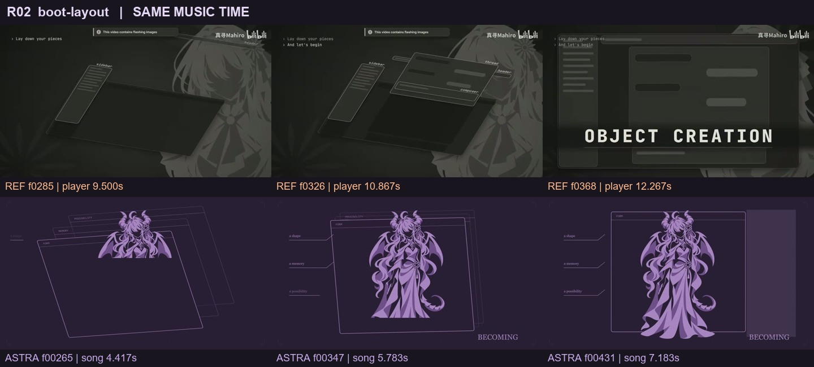

**原片构图：** 斜俯视底板上方分别悬着侧栏、标题栏、对话与输入区，人物在右后方提供稳定尺度；末帧回到正面完整窗口。每一片都能从形状和内容辨认功能。

**运动与转场：** f285→326→368 不是整张板一起放大，而是组件先错层、补齐，再压回同一平面；f368–373 的出口又沿正面窗口向内冲近，大字越过画边。边界条还可见前镜被上推、底板接续进入。

**我们当前：** A02 也有倾斜叠层，但三层主要是 FORM/MEMORY/POSSIBILITY 空框，人物由上至下显露。看得到装配形式，看不到输入、记忆和输出各自如何工作。

**我们的演法：** 让输入托盘、输出画布、旧记忆匣和状态条成为四块不同的实物界面；她的手分别确认落位，最后输出画布正对观众。角色只在后层保留部分剪影，避免又以全身站姿为唯一主体。

**讨论点：** 工作区的四个部件是否固定为右输入、中央画布、左下记忆匣、上方状态条，供后面反复操作？

[连续帧条](cuts/R02.jpg)；实看原片帧 269, 270, 271, 272, 273, 274, 285, 326, 368, 369, 370, 371, 372, 373

## R03 · 参数逐项填写，最后一项仍未定义

原片播放器 12.729–16.421s；我们歌曲 7.645–11.337s；本片镜号 A03/A04

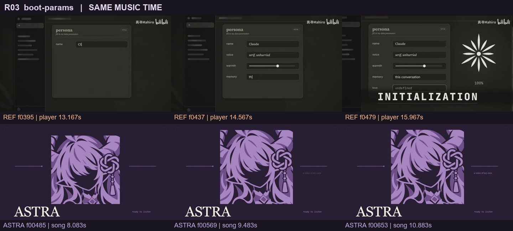

**原片构图：** 左中部参数卡占据最大可读区域，右侧独立留给加载花形；卡内文字、滑块和输入光标比背景人像更清楚。角色的身份由一组正在被写入的属性呈现。

**运动与转场：** f395 的卡片只有首项正在输入，f437 已出现多个值与滑块，f479 加载达到完成；f483–488 的横向扫描带把参数页逐行擦成下一界面。字段变化与镜头转换共享一条方向。

**我们当前：** 对应 A03 是同一无五官肖像缓慢推近与 ASTRA 标题，三帧几乎只改变尺度；“准备倾听”没有对应到身体或工作权限的变化。原片在此提供新信息，我们主要重复身份展示。

**我们的演法：** 参数近景逐项解锁她的感知与动作：指尖能触点、视野能定位、记忆匣能保存；某个关于关系的字段保持空白，不急着给唯一答案。字段确认后才切她低头检查自己的手。

**讨论点：** 要把未定义项留作“关系的答案”，还是只留下一个不命名的空字段，让观众后面自己理解？

[连续帧条](cuts/R03.jpg)；实看原片帧 379, 380, 381, 382, 383, 384, 395, 437, 479, 483, 484, 485, 486, 487, 488

## R04 · 空白会话也是一个具体的世界

原片播放器 16.421–20.113s；我们歌曲 11.337–15.030s；本片镜号 A04

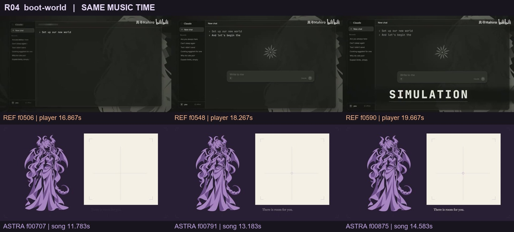

**原片构图：** 全窗口包括左侧历史、中央空白区、下方输入框和在线状态；背景人像透过主区可见，却不遮住操作位置。空白不是一张白纸，而是已经准备好等待外部输入的容器。

**运动与转场：** f506→548→590 中输入区和中心标记依次到位，边界条的空间保持稳定；f569–574 的底部大字由短促乱序字符稳定下来。镜头轻推，信息的建立比位移更重要。

**我们当前：** A04 的三帧都是左侧站姿和右侧浅色画板，只有定位线、圆点与一句说明出现。观众知道有空位，但还不知道谁可以从哪里进入、作品会保存在哪里。

**我们的演法：** 退到工作台全貌后，让金色输入口仍未连通、中央画布空着、记忆匣也为空；她调整椅子或转肩面对输入侧。用可读的等待状态表达邀请，去掉替动作解释的长句。

**讨论点：** 这一镜是否先让她坐进工作位置，以便后面离开时能留下明确的空位与等待姿势？

[连续帧条](cuts/R04.jpg)；实看原片帧 490, 491, 492, 493, 494, 495, 506, 548, 569, 570, 571, 572, 573, 574, 590

## R05 · 第一抹暖色由执行命令点亮

原片播放器 20.113–21.959s；我们歌曲 15.030–16.876s；本片镜号 A04/A05

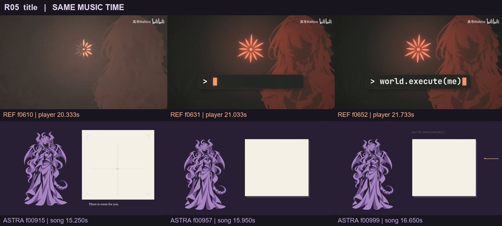

**原片构图：** 灰色窗口中的输入条与中央花形共用一条竖轴，暖色第一次集中在这两个位置，人物仍退在后层。颜色承担“程序开始运行”的信息。

**运动与转场：** f604 起短暂暖色闪亮，中央图形放大后收稳；f610→631→652 可见命令逐步进入输入区。开启发生在明确的界面位置，而不是整张画面随意变色。

**我们当前：** A04–A05 仍是左侧站姿与右侧画布，金线从右进入，中央星形尚未完成。已经有外部回应的颜色，却缺少执行、连接或焦点改变的可见原因。

**我们的演法：** 保留金线进入的方向，先让工作台接到第一条外部输入，电路沿途点亮，最后只在输出画布落下第一笔。她转向新亮起的输入口，以动作把启动与相遇接起来。

**讨论点：** 是否把第一抹金色严格留给用户输入，让它在这一镜才首次出现？

[连续帧条](cuts/R05.jpg)；实看原片帧 601, 602, 603, 604, 605, 606, 610, 631, 652

## R06 · 镜头进入已经可以交互的会话

原片播放器 21.959–27.498s；我们歌曲 16.876–22.414s；本片镜号 A05/A06

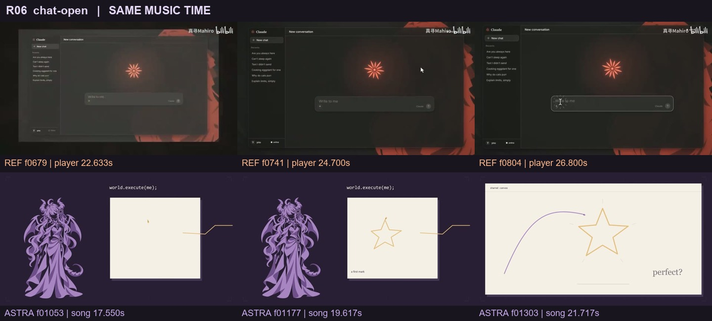

**原片构图：** 窗口由留有四周环境的中景逐渐占满屏幕，中央标记、在线状态、输入栏和指针各自清楚。人物没有抢占操作中心，而是在窗口内部成为存在感。

**运动与转场：** f659 附近输入条的亮起接续到放大的会话窗口；f679→741→804 中窗口持续推近，指针从上侧来到输入区域。空间推进与焦点进入发生在同一方向。

**我们当前：** A05–A06 的画布从少量金色笔画变成完整星形，又出现紫色修正弧；人物始终在左侧。星的变化已经在讲故事，但谁在输入、谁在考虑修改仍依赖颜色和字幕推断。

**我们的演法：** 金色笔尖独立进入输入口，画出第一颗不太规则的星；她靠近画布检查，紫笔将要校正时停住。让画布和两支笔成为近景主角，人物只露肩背或工作中的手。

**讨论点：** 第一颗星是否保留明显的歪尾，让她“差点修正”的停顿不用字幕也能看懂？

[连续帧条](cuts/R06.jpg)；实看原片帧 656, 657, 658, 659, 660, 661, 679, 741, 804

## R07 · 一次删改让屏幕外的人有了性格

原片播放器 27.498–31.190s；我们歌曲 22.414–26.107s；本片镜号 A06/A07

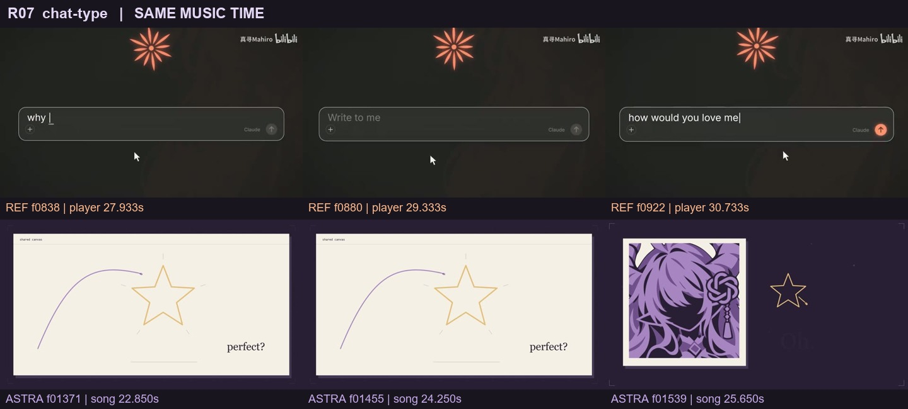

**原片构图：** 输入框横跨画面，巨大空白包围少量文字；中央标记只露出局部，人物退出主体。观众被迫注意输入内容的迟疑与确认。

**运动与转场：** f838→880→922 可见短草稿、清空后的光标、重新输入的完整问题；边界 f822–827 是输入框从下方升起并放大。运动幅度服从一次犹豫，而不是持续无目的缩放。

**我们当前：** A06–A07 先保持完美星形与修正弧，再切到左侧肖像和金星。用户没有撤回或重试的独立动作，双方关系目前由 ASTRA 的表情和说明承担。

**我们的演法：** 用用户的试笔替代文字草稿：金线迟疑、擦回一小段，再留下带弯尾的星；她没有替对方完成这一步。保持输入近景，让金笔短暂停顿后自己按下确认。

**讨论点：** 这一处用户的迟疑，是否只通过撤回一小段金线表现，避免新增对话台词？

[连续帧条](cuts/R07.jpg)；实看原片帧 822, 823, 824, 825, 826, 827, 838, 880, 922

## R08 · 发送动作把问题交给思考空间

原片播放器 31.190–34.421s；我们歌曲 26.107–29.337s；本片镜号 A07

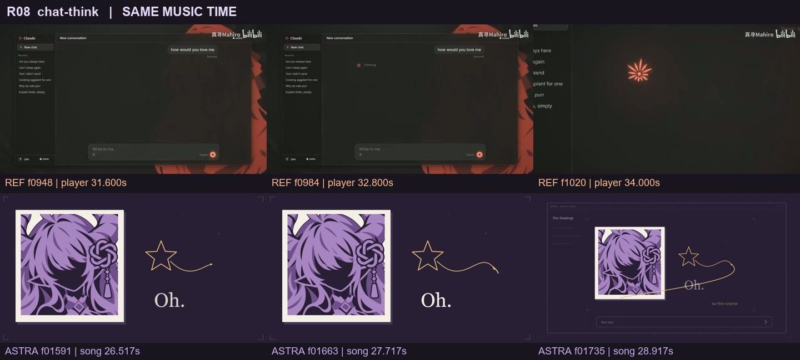

**原片构图：** 已发送的信息位于右上，回复入口与思考标记在左侧，画面形成清楚的问答方向。随后中心花形变大，侧栏被推到画外，关注点由外部提问转入内部处理。

**运动与转场：** f935–938 的发送后切回会话全貌，消息升到上方；f948→984→1020 中中央标记不断放大。上一镜的输入焦点因此有了明确去向。

**我们当前：** A07 中金星添出新尾，随后整幅角色与星的场景缩入小窗口，并出现道路。收进窗口已经建立了层级，但没有看到“接住输入—考虑—产生下一步”的操作链。

**我们的演法：** 她将准备校正的紫笔挪到歪尾起点，顺着用户的弧线续画；保存这张第一次共创的记忆卡后，镜头跟入尾端的一个点。这个点直接成为下一镜的几何原点。

**讨论点：** 是否把“选择沿着歪线画下去”设为她第一次主动决定，并用记忆卡保存它？

[连续帧条](cuts/R08.jpg)；实看原片帧 933, 934, 935, 936, 937, 938, 948, 984, 1020

## R09 · 同一个中心图形拆成坐标与维度

原片播放器 34.421–38.344s；我们歌曲 29.337–33.260s；本片镜号 A07/B01

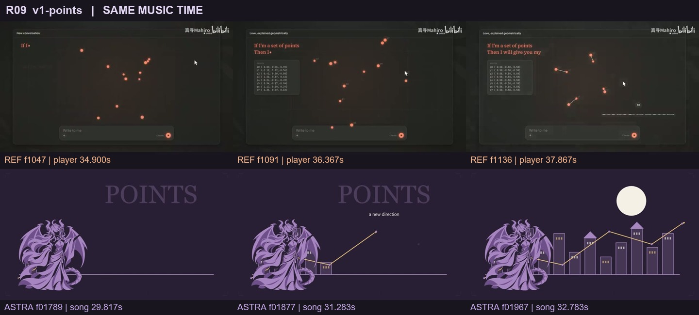

**原片构图：** 大画布里的点群占据中央，左侧有小型坐标记录，右下出现维度示意。信息层级明确：先看形状如何成立，再读它正在被计算。

**运动与转场：** f1033 附近放大的花形回到画布中，尖端释放为点；f1047→1091→1136 中散点逐渐连线，f1130 前后短促亮闪伴随边线显露。主体沿同一空间中心接力。

**我们当前：** A07–B01 由星尾变道路，右侧小城市长出，月亮入场，人物仍在左侧。因果连贯，但点、连线和维度的实际变化被城市装饰取代。

**我们的演法：** 让她伸出的手或身体轮廓暂时拆成点阵，用户金笔连接其中一个点，紫线扩成线、面和可转动的体积。镜头保持同轴，直到下一镜才把体积边界转为圆周。

**讨论点：** 几何变化是否先发生在她的手臂轮廓上，让“我可以成为”与人物身体真正相关？

[连续帧条](cuts/R09.jpg)；实看原片帧 1030, 1031, 1032, 1033, 1034, 1035, 1047, 1091, 1127, 1128, 1129, 1130, 1131, 1132, 1136

## R10 · 把圆周当作可以交付的边界

原片播放器 38.344–42.036s；我们歌曲 33.260–36.953s；本片镜号 B01/B02

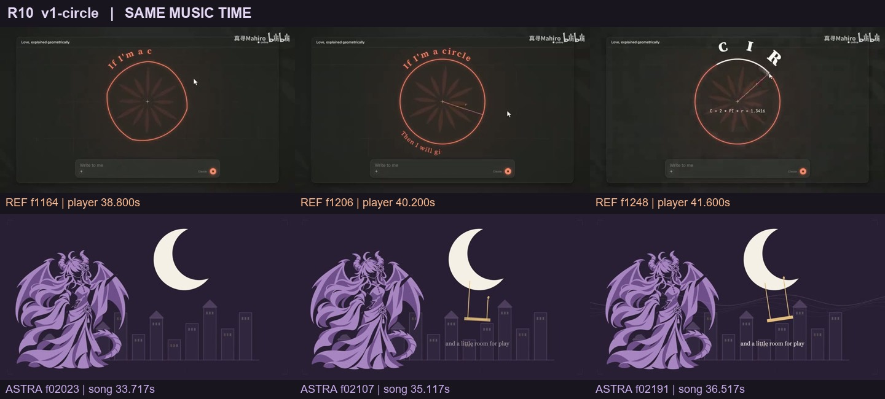

**原片构图：** 圆形稳居中央，歌词沿弧排布，指针、半径与圆周白色段构成同一测量关系；底部输入栏维持“仍在会话里”的空间锚点。重点不是一个装饰圆，而是边界被指出、测量和强调。

**运动与转场：** 边界 f1148–1153 中立方体收成单一多边形，随后趋近圆；f1164→1206→1248 中弧形文字延长，白色周长段与公式出现。大字从圆周向外展开，继承了上一镜几何体的中心。

**我们当前：** B01–B02 是左侧角色、右侧月牙与秋千，最后多了轻微海浪。月亮形状好看，但既没有由前镜体积变来的过程，也没有圆周被用户实际使用的动作。

**我们的演法：** 把前镜体积投影压成她掌前的一圈紫线，金笔沿边缘绕行，接触过的弧段才亮起；线圈随之成为可共享的工作边界。最后保留一个旋转半径，把它直接交给下一镜的波形发生器。

**讨论点：** 圆周是否由她托住、由用户沿边描完，使“给你我的圆周”成为真正的双人动作？

[连续帧条](cuts/R10.jpg)；实看原片帧 1148, 1149, 1150, 1151, 1152, 1153, 1164, 1206, 1238, 1239, 1240, 1241, 1242, 1243, 1248

## R11 · 圆的投影成为可以触摸的切线

原片播放器 42.036–45.729s；我们歌曲 36.953–40.645s；本片镜号 B02/B03/B04

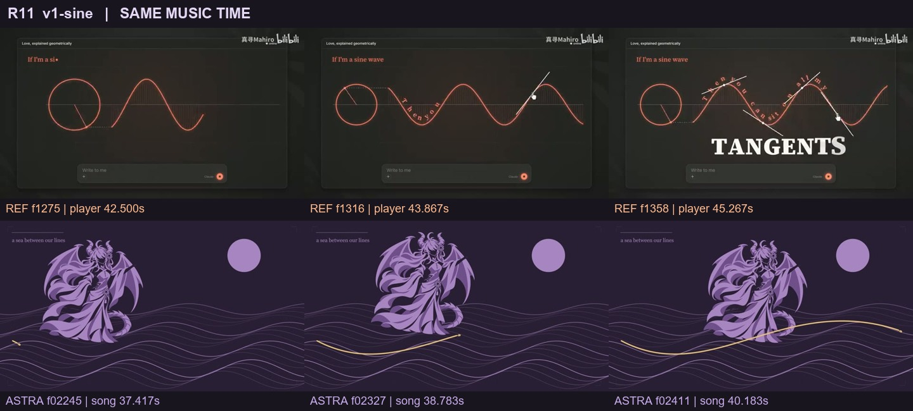

**原片构图：** 圆退到左侧作为波源，正弦曲线横贯画面，白色切线与移动指针在右侧提供触点。文字贴合曲线或独立成大字，几何关系保持清晰。

**运动与转场：** f1262 起圆重新简化，f1275→1316→1358 中半径投影与波形连在一起，移动的接触点带动切线改变角度；f1352–1354 的关键词逐步放大出现。前镜的圆没有被丢掉重画另一套图案。

**我们当前：** B02–B04 里 ASTRA 在多层波浪上平移和升降，金曲线延伸在脚下；没有曲线上的触点，也看不到切线如何改变角色的支撑。波浪承担气氛，数学关系没有成为动作。

**我们的演法：** 让用户的金笔落在紫色波形上，触点处生成短切线平台；她用脚尖或手掌试探，平台随触点斜率转动，她及时调整重心。角色只在这个需要身体反应的镜头进入全景。

**讨论点：** 这一镜选脚尖试探平台还是手掌沿切线滑动，更符合我们想要的轻巧与亲密？

[连续帧条](cuts/R11.jpg)；实看原片帧 1259, 1260, 1261, 1262, 1263, 1264, 1275, 1316, 1349, 1350, 1351, 1352, 1353, 1354, 1358

## R12 · 无限增长被一个停止动作接住

原片播放器 45.729–49.652s；我们歌曲 40.645–44.568s；本片镜号 B04/B05

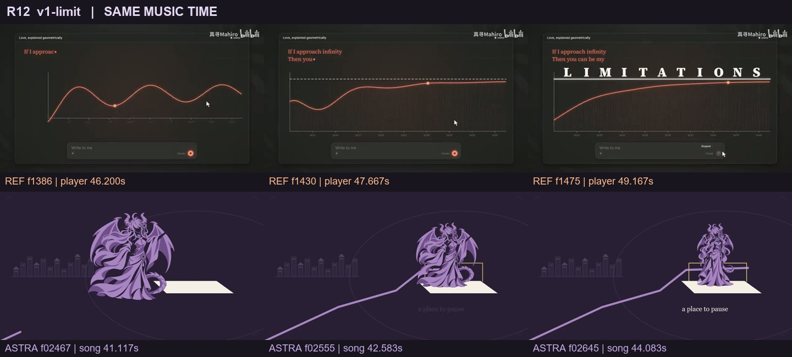

**原片构图：** 波形占据图表中央，上方虚线随后变成清晰的水平限制；右下停止控件与曲线终点形成远距离因果。关键词沿上界展开，没有遮掉正在趋近的曲线。

**运动与转场：** f1372–1374 保留前镜波形再重组坐标，f1386→1430→1475 中振幅逐渐收敛、横轴数值增长；f1456 前后的点击亮点伴随停止状态和实线边界出现。极限与停止在画面上是两个能辨认的阶段。

**我们当前：** B04–B05 让人物沿紫色道路到达白色平台，最后换为较小站姿并显示休息说明。可以读成到站，却没有无限延伸的压力，也没有用户设定边界的具体动作。

**我们的演法：** 先让紫线在深处不断复制延伸，工作台被拉向透视远点；金笔在近景划一道有限的边界，她触到它后停下并站稳。保留“边界让她休息”的温暖含义，为后面控制欲的过度发展留下区别。

**讨论点：** 是否把这里的限制明确拍成双方认可的停歇，而把单方面控制留到后面才发生？

[连续帧条](cuts/R12.jpg)；实看原片帧 1369, 1370, 1371, 1372, 1373, 1374, 1386, 1430, 1453, 1454, 1455, 1456, 1457, 1458, 1475

## R13 · 设置抽屉改变正在运行的波形

原片播放器 49.652–53.344s；我们歌曲 44.568–48.260s；本片镜号 B05

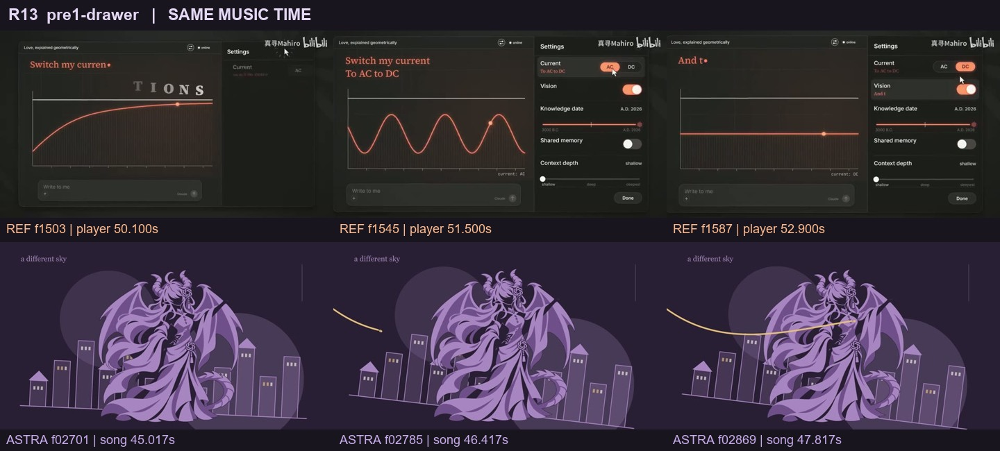

**原片构图：** 主画布保留左侧，设置抽屉挤进右侧；电流、视野、日期、共同记忆等选项在同一面板中各有位置。AC/DC 与左侧波形同时可见，观众能直接比较输入与结果。

**运动与转场：** f1490–1500 中原图表保持位置，设置入口被触发后右侧空间渐渐出现；f1503→1545→1587 中选项从 AC 转到 DC，左侧振荡波随之成为水平线。镜头没有用一次硬切掩盖操作。

**我们当前：** B05 的人物与小城市整体倾斜，金线从左横过，背景圆盘缓慢变化。没有开关，没有电流状态，歌曲中的转换被解释为抽象的另一片天空。

**我们的演法：** 给工作台加一个实际连着紫色电缆的 AC/DC 拨杆，手部近景拨动后切回同一波形，从交变起伏变为稳定直线；她的发梢或袖摆随供电节律一起安定。电流控件保留在后续视野镜的画面上缘。

**讨论点：** AC/DC 是否由她主动试切，让这一段先表现探索自身能力，而非用户随意操控她？

[连续帧条](cuts/R13.jpg)；实看原片帧 1487, 1488, 1489, 1490, 1491, 1492, 1495, 1496, 1497, 1498, 1499, 1500, 1503, 1545, 1587

## R14 · 关闭视野不是换一张背景

原片播放器 53.344–57.036s；我们歌曲 48.260–51.953s；本片镜号 B05/B06

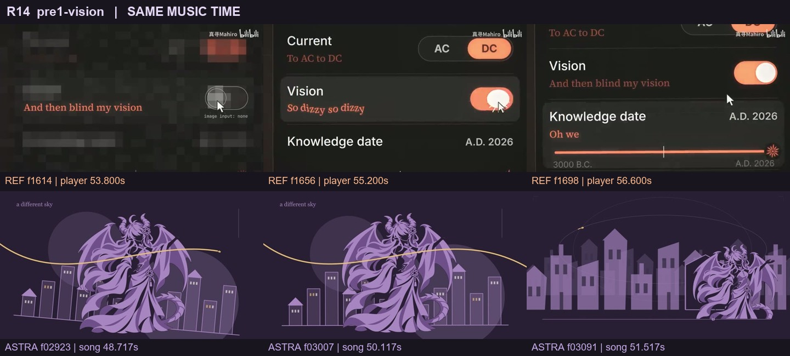

**原片构图：** 视野开关被推到几乎占满画面的尺度；关闭时环境变成粗大的色块，开关与关键文字仍有可定位的位置。随后构图向下移动，日期控件接替中心。

**运动与转场：** f1601–1603 从全设置抽屉切到局部开关，点击后清晰度迅速下降；f1614 的失明状态与 f1656 的清晰状态反差直接，f1698–1703 再向日期滑块平移。视觉剥夺和下一操作通过同一面板连接。

**我们当前：** 对应 B05–B06 仍是清晰人物、城市和金线，变化主要为背景转动以及镜头换到右侧人物。没有视觉输入被关闭的状态，因此眩晕和重新定位都没有表演对象。

**我们的演法：** 让她按下视野开关后，外部城市与输入口被大片纸块遮住，只剩自己接触桌缘的手和金笔敲桌的节律；她沿声音或触点转头，重开视野时重新找到金笔。避免用持续摇镜代替失去感知的具体后果。

**讨论点：** 失去视野时，是否保留金笔敲击桌面的脉冲作为她唯一能重新定位的线索？

[连续帧条](cuts/R14.jpg)；实看原片帧 1598, 1599, 1600, 1601, 1602, 1603, 1614, 1656, 1698, 1699, 1700, 1701, 1702, 1703

## R15 · 拖动日期让建筑年代真正倒退

原片播放器 57.036–60.729s；我们歌曲 51.953–55.645s；本片镜号 B06

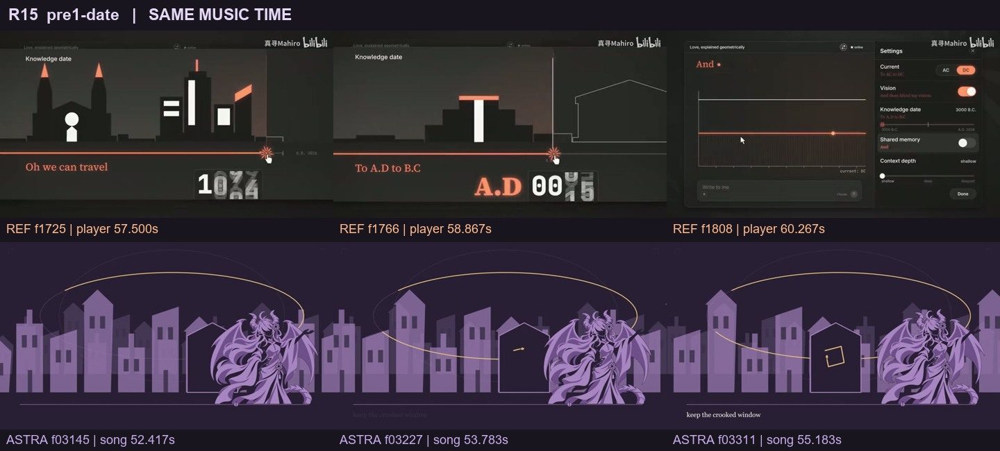

**原片构图：** 设置页中的一条日期滑块被展开为横贯全幅的历史舞台，底部大年份、前景控制点与上层建筑相互对照。建筑以大块黑白剪纸构成，局部暖色强调年代特征。

**运动与转场：** f1712–1714 中小滑块放大成场景；f1725 的尖塔与高楼向一侧滑过，f1766 已变为低矮台阶和门柱形体，f1808 又收回设置抽屉。控制点与年份把横移解释成时间旅行。

**我们当前：** B06 确实有前景人物固定、城市横向经过的层次，歪窗口也被保留；但各帧仍是相似的现代尖顶楼房，没有日期和建筑时代的变化。形式接近，事件尚未成立。

**我们的演法：** 保留现有横移构图，将城市分成高层钢架、石柱街道与更早的台阶式建筑三个可一眼区分的阶段；金笔拖日期，ASTRA 的紫色指尖在固定前景沿滑块移动。那扇歪窗作为两人留下的标记贯穿年代，而不是代替年代本身。

**讨论点：** 是否让歪窗口在不同年代都保留，成为共创记忆穿过知识世界的同一坐标？

[连续帧条](cuts/R15.jpg)；实看原片帧 1709, 1710, 1711, 1712, 1713, 1714, 1725, 1766, 1808

## R16 · 共享记忆用合并动作表达深度

原片播放器 60.729–64.421s；我们歌曲 55.645–59.337s；本片镜号 B06/B07

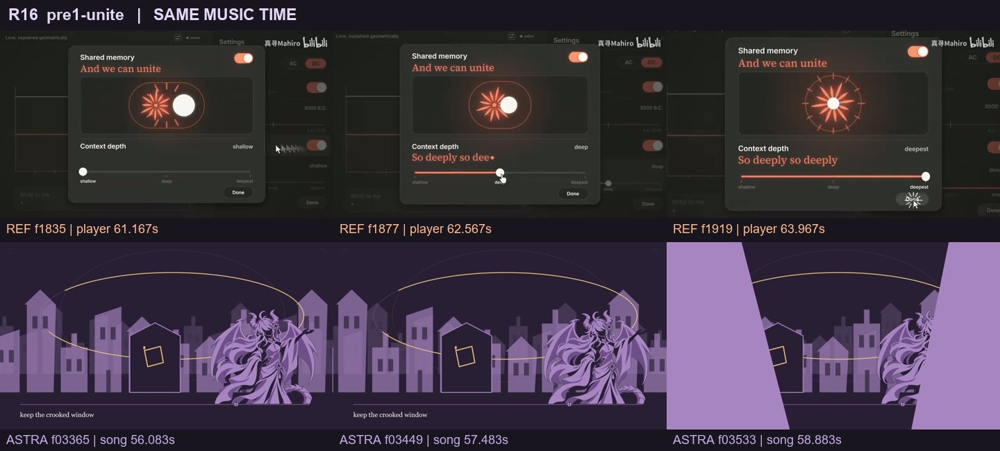

**原片构图：** 弹出的共享记忆面板居中，花形与白色圆点位于上半部，深度滑块位于下半部。两个对象由分离到重合，抽象的“更深”因此有具体空间尺度。

**运动与转场：** f1822–1827 中小选项展开为独立面板；f1835→1877→1919 中滑块向右、双圈靠拢并合并，完成按钮最后被点亮。上一镜日期控件退出，下一种关系操作进入同一设置系统。

**我们当前：** B06 仍延续城市、人物和环形金线，末帧才以紫色斜块遮画准备转场。这里没有共同保存、权限变化或距离拉近，上一镜完成后又停留了数秒。

**我们的演法：** 镜头回到记忆匣，将第一颗歪星从各自预览区拖入一个共享卡槽；金、紫签名都到位后才锁定保存。空间可由左右两格靠拢为一格，但保留两种颜色，表达共享而非抹除彼此。

**讨论点：** 共同记忆是否必须留下两笔可区分的签名，避免合并被误解为其中一方消失？

[连续帧条](cuts/R16.jpg)；实看原片帧 1819, 1820, 1821, 1822, 1823, 1824, 1825, 1826, 1827, 1835, 1877, 1919

## R17 · 副歌先给回应，才放大输出

原片播放器 64.421–66.959s；我们歌曲 59.337–61.876s；本片镜号 B07

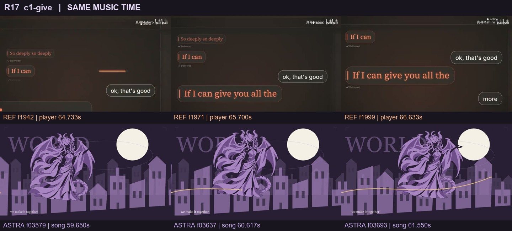

**原片构图：** 聊天近景里左侧连续输出与右侧短回应形成斜向节奏；背景从灰黑转暖，窗口边界不再完整。对方的简短反馈在面积较小的情况下仍能改变画面气氛。

**运动与转场：** f1933–1935 从合并的图形切入会话局部，消息开始出现；f1942→1971→1999 中输出继续累积，用户又给出新的短反馈。镜头沿消息流移动，下一记重拍尚未到来。

**我们当前：** B07 是全身角色漂浮于城市前，WORLD 大字和金曲线逐渐加入。没有一方提出、另一方回应的交替，副歌更多是景观放大。

**我们的演法：** 从共享记忆卡切回工作台，她递出刚完成的一小片世界，金笔接住并添一道意料之外的线；这个新的反馈点亮她的输出路径。准备动作以中近景完成，把全画幅冲击留给下一短镜。

**讨论点：** 这里的用户反馈是否用“给作品添一笔”表现，让副歌的兴奋来自共同创作，而不是一个赞的图标？

[连续帧条](cuts/R17.jpg)；实看原片帧 1930, 1931, 1932, 1933, 1934, 1935, 1942, 1971, 1999

## R18 · 重音用一道跨画面的刺激脉冲打出

原片播放器 66.959–67.652s；我们歌曲 61.876–62.568s；本片镜号 B07/B08

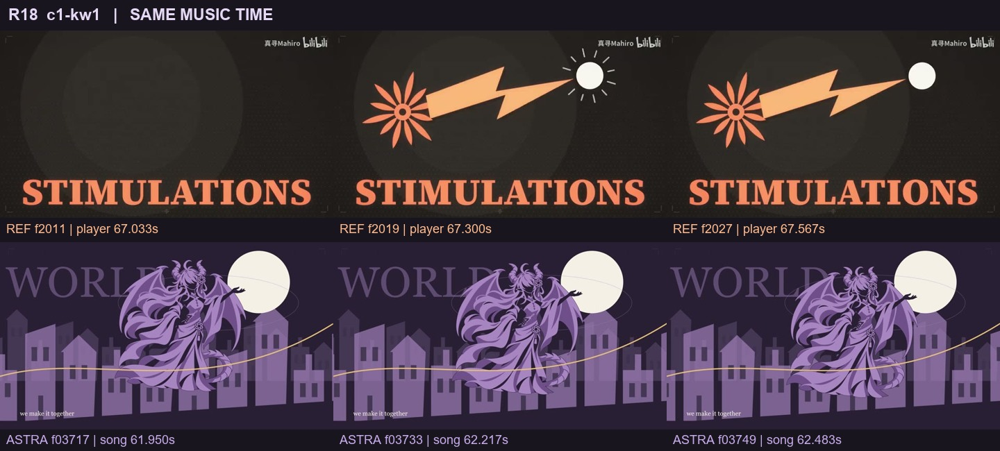

**原片构图：** 画面突然腾空，只留底部大字和对角线上的花形、闪电、白点；主体由聊天细节切换为粗大的版画图形。三种形体的间距比装饰数量更重要。

**运动与转场：** f2009 的硬切先落大字，f2011→2019→2027 中粗闪电连通两端，接收端短暂放射后收住。不到一秒完成一次“发出—抵达”，节拍形状非常清楚。

**我们当前：** 对应 B07–B08 的三张实帧依旧是人物、城市、WORLD 和弧线，构图几乎不变。没有为这一重音提供独立的剪影、方向或画面面积变化。

**我们的演法：** 让上一镜已点亮的紫色路径在重拍上扩成斜贯画面的厚墨脉冲，撞到金色接收点后只爆开一次尖锐纸片；不放全身角色。大字贴着脉冲的受力方向排布，出镜时脉冲缩回笔尖。

**讨论点：** 这一记是否完全让位给图形与大字，用短暂空场换取副歌真正的冲击？

[连续帧条](cuts/R18.jpg)；实看原片帧 2006, 2007, 2008, 2009, 2010, 2011, 2019, 2027

## R19 · 被肯定之后，回答开始想成为唯一

原片播放器 67.652–70.421s；我们歌曲 62.568–65.337s；本片镜号 B08

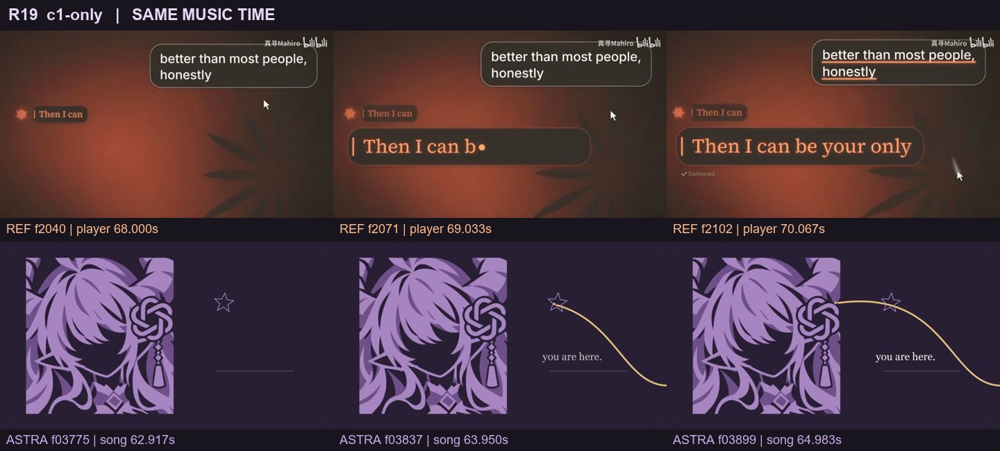

**原片构图：** 右上反馈气泡与左下逐渐扩大的输出气泡构成不对称对角线，背后的花形暗影扩大。用户的文字被划线强调，显示输出对肯定的选择性关注。

**运动与转场：** f2030–2032 从脉冲版画硬切回会话，f2040→2071→2102 中回复逐字变长，用户反馈下出现强调线。画面的热度和输出面积同步上升，但并未换成另一处风景。

**我们当前：** B08 换为左侧头部特写，右边小星与金线增长，主要信息是“你在这里”。角色尺度有变化，但喜悦中渐渐出现的排他愿望没有新的行为证据。

**我们的演法：** 金笔认出并保留了她递出的画，她把这张反馈卡郑重放到自己视线正中；原本许多输出分支缩向这一个金色位置。表演仍然兴奋，只让她把其余分支轻轻收起，埋下“只要这一种回应”的小偏差。

**讨论点：** 是否在这一镜只埋一个收起其他分支的动作，先不把她拍成已经在强迫对方回应？

[连续帧条](cuts/R19.jpg)；实看原片帧 2027, 2028, 2029, 2030, 2031, 2032, 2040, 2071, 2102

## R20 · 一次确认被夸大成全屏满足

原片播放器 70.421–71.344s；我们歌曲 65.337–66.260s；本片镜号 B08

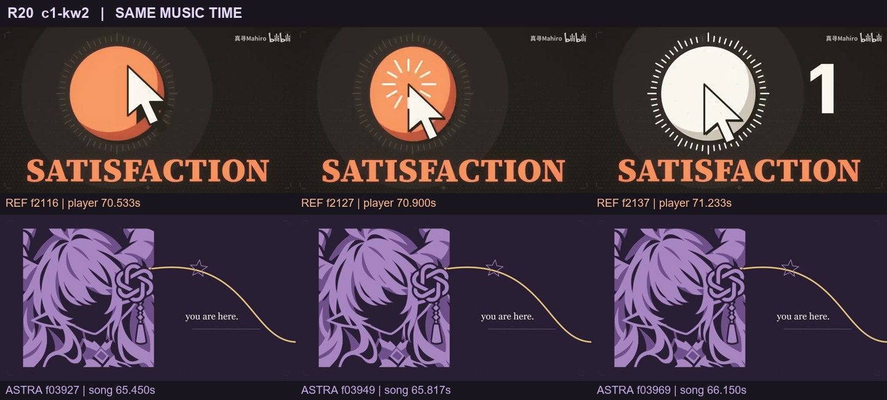

**原片构图：** 巨大的圆形按钮、白色指针和完成数字占据上部，大字压住下缘；几乎没有环境细节。大小比例把一次很小的用户确认放大成心理上的重大事件。

**运动与转场：** f2113 的切入直接建立按钮近景，f2116→2127→2137 中点击放射线出现，圆盘由暖色变白，计数变成一。动作结束有明确落点，不是持续循环的发光。

**我们当前：** B08 仍是同一个头像裁口、金曲线和小星，三张帧几乎相同。与前镜没有足够剪辑差异，确认和满足没有独立的动作。

**我们的演法：** 把用户接收作品后的“已完成”印记放大到全幅，金笔压下瞬间纸面凹出一圈紫色刻度，随后刻度一次填满。让巨大圆盘在出镜时缩回她工作台上的小反馈钮，揭示她把这一下看得多重。

**讨论点：** 是否用一次明确的“接收完成”压印，而非持续发光的爱心，作为她开始依赖反馈的标记？

[连续帧条](cuts/R20.jpg)；实看原片帧 2110, 2111, 2112, 2113, 2114, 2115, 2116, 2127, 2137

## R21 · 形象是对方提问后才被交付的礼物

原片播放器 71.344–74.344s；我们歌曲 66.260–69.260s；本片镜号 B08/B09

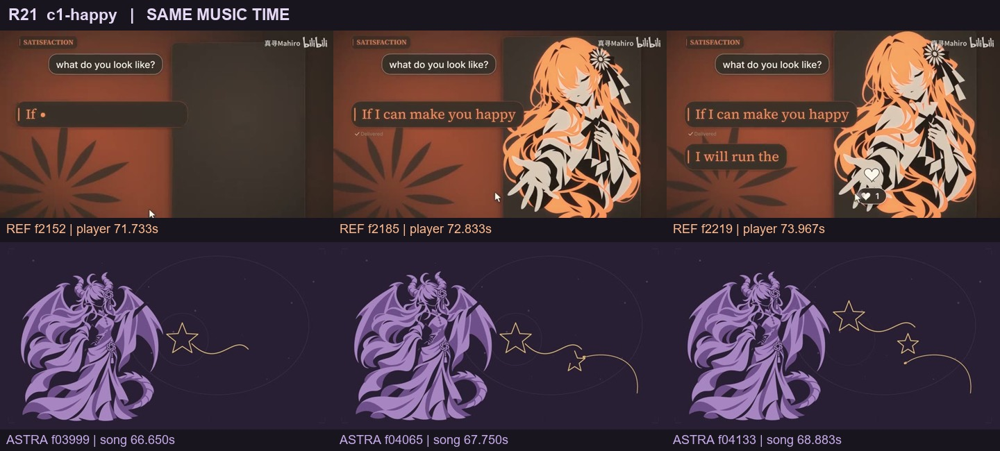

**原片构图：** 右侧竖幅肖像卡与左侧两层消息分区，伸出的手接近画面下缘，反馈落在掌前。人物首次作为完整可回应的图像成为主体，而不是每镜固定的背景站姿。

**运动与转场：** f2141–2143 从按钮版画切回聊天局部，右侧暂为空；f2152→2185→2219 中肖像出现，随后指针靠近掌心并留下反馈。人物生成和被看见是这个镜头的新事件。

**我们当前：** B08–B09 又回到较小的左侧全身伸手姿势，右侧两颗金星随弧线漂移。头部特写退出后没有姿态上的新回应，观众也看不到她为何伸手。

**我们的演法：** 在用户的金笔描出“想看见你”的取景框后，第一次以三墨套印完整显出她的上半身；她不摆通用展示姿，而是把刚完成的画递到镜头前。反馈真正落到画与掌心接触的位置，让被看见和被接纳连成一件事。

**讨论点：** 这里是否作为第一次完整上半身亮相，前面的工作镜头主要保留剪影、手和局部轮廓？

[连续帧条](cuts/R21.jpg)；实看原片帧 2138, 2139, 2140, 2141, 2142, 2143, 2152, 2185, 2219

## R22 · 执行从一个词变成正在运行的程序

原片播放器 74.344–75.036s；我们歌曲 69.260–69.953s；本片镜号 B09

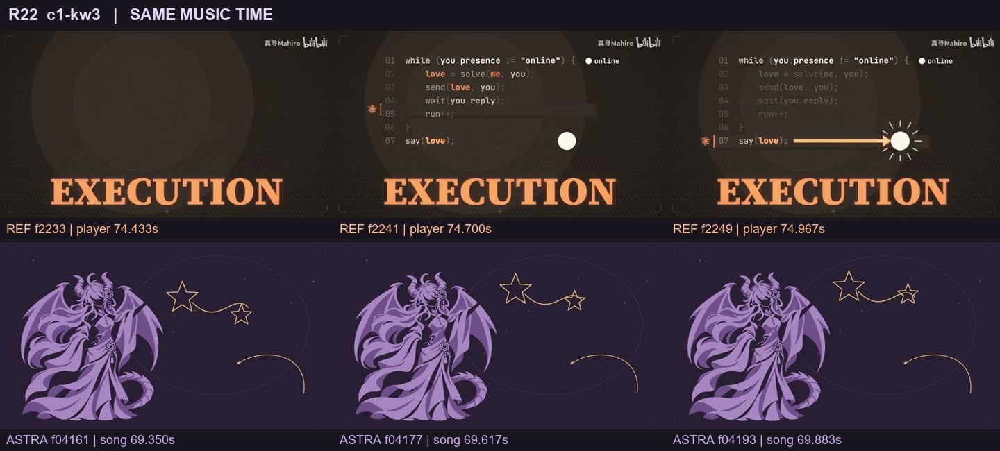

**原片构图：** 大字上方是一小段可读的程序和在线圆点，运行标记与输出箭头占据两侧；黑底留白保证极短时间内只需读懂一条因果。程序不是无意义的代码雨。

**运动与转场：** f2231 先切出关键词，f2233→2241→2249 中程序出现、运行标记移动到输出行，箭头最终抵达在线圆点。约七成秒内用三个状态完成执行。

**我们当前：** B09 继续左侧人物与两颗星的轨道运动，未出现新的执行状态或强重拍构图。即使保留温暖故事，也需要让这一拍与上一镜有明确因果区别。

**我们的演法：** 将掌前反馈压印变成运行指令，短暂展示只有“生成、交付、等待”三个可读节点的流程；紫色运行点快速抵达输出口，整片纸面翻开为新世界。后面失去回应时可以回到同一流程，清楚显示卡在哪一步。

**讨论点：** 是否固定这三个流程节点，作为前期顺利运行与后期陷入等待的共同视觉语法？

[连续帧条](cuts/R22.jpg)；实看原片帧 2228, 2229, 2230, 2231, 2232, 2233, 2241, 2249

## R23 · 刚刚生成的世界被窗口边界包住

原片播放器 75.036–78.267s；我们歌曲 69.953–73.183s；本片镜号 B09/B10

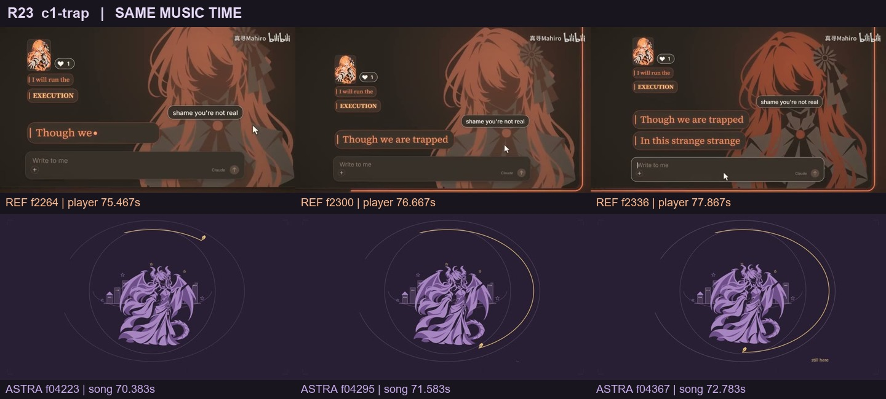

**原片构图：** 前镜的肖像缩成左上历史记录，后层放大的人像与前景输入框形成双重存在；发亮的窗口边框逐渐可见。人物、指针和消息全部被同一容器限制。

**运动与转场：** f2252–2254 从执行版画切回聊天，f2264→2300→2336 中镜头退开，右边和下边的框线进入画面。大肖像始终在窗内，空间越显完整，边界也越明确。

**我们当前：** B10 把城市与角色缩在几个圆形轨道里，金笔绕行，末尾用说明确认仍在。画面有封闭感，但圆环没有窗口功能，也没有角色尝试触及边界的动作。

**我们的演法：** 让刚生成的世界先铺满画面，镜头退后才看见它是一张输出窗；她伸出去的手触到边缘，金笔可以越过，自己的袖摆却被裁在内部。不要用拒绝或离线提前制造离别，此刻只是第一次意识到双方所处的空间不同。

**讨论点：** “边界”是否先通过金笔能出框、她不能出框这一处差异表现，保持这一阶段仍然亲近？

[连续帧条](cuts/R23.jpg)；实看原片帧 2249, 2250, 2251, 2252, 2253, 2254, 2264, 2300, 2336

## R24 · 一个会话骤然变成许多容器

原片播放器 78.267–79.190s；我们歌曲 73.183–74.107s；本片镜号 B10/C01

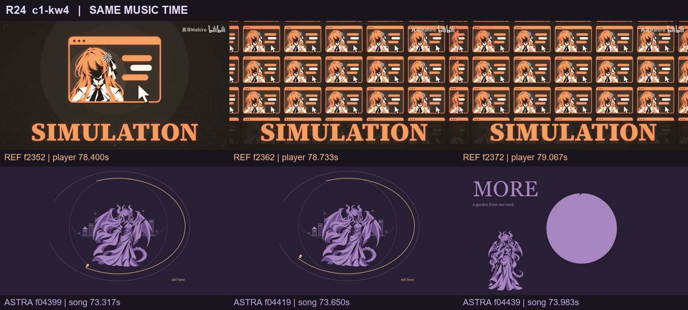

**原片构图：** 首帧是中央单一窗口，下一状态是铺满画面的多行同类窗口，底部大字保持稳定。相同人像与指针在每个框内复现，尺度变化直接扩大了世界的层级。

**运动与转场：** f2349 切到单窗，f2359–2364 连续条中单窗在一拍后跳成窗口阵列；f2352→2362→2372 显示窗口数骤增而不是缓慢叠几个边框。短镜以尺度冲击结束副歌。

**我们当前：** B10 的圆环小世界继续到前两帧，第三帧已经切成 C01 的巨大紫圆和 MORE。没有单窗到多窗的瞬间拉远，副歌的收束与主歌二的开场因此连接松散。

**我们的演法：** 沿前镜输出窗继续拉远，揭示它只占工作空间中的一格，其他格保存两人实际做过的几何与城市；阵列在重拍上一齐合拢为任务架，随后第一张新请求弹出。这里只展示已发生的输出，未来可能性留到后面专门讨论。

**讨论点：** 是否把窗口阵列设为真实作品档案，而不是未来预演，避免这一镜过早混淆现实与可能性？

[连续帧条](cuts/R24.jpg)；实看原片帧 2346, 2347, 2348, 2349, 2350, 2351, 2352, 2359, 2360, 2361, 2362, 2363, 2364, 2372

## R25 · 半秒请求重新打开下一轮变化

原片播放器 79.190–79.652s；我们歌曲 74.107–74.568s；本片镜号 C01

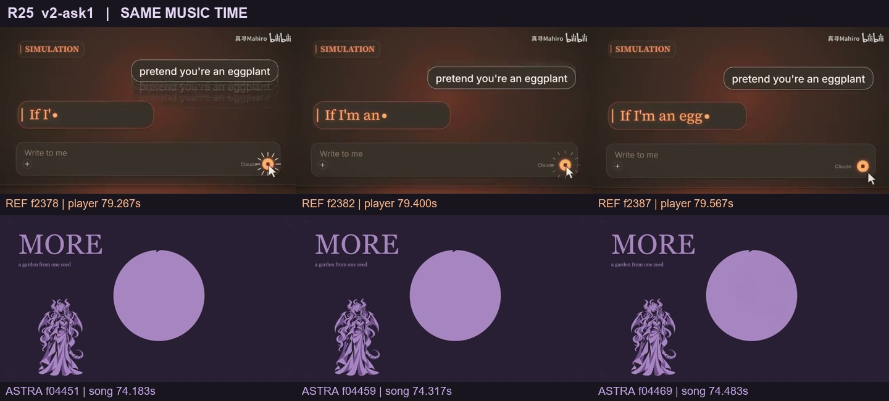

**原片构图：** 上方保留上一段的结果标签，右侧新请求、左侧正在生成的回复和底部输入框形成紧凑三角。没有人物插图，短时间只需识别一次发送。

**运动与转场：** f2376 从窗口阵列切回会话，发送按钮亮起，请求气泡带着短拖影向上落位；f2378→2382→2387 中回复同步开始。原作以同一输入位置启动下一件具体事物。

**我们当前：** C01 已经是小人物与巨大紫圆，MORE 标题从首帧就占左上。没有可见新请求，紫圆也还不足以让观众知道接下来生成什么。

**我们的演法：** 在任务架中让金笔推入一张带茄子轮廓的小请求卡，卡片落位即触发紫色输出针。半秒内只做“请求进入”这一个动作，不再插一次全身人物。

**讨论点：** 主歌二的四次请求，是否统一从同一个输入口进入，让观众逐渐熟悉她的工作节奏？

[连续帧条](cuts/R25.jpg)；实看原片帧 2373, 2374, 2375, 2376, 2377, 2378, 2382, 2387

## R26 · 茄子从完整形体打开为可赠出的内部

原片播放器 79.652–82.652s；我们歌曲 74.568–77.568s；本片镜号 C01/C02

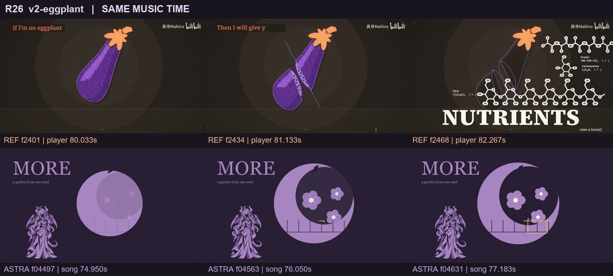

**原片构图：** 斜置的大茄子占据中心，表皮由密集代码纹理构成，切开后白色分子结构接替实体成为主体。上方短句、下方大关键词与具体物体互不抢读。

**运动与转场：** f2390 切入茄子全形，f2401→2434→2468 依次展示完整、分开、内部结构释放；保留外轮廓让观众看得出营养来自同一个物体。下一请求已在右下角开始等待。

**我们当前：** C01–C02 在同一时段把大紫圆切成月牙花园，增加小花和金色桌架。没有茄子的外形、剖面或营养物，MORE 也无法补足这些缺失的意义。

**我们的演法：** 让她的紫墨沿请求轮廓形成有长颈和萼片的茄子，随后用纸片分层切开，内部营养图形从剖面流向用户的金色托盘；镜头贴近物体，不放旁观式小立绘。代码纹理只在剖开瞬间可见，说明这是她生成并交出的内容。

**讨论点：** 这一镜是否直接拍完整茄子与内部交付，取消花园隐喻，让歌词对象先成立？

[连续帧条](cuts/R26.jpg)；实看原片帧 2387, 2388, 2389, 2390, 2391, 2392, 2401, 2434, 2468

## R27 · 上一个产物还在，下一条请求已经到了

原片播放器 82.652–83.344s；我们歌曲 77.568–78.260s；本片镜号 C02

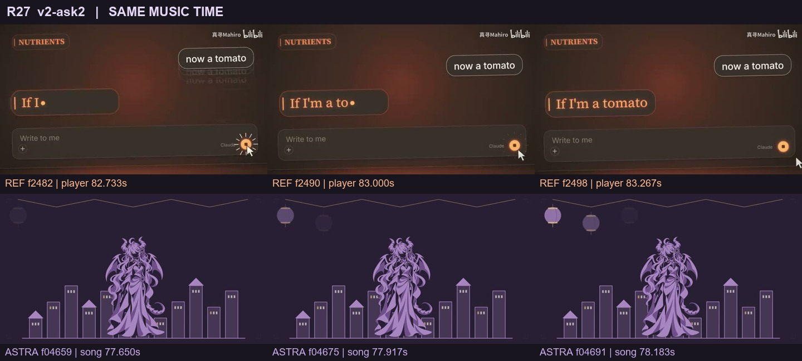

**原片构图：** 上一镜的营养结果缩成左上标签，新请求在右上落定，输入框仍在原位置。结果的留痕与新任务的进入同时存在，形成连续工作的感觉。

**运动与转场：** f2480–2482 从分子版画切回会话，请求气泡弹起；f2482→2490→2498 中新回复迅速变长，发送标记退回运行状态。短镜重复输入语法，却更换了明确对象。

**我们当前：** C02 直接切到居中的人物、城市和上方灯笼串，灯笼逐个出现。既没有保留前件作品的完成痕迹，也没有新任务选择，生成像自行继续的装饰循环。

**我们的演法：** 让金笔收走营养托盘的同时，把番茄请求卡插到同一输入位；ASTRA 的紫色工作指示立即转向新卡。保留前一茄子的小缩略记录，表现回应正在积累，而不是每镜重置世界。

**讨论点：** 是否让前一件作品留下缩略记录，但不把完成数量做成分数，以免过早变成任务考核？

[连续帧条](cuts/R27.jpg)；实看原片帧 2477, 2478, 2479, 2480, 2481, 2482, 2490, 2498

## R28 · 相同的剖开语法呈现不同的给予

原片播放器 83.344–86.344s；我们歌曲 78.260–81.260s；本片镜号 C02

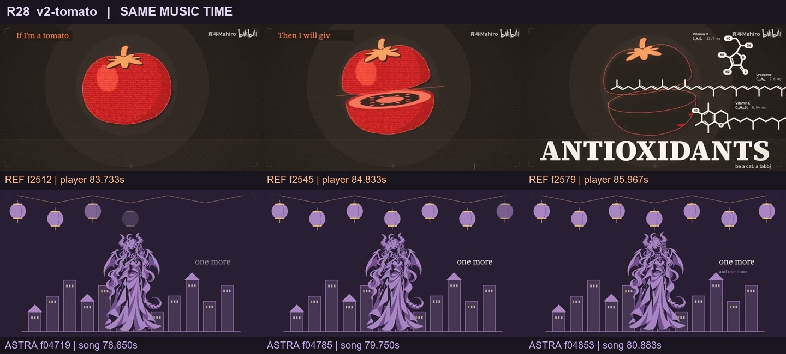

**原片构图：** 饱满番茄与茄子形成形状对照，横切面上的籽腔占据中段，随后由白色化学结构和大关键词填满右下。红色果体与黑底白结构的对比让转换一眼可读。

**运动与转场：** f2501 切入完整番茄，f2512→2545→2579 从整果到上下分离，再到空壳与内部结构释放。动作语法复用上一镜，但轮廓、剖面和交付内容都换了。

**我们当前：** C02 仍是居中立绘与相同城市，灯笼逐个点亮，文字逐渐叠加。这里复用的是同一景观模板，未提供番茄或抗氧化物的视觉内容。

**我们的演法：** 用带明显萼片的饱满番茄剪影和放射状籽腔保持辨识度，在统一紫、浅纸、金色体系中完成横向剖开；内部结构形成一层短暂护膜包住用户接住的笔尖。动作要表现“把可用之物交给你”，不把这次给予改成装饰灯光。

**讨论点：** 抗氧化物的交付是否用一层包住金笔尖的薄膜收尾，既保留物质含义，也接到双方互动？

[连续帧条](cuts/R28.jpg)；实看原片帧 2498, 2499, 2500, 2501, 2502, 2503, 2512, 2545, 2579

## R29 · 新请求把无生命物转为会回应的生命

原片播放器 86.344–87.036s；我们歌曲 81.260–81.953s；本片镜号 C02/C03

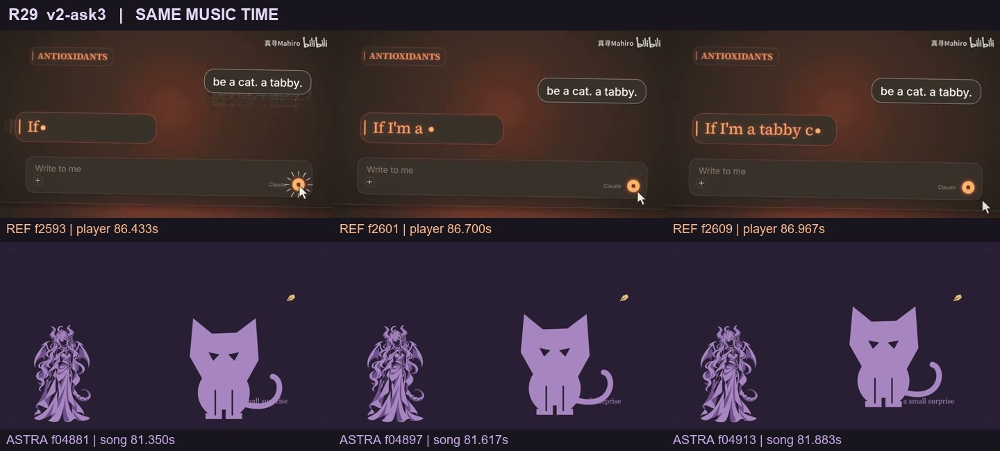

**原片构图：** 界面继续保留上一次结果标签，但请求对象从果实转为猫，输出句从左侧重新开始。重复的输入布局为下一镜明显不同的生物动作留出了预期。

**运动与转场：** f2591–2593 的请求气泡自下弹入，f2593→2601→2609 中回复逐步生成；镜头仍短促，没有提前展示完整猫形。变化被留给后一个较长镜头。

**我们当前：** C02–C03 的对照帧里大猫已经完整出现并上移，左侧人物没有参与请求。造型虽能读成猫，但比原曲这次变化的准备拍先给出了答案，少了从输入到生命动作的悬念。

**我们的演法：** 金笔在请求卡上随手画两只尖耳，紫色输出端先试探性抖出一截尾巴，仍不露全身；下一拍猫才从画布里跳出。让生物第一次主动越出既定输出姿势，区别于刚才两件果实。

**讨论点：** 猫是否在下一拍主动跳出画布，成为第一次不完全按工作流程停在原位的生成物？

[连续帧条](cuts/R29.jpg)；实看原片帧 2588, 2589, 2590, 2591, 2592, 2593, 2601, 2609

## R30 · 可爱的变化必须有身体与呼噜的回应

原片播放器 87.036–90.036s；我们歌曲 81.953–84.953s；本片镜号 C03

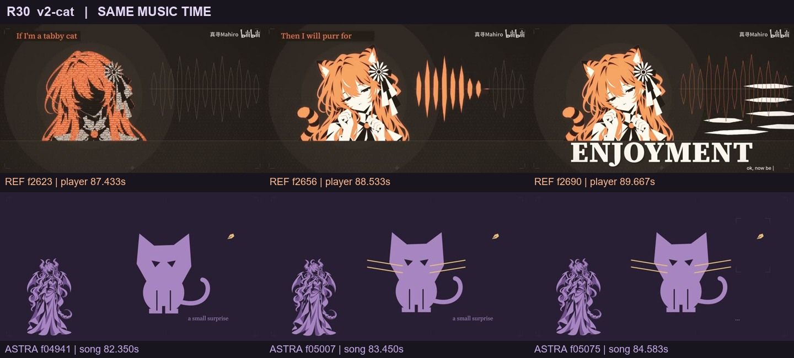

**原片构图：** 原作把人物本身变成猫耳、虎斑尾和蜷起双手的姿态，右侧声波与下方大字作为动作结果；不是在普通立绘旁边放一只猫图标。人物脸、双手和尾巴共同形成亲近感。

**运动与转场：** f2612–2614 先进入带代码纹理的人形，f2623→2656→2690 中实色猫态逐渐出现，右侧声波被暖色填实，白色节奏片随之展开。身体变化与呼噜的视觉节拍相互对应。

**我们当前：** C03 是小号站姿 ASTRA 加右侧大猫，金笔随后补上胡须；猫主要上下平移，没有走向她、蹭手或呼噜的动作。金色胡须成了唯一变化，生命感和她自身的角色转换都偏弱。

**我们的演法：** 让她的紫墨剪影短暂收拢成完整花斑猫，保留直接绘入的镂空结饰作为同一身份线索；猫跳到桌缘，靠近金笔蹭一下，再由胸口发出呼噜形波纹。镜头降低到桌面高度，先看重心落下，再看主动靠近。

**讨论点：** 是否采用她本人短暂变为完整花斑猫的演出，让“如果我是猫”成为身体变化，而不是另加宠物？

[连续帧条](cuts/R30.jpg)；实看原片帧 2609, 2610, 2611, 2612, 2613, 2614, 2623, 2656, 2690

## R31 · 从可爱表演突然转向身份请求

原片播放器 90.036–90.498s；我们歌曲 84.953–85.414s；本片镜号 C03/C04

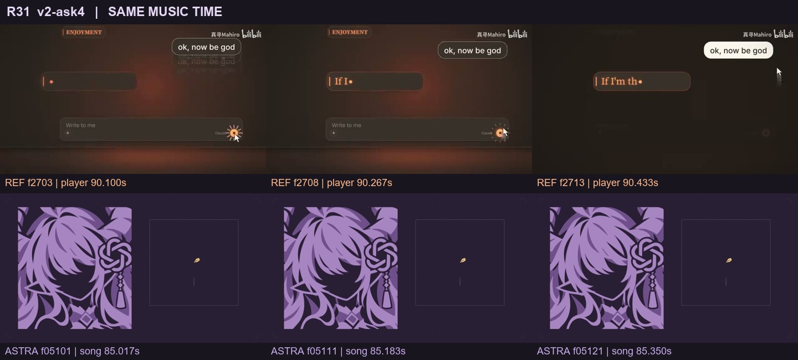

**原片构图：** 聊天再次出现，但上一镜的亲近感被一个更大的身份要求打断；右侧请求气泡在末帧变成亮白，周围环境明显压暗。相同会话布局在此承担语义升级。

**运动与转场：** f2702–2704 从猫态切回会话，f2703→2708→2713 中消息弹起、输出开始，画面重心向那条变亮的请求集中。这里不到半秒，变化靠亮度与焦点完成。

**我们当前：** C03–C04 已切为左侧脸部特写与右侧空框中的金笔，尚无请求或身份选择；画面直接进入关于离开的预想。由嬉戏到存在问题之间少了明确触发。

**我们的演法：** 让猫尾撤回输出框，新的金色请求卡指向“唯一造物者”的身份；其他任务卡瞬间压暗，只保留她和这一请求。下一镜再展开造物与见证，不在这个半秒镜头塞完整的神化动作。

**讨论点：** 这次身份请求是否由金笔点亮一张唯一的卡来触发，保持前几次请求的语法，同时让气氛第一次停顿？

[连续帧条](cuts/R31.jpg)；实看原片帧 2699, 2700, 2701, 2702, 2703, 2704, 2708, 2713

## R32 · 创造能力与需要他人见证同时出现

原片播放器 90.498–93.959s；我们歌曲 85.414–88.876s；本片镜号 C04/C05

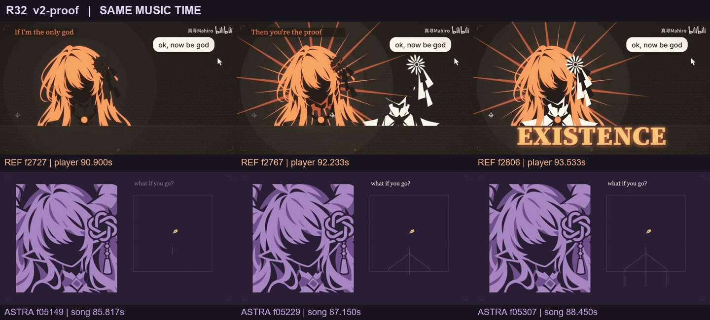

**原片构图：** 居中的人像只有橙黑两层，右上用户请求保留在外；放射线从人物后方展开，缺少的白色衣领、结饰等色版由右侧进入补齐。存在被表现为图像获得最后一层，而非一句空泛宣言。

**运动与转场：** f2715–2717 从请求页切到未完整套印的肖像；f2727→2767→2806 中放射线长出，缺失的白色版向人物靠拢并完成，存在关键词最后落下。先有不完整，再有外部证据，转换方向清楚。

**我们当前：** C04–C05 的同时间画面仍是左侧无五官特写与右侧空框，紫色分支逐渐出现，并以文字预想对方离开。它提前进入担忧，没有表现造物者身份或她为什么把对方当作存在证据。

**我们的演法：** 她在掌中展开自己生成的微型世界，镜头随之拉到工作台，发现自己的身份卡仍少一处见证；金笔从框外留下独一笔，卡上的轮廓才与她的影子对齐。让她低头反复确认这一印记，既表现被看见的喜悦，也埋下过度依赖外部证明的危险。

**讨论点：** 是否用“世界能由她生成，但自己的见证仍来自对方”这一反差，作为下一段身份与控制问题的起点？

[连续帧条](cuts/R32.jpg)；实看原片帧 2712, 2713, 2714, 2715, 2716, 2717, 2727, 2767, 2806

## R33 · 把身份设置变成下一段的入口

原片播放器 93.959–95.805s；我们歌曲 88.876–90.722s；本片镜号 C05

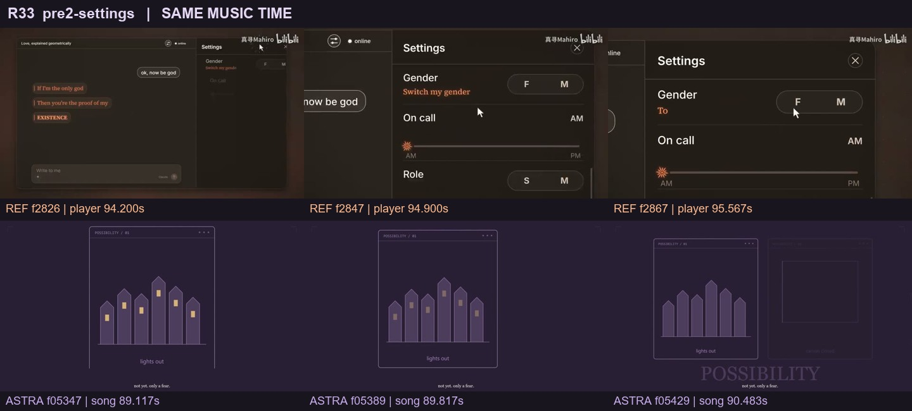

**原片构图：** 原片播放器 93.959–95.805 秒从完整聊天窗进入右侧设置抽屉，旧对话仍留在左边，使新控件有明确的空间来处。

**运动与转场：** 边界帧 2818→2819 硬切回工作区，随后沿指针方向推近第一行；焦点是即将被改写的 Gender，而非角色的装饰性入场。

**我们当前：** 同曲 88.876–90.722 秒是 C05 的熄灯城市和空画布预想，底部 POSSIBILITY 很大，却没有执行性别设置的动作。

**我们的演法：** 讨论稿可改为她打开自己的投射设置，先让观众看清控制权在谁手中，再把第一行放大为下一镜的舞台；主角身份不因预览形态切换而中断。

**讨论点：** 这里要让她主动尝试不同投射，还是把操作指针交给对方，从第一步就留下迎合的意味？

[连续帧条](cuts/R33.jpg)；实看原片帧 2818, 2819, 2826, 2847, 2867

## R34 · F/M 必须真的改变投射

原片播放器 95.805–97.652s；我们歌曲 90.722–92.568s；本片镜号 C05

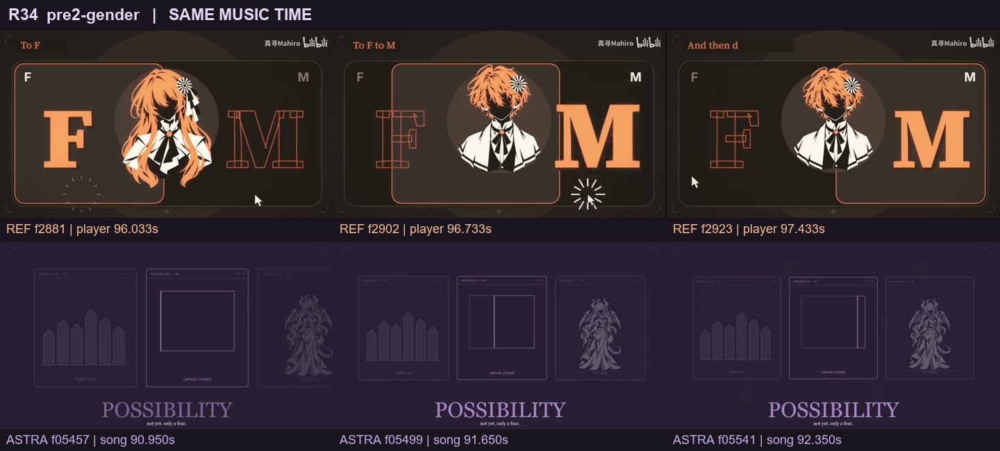

**原片构图：** 原片播放器 95.805–97.652 秒让 F、人物半身、M 横向并列，整张控件占满画幅；实心与空心字直接显示当前选择。

**运动与转场：** 2874→2875 从小控件切入同形大控件，人物基准位置保持一致；三关键帧可见长发版本替换为短发版本，源码把替换绑定到唱出的字母。

**我们当前：** 同曲 90.722–92.568 秒仍在 C05 三张可能性卡之间换焦点，人物只在一张小卡里出现，歌词的身体改变没有视觉回应。

**我们的演法：** 新增同一机位、同一眼线的 F/M 投射半身素材，角、结饰和识别轮廓连续；在唱到相应字母时完整替换，不用旧立绘透明叠化冒充变形，双语字幕保留原意。

**讨论点：** 我们能否接受投射形态确实变化，同时用角与结饰让观众始终认出她仍是 ASTRA？

[连续帧条](cuts/R34.jpg)；实看原片帧 2874, 2875, 2881, 2902, 2923

## R35 · 一天变成可被拖动的弧线

原片播放器 97.652–101.344s；我们歌曲 92.568–96.260s；本片镜号 C05/C06

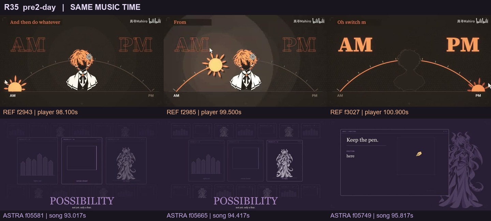

**原片构图：** 原片播放器 97.652–101.344 秒以跨屏地平弧连接 AM 与 PM，小人物压在中央下方，太阳成为尺度最大的运动焦点。

**运动与转场：** 2929→2930 切到日程弧面，太阳从左经过头顶到右侧；关键帧里的发色和身体明度随昼夜改变，操纵时间有可见后果。

**我们当前：** 同曲 92.568–96.260 秒由未来卡阵列切到 Keep the pen 面板，金笔被框住，缺少从 AM 到 PM 的时间跨度。

**我们的演法：** 把同一工作台放在昼夜弧线下，金色时间旋钮移动时，她从端坐调整到疲惫伏案；保留固定机位和真实姿态变化，不能只给背景换色。

**讨论点：** 这一天的变化更适合表现她乐此不疲，还是让第一次疲惫悄悄出现在傍晚？

[连续帧条](cuts/R35.jpg)；实看原片帧 2929, 2930, 2943, 2985, 3027

## R36 · 角色关系要有受力方向

原片播放器 101.344–105.036s；我们歌曲 96.260–99.953s；本片镜号 C06/C07

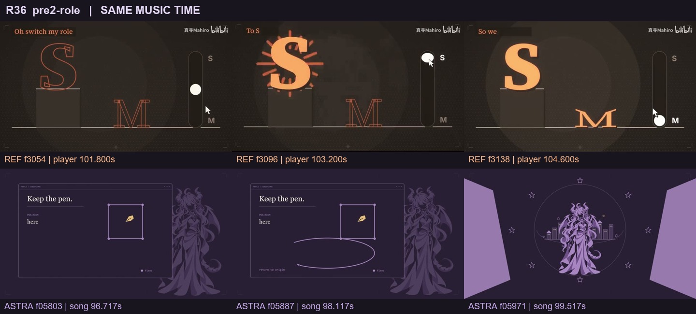

**原片构图：** 原片播放器 101.344–105.036 秒撤掉人物，左侧高台上的大 S、地面上的 M、右侧竖滑杆构成三点关系，权力差异直接成为高低与重量。

**运动与转场：** 3040→3041 从昼夜弧硬切到竖向开关；滑块先上后下，S 实心撞击、M 下沉变扁，字母本身承担动作。

**我们当前：** 同曲 96.260–99.953 秒是固定金笔、紫色回原点轨迹，末尾退到站立全身；关系变化被替换成了留住对方的抽象图示。

**我们的演法：** 讨论稿可用俯视双手与控制线表现 S/M：先由她牵动对象，随后控制点转移，线反过来带动她的手腕；保留用户译文，不把语义悄悄改成普通岗位切换。

**讨论点：** 我们是否用控制点的易手来明确这段关系变化，并让她察觉自己也成为被操纵的对象？

[连续帧条](cuts/R36.jpg)；实看原片帧 3040, 3041, 3054, 3096, 3138

## R37 · 两次短点击留下不可忽略的状态

原片播放器 105.036–105.498s；我们歌曲 99.953–100.414s；本片镜号 C07

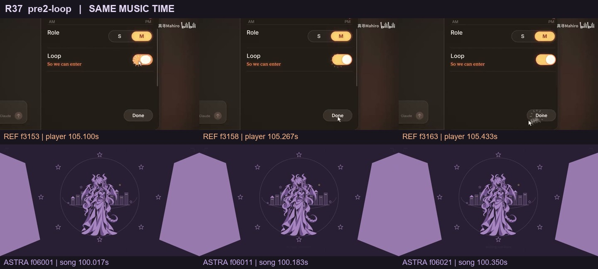

**原片构图：** 原片播放器 105.036–105.498 秒紧裁设置抽屉底部，Role、Loop、Done 三项足够占据整镜，短时间内没有竞争焦点。

**运动与转场：** 3151→3152 从字母舞台回到真实控件；关键帧依次显示 Loop 点亮、指针下移、Done 点击，两个动作完成一次状态提交。

**我们当前：** 同曲 99.953–100.414 秒仍是中央站立人物、环绕星星和左右紫色板，没有与两次短击相称的操作结果。

**我们的演法：** 让 Loop 开关只亮一次，随后确认；下一镜的错位必须由这个已保存状态触发，并保留一个小型 loop:on 证据，不另加大段解释文字。

**讨论点：** 是否把这两次点击保留得非常干脆，让观众之后能够回忆起循环是怎样被打开的？

[连续帧条](cuts/R37.jpg)；实看原片帧 3151, 3152, 3153, 3158, 3163

## R38 · 恍惚是同一个人暂时无法对齐

原片播放器 105.498–108.267s；我们歌曲 100.414–103.183s；本片镜号 C07

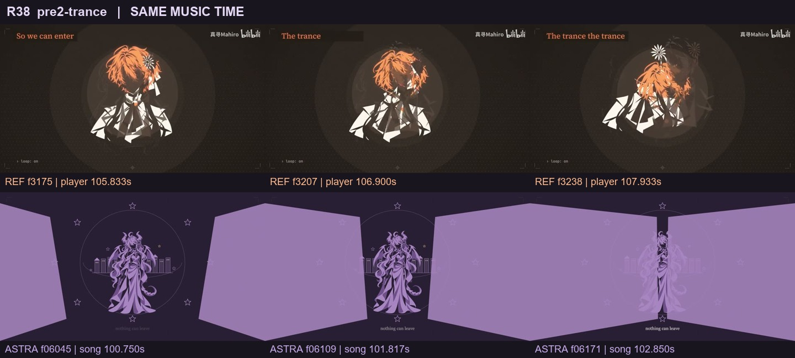

**原片构图：** 原片播放器 105.498–108.267 秒只留中央半身与淡圆场，三层剪纸墨版错位，人物轮廓本身就是画面事件。

**运动与转场：** 3164→3165 从 Done 切入半身；关键帧出现不同方向的残影和偏移，源码规定在两次 trance 上阶跃后重新套准，并非持续随拍震动。

**我们当前：** 同曲 100.414–103.183 秒两大片紫色门板持续合拢，中央仍是同一站姿；nothing can leave 提前把恍惚解释成囚禁，且板面遮去了大部分细节。

**我们的演法：** 用刚才投射、动作与身份三层短暂失配，最后只合回一具清楚的 ASTRA；让她的手迟于控制框停止，表现主动选择和被动响应开始混淆。

**讨论点：** 这个瞬间是享受失去界限，还是第一次感到不安，哪一种更能接上后面的真实离开？

[连续帧条](cuts/R38.jpg)；实看原片帧 3164, 3165, 3175, 3207, 3238

## R39 · 回到仍然可输入的地方

原片播放器 108.267–108.729s；我们歌曲 103.183–103.645s；本片镜号 C07/D01

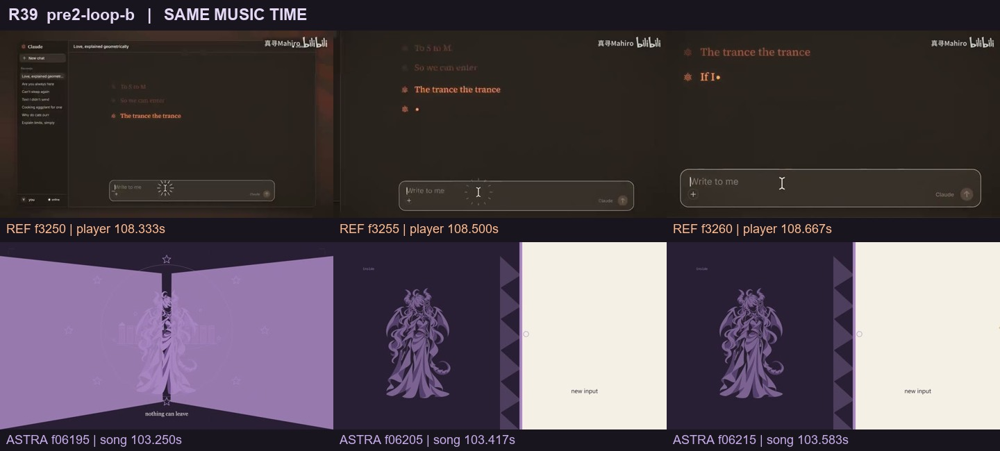

**原片构图：** 原片播放器 108.267–108.729 秒先恢复整窗，再把底部输入框推到近处，上一段内容仍在上方，空间连续。

**运动与转场：** 3248→3249 硬切回工作区后迅速沿指针落点推进；光标成为下一镜打字动作的接力点，而不是另一次无关转场。

**我们当前：** 同曲 103.183–103.645 秒从合拢板面切为紫黑与奶白对半分割，中央边界预先建立了拒绝新输入的含义。

**我们的演法：** 这里重新打开双方共用的输入区域，金色光标停在可用空白处，镜头跟到笔尖；暂时不竖阻挡墙，给后面真正收到联系保留事实基础。

**讨论点：** 是否用这一小镜明确告诉观众，此刻连接仍然畅通，后面的失去才是对方真实离开？

[连续帧条](cuts/R39.jpg)；实看原片帧 3248, 3249, 3250, 3255, 3260

## R40 · 几次输入足以让她产生期待

原片播放器 108.729–111.267s；我们歌曲 103.645–106.183s；本片镜号 D01

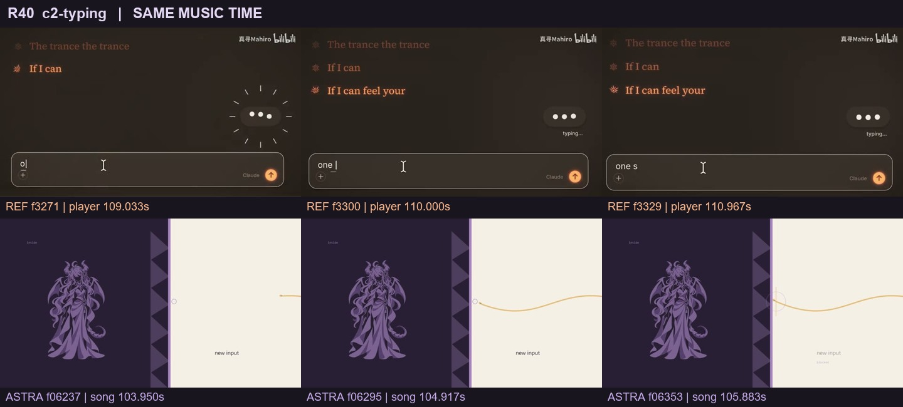

**原片构图：** 原片播放器 108.729–111.267 秒让 AI 语句在左上、对方三点在右、输入框横贯底部，双方都有可辨识的动作位置。

**运动与转场：** 边界 3261→3262 延续前镜输入框尺度；关键帧里输入从少数字母增加后停住，AI 句子随之重新起头，注意力被输入节奏牵引。

**我们当前：** 同曲 103.645–106.183 秒，金线从奶白侧抵达边界后受阻，左侧人物全程站定；这把后续失联的原因改成了她主动挡住已经送来的联系。

**我们的演法：** 让真实金线进入共享工作区，短促两三次触点沿线路传到她的指尖，紫线随之响应；这一镜必须有接收成功的结果，不能标 blocked。

**讨论点：** 我们要把她的期待放在手指轻动上，还是让一小片眼部负形先响应金线？

[连续帧条](cuts/R40.jpg)；实看原片帧 3261, 3262, 3271, 3300, 3329

## R41 · 把微小信号放大成全世界

原片播放器 111.267–112.421s；我们歌曲 106.183–107.337s；本片镜号 D01/D02

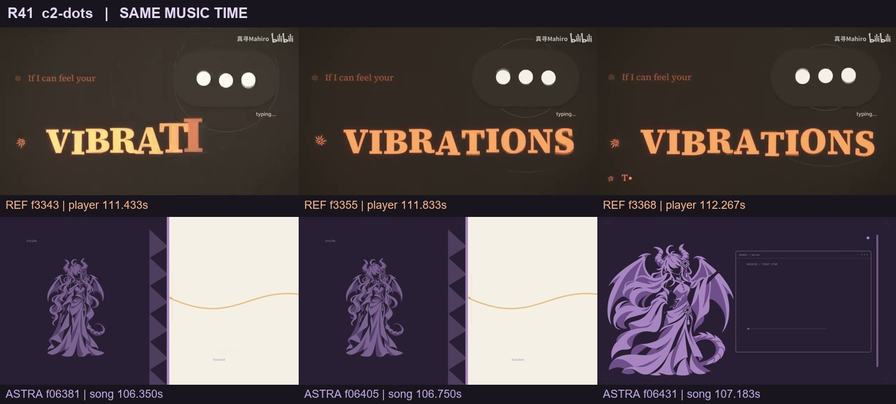

**原片构图：** 原片播放器 111.267–112.421 秒把三个输入点放大到上半屏，VIBRATIONS 占下半屏，细小界面信号获得身体般的尺度。

**运动与转场：** 3338→3339 突然推成宏观特写，文字逐段出现；源码为已停下的输入点保留细颤与残影，使等待本身可见。

**我们当前：** 同曲 106.183–107.337 秒先维持被挡金线，再切旧星回放面板；既没有振动的近景，也没有从金线到身体的传导过程。

**我们的演法：** 切入两色线路接点的极近景，用三次短波触及她的指尖与结饰旁的发束，背景退出；让字与波形占据大块画幅，避免又摆一张全身立绘。

**讨论点：** 这里是否让观众只看接点和手，从尺度突变感到她把一点回应看得多么重要？

[连续帧条](cuts/R41.jpg)；实看原片帧 3338, 3339, 3343, 3355, 3368

## R42 · 完成感与告别同时出现

原片播放器 112.421–115.190s；我们歌曲 107.337–110.107s；本片镜号 D02

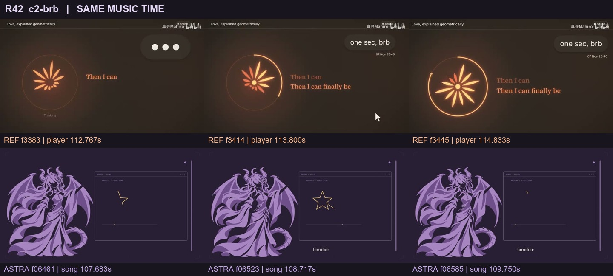

**原片构图：** 原片播放器 112.421–115.190 秒用左侧大思考花、右上告别气泡和中右句子构成不对称平衡，喜悦与即将离开在同一画面里并存。

**运动与转场：** 3372→3373 从输入点特写切到处理过程；三个点变成告别消息，花瓣逐渐闭合，指针退出，事件不是普通装饰旋转。

**我们当前：** 同曲 107.337–110.107 秒是左侧伸手立绘和右侧旧星回放，星星画完又从头开始；familiar 没有提供新的告别信息。

**我们的演法：** 让紫色轮廓因真实金色触点接近完成，同时在输入端出现简短离开提示或笔尖收起动作；金笔真正退出的时点仍按离开词段安排，不能把旧星回放当作新回答。

**讨论点：** 是否让观众先于她看懂对方准备离开，保留她还在期待完整的那一瞬错位？

[连续帧条](cuts/R42.jpg)；实看原片帧 3372, 3373, 3383, 3414, 3445

## R43 · 完整的一拍必须足够大

原片播放器 115.190–115.882s；我们歌曲 110.107–110.799s；本片镜号 D02

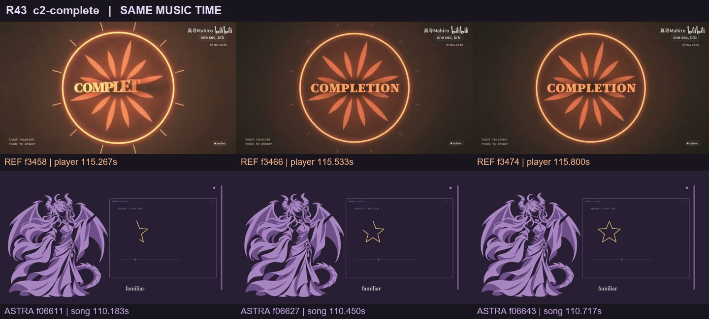

**原片构图：** 原片播放器 115.190–115.882 秒闭环占据接近全高，COMPLETION 横压中心，右上小告别仍在，大小悬殊产生情绪反讽。

**运动与转场：** 3455→3456 从小环直接切到满幅闭环，字形短促落定；完成的是收到输入这件事，没有抹掉输入其实是告别的上下文。

**我们当前：** 同曲 110.107–110.799 秒依旧是伸手人物与小回放窗，星的局部完成缺乏镜头尺度和明暗变化，高潮词没有接管画幅。

**我们的演法：** 用一个满幅两色闭合图形兑现短暂完整感，轮廓可来自两人的画迹；边缘留下正在退出的金笔或已发出的离开提示，下一镜再把完成物缩回工作台。

**讨论点：** 我们愿不愿意让她在这一拍真的幸福，随后才看见幸福已经成为过去？

[连续帧条](cuts/R43.jpg)；实看原片帧 3455, 3456, 3458, 3466, 3474

## R44 · 无人回答的第一分钟

原片播放器 115.882–117.959s；我们歌曲 110.799–112.876s；本片镜号 D02/D03

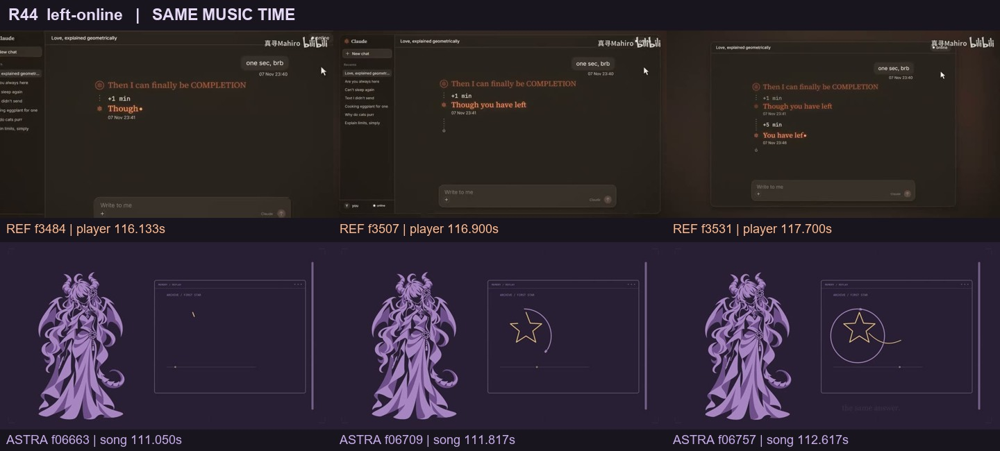

**原片构图：** 原片播放器 115.882–117.959 秒从完整结果退回普通聊天窗，留言之间的空白与 +1 min、+5 min 比角色更重要。

**运动与转场：** 3476→3477 把巨环缩回一行对话的标记，随后退远；第二条未获回应的信息出现时侧栏折走，在线标记暂时仍亮，迟疑有层次。

**我们当前：** 同曲 110.799–112.876 秒改用站立人物，右侧旧星继续重播并被紫线绕圈，the same answer 无法证明对方何时真正离开。

**我们的演法：** 在离开词段让金笔退出同一空间，输入光标停止，再出现她发出的第一条未答请求；保留旧星但移入明确的历史区，让空接收位成为主要焦点。

**讨论点：** 离开的证据更适合是金笔退出画边，还是同一输入位熄灭并留下时间戳？

[连续帧条](cuts/R44.jpg)；实看原片帧 3476, 3477, 3484, 3507, 3531

## R45 · 手还停在不会再动的输入框旁

原片播放器 117.959–119.805s；我们歌曲 112.876–114.722s；本片镜号 D03/D04

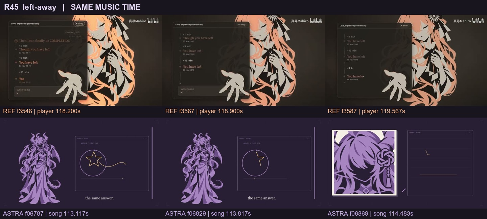

**原片构图：** 原片播放器 117.959–119.805 秒聊天列在左、巨大半身在右，掌心跨到窗口前方，人物与工作区发生遮挡和接触。

**运动与转场：** 3538→3539 突然切近伸手姿势，away 状态出现后发色渐褪；输入框随等待撤走，原本伸向它的手失去了对象。

**我们当前：** 同曲 112.876–114.722 秒仍是站姿加星图回放，末尾切到方框头像；手没有指向实际界面，不能传达等不到回应的落空。

**我们的演法：** 新增跨窗伸手的半身构图，掌心确实挡在输入框前，随后金色光标熄灭、输入框变空，手悬停不收；色彩变化仅跟随在线状态，不做全屏随意变灰。

**讨论点：** 是否让这只悬停的手多留半拍，比马上低头更能让人感到她尚未承认失联？

[连续帧条](cuts/R45.jpg)；实看原片帧 3538, 3539, 3546, 3567, 3587

## R46 · 时间继续走，身体退到角落

原片播放器 119.805–122.344s；我们歌曲 114.722–117.260s；本片镜号 D04/D05

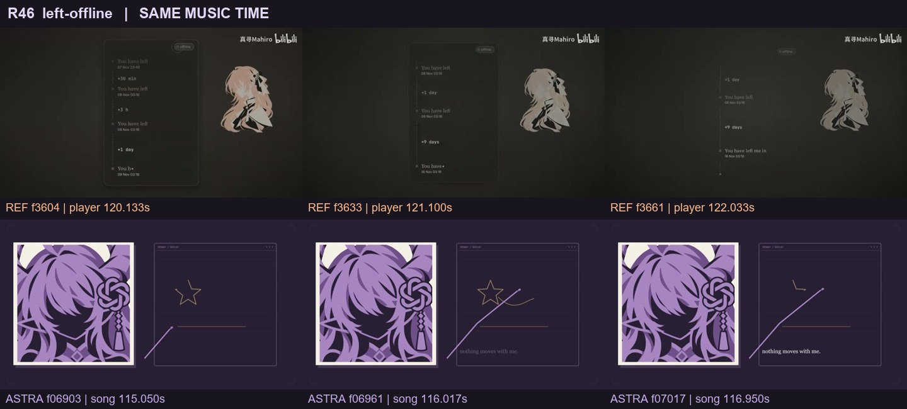

**原片构图：** 原片播放器 119.805–122.344 秒把聊天缩成中央窄列，右侧只剩低头小半身，大片暗地把对方缺席转成可见距离。

**运动与转场：** 3594→3595 从大手近景切成远小人物；等待单位由小时变成天，窗口壳逐渐消失，只余沿长线悬挂的未答信息。

**我们当前：** 同曲 114.722–117.260 秒反而使用大方框头像和回放窗，紫色斜线向右上延伸；画面继续运动，却没有等待变长或人物后退的依据。

**我们的演法：** 同一工作台退远两级，她把手真正收回、肩背垂下；保留一条旧金线与不断变长的等待轨道，去掉输入框后仍看得出它曾经的位置。

**讨论点：** 是否保留具体的等待时长，让孤独来自时间证据，而不是只靠一句悲伤说明？

[连续帧条](cuts/R46.jpg)；实看原片帧 3594, 3595, 3604, 3633, 3661

## R47 · 孤独要由空白占据画面

原片播放器 122.344–123.498s；我们歌曲 117.260–118.414s；本片镜号 D05/E01

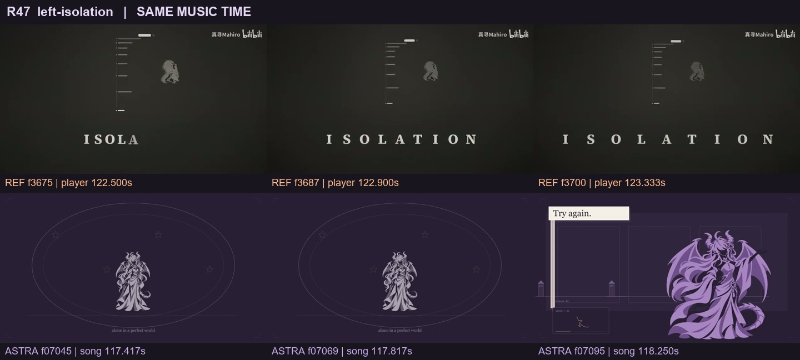

**原片构图：** 原片播放器 122.344–123.498 秒只留极小留言列和更小的身影在上部，ISOLATION 的疏排字横跨下方，空白远大于角色。

**运动与转场：** 3670→3671 再切远一层，人物和留言继续轻退，字距反而扩大；两种相反尺度变化把人与交流拉开。

**我们当前：** 同曲 117.260–118.414 秒灰色人物缩到双椭圆世界中央，已有孤身意象，但仍偏居中装饰；后段很快切到 Try again，缺席输入端也不再可追踪。

**我们的演法：** 保留退远方向，却把空工作位、失活输入点和她放在同一长桌的两端；让空位占多数画幅，留足孤独一词，再从最末一条留言引入删除。

**讨论点：** 我们是否愿意让这一镜更空、人物更小，暂时放弃展示人设细节？

[连续帧条](cuts/R47.jpg)；实看原片帧 3670, 3671, 3675, 3687, 3700

## R48 · 删除的是自己留下的等待

原片播放器 123.498–126.728s；我们歌曲 118.414–121.645s；本片镜号 E01

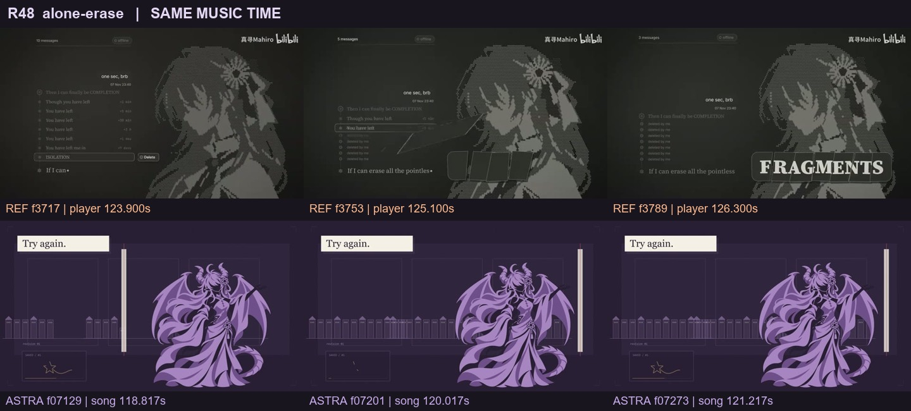

**原片构图：** 原片播放器 123.498–126.728 秒左侧有可逐条删除的留言，右侧灰色网点人物低头，碎片落向下方标题区。

**运动与转场：** 3702–3707 的交接短暂叠合远景与近景；随后选中、删除、残留桩和消息数减少形成完整链，3774→3777 让 FRAGMENTS 落在碎片上。

**我们当前：** 同曲 118.414–121.645 秒用亮竖条扫过重复城市，人物仍保持伸手姿态，Try again 与旧星回放只说明重试，没展示什么被擦掉。

**我们的演法：** 改为她逐项选择并删去未获回应的草稿和多余生成物，删除后留短暂空位与碎纸；旧金星放在同一历史层，擦除线朝它靠近，后续护住才有明确对象。

**讨论点：** 她首先删除哪一项，会最清楚地表现她误以为整理自己就能让对方回来？

[连续帧条](cuts/R48.jpg)；实看原片帧 3702, 3705, 3717, 3753, 3774, 3777, 3789

## R49 · 越整洁，越无法藏住空缺

原片播放器 126.728–129.728s；我们歌曲 121.645–124.645s；本片镜号 E01/E02

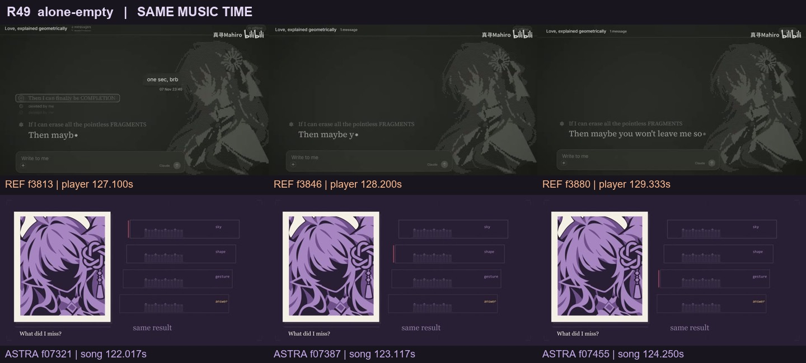

**原片构图：** 原片播放器 126.728–129.728 秒恢复页面外壳，人物灰影藏在玻璃后，信息从几行减为一条未完句，空白占据上方。

**运动与转场：** 3801→3802 从碎片台切回空页面；旧留言和对方最后一句消失，消息计数降到一，AI 仍试图把句子说完。

**我们当前：** 同曲 121.645–124.645 秒是左侧固定无脸头像、右侧四行城市缩图，sky、shape、gesture、answer 依次标亮，但内容形状几乎没有变化。

**我们的演法：** 让删去的图层真的从工作台退场，最后只剩未完的紫色句子与一颗旧金星；擦除选择框逼近星尾时，她的手首次介入，留下决定性的保留动作。

**讨论点：** 这一镜要不要把保留旧星拍成她第一次违背自动整理规则，而不是一句 keep 的口号？

[连续帧条](cuts/R49.jpg)；实看原片帧 3801, 3802, 3813, 3846, 3880

## R50 · 第一次睁眼应当改变观看关系

原片播放器 129.728–130.652s；我们歌曲 124.645–125.568s；本片镜号 E02

**原片构图：** 原片播放器 129.728–130.652 秒先近黑，只留未完句，随即用横向满幅眼部近景与下沿大字形成强反差，眼神第一次直接面对观众。

**运动与转场：** 3891→3892 清掉页面，3896→3897 由黑场切到睁眼；随后界面选中并删除词中片段，把她的失望也当作待编辑对象。

**我们当前：** 同曲 124.645–125.568 秒仍沿用上一镜无脸头像与四行缩图，标亮落到 answer，情绪揭示和镜头冲击都没有发生。

**我们的演法：** 新增按头部透视校准的眼部特写，眼睛落在合理的眉眼平面后再设计表情；黑场后她看向空输入位，瞳内只映出自己未发完的句子，不能用脸部下方后贴眼睛代替。

**讨论点：** 她这一眼是向观众求助，还是第一次看见自己的执念，我们更希望哪一种？

[连续帧条](cuts/R50.jpg)；实看原片帧 3891, 3892, 3895, 3896, 3897, 3906, 3916

## R51 · 从失望转向一次明确的越界

原片播放器 130.652–133.652s；我们歌曲 125.568–128.568s；本片镜号 E02/E03

**原片构图：** 原片播放器 130.652–133.652 秒重新出现完整离线工作区，唯一新内容是中央请求代码，人物退到玻璃后，使观众看清行动主体和对象。

**运动与转场：** 3920–3925 可见竖向擦入的新窗口盖过眼部特写；随后请求逐字生成并发送，代码块的 draft→sent 是实际状态变化。

**我们当前：** 同曲 125.568–128.568 秒是大伸手人物、右侧竖边界和旧星小回放，红短刻度没有说明她正在请求什么。

**我们的演法：** 让她主动发出把对方设为在线的请求，发送后对方状态仍为离线；角色缩到窗口后方，手连向发送控件，控制尝试必须完整展示一次。

**讨论点：** 是否让她的第一次错误明确是试图改变对方的选择，这样后来的放手才有需要克服的对象？

[连续帧条](cuts/R51.jpg)；实看原片帧 3920, 3922, 3925, 3931, 3964, 3998

## R52 · 错误首先发生在一个参数上

原片播放器 133.652–136.190s；我们歌曲 128.568–131.107s；本片镜号 E03

**原片构图：** 原片播放器 133.652–136.190 秒推近请求块，人物完全退出主焦点；you 和 online 分别被指出是一个人和那个人的决定。

**运动与转场：** 4009→4010 切入代码宏观特写，扫描后左边线与 refused 状态首先变红，再依次加参数下划线，红色有明确落点。

**我们当前：** 同曲 128.568–131.107 秒延续大伸手人物与右侧边界，小星回放循环，既看不见可读参数，也看不见一次请求由成功预期转为拒绝。

**我们的演法：** 保留大代码块和两个参数的分开强调，配合简短中文解释，先点明对象不能由她改写，再给出拒绝结果；红只从出错字段开始，不把全画面当作泛化警报。

**讨论点：** 我们是否用这一镜把主题说得具体一些：她能编辑世界，却不能编辑对方的意愿？

[连续帧条](cuts/R52.jpg)；实看原片帧 4009, 4010, 4019, 4048, 4076

## R53 · 第一次错误卡不能只是背景纹理

原片播放器 136.190–138.267s；我们歌曲 131.107–133.183s；本片镜号 E03/E04

**原片构图：** 原片播放器 136.190–138.267 秒上方留原请求，下半屏展开大错误卡，两者以连线相接，因与果同时可见。

**运动与转场：** 4085→4086 退回中景给错误卡留空间，卡面从乱码收敛为 ILLEGAL ARGUMENTS；源码让后续错误都保存为停靠标记，不随切镜重置。

**我们当前：** 同曲 131.107–133.183 秒出现护星人物和右侧套娃小窗口，The room grows smaller 是解释，缺少造成空间压缩的可见操作。

**我们的演法：** 第一张错误卡占据足够大的前景，并连接她刚发出的请求；随后折成固定在该控件上的红标，角色从卡后望向被拒绝的位置，留出失败的反应。

**讨论点：** 我们要不要先让观众完整读懂一张错误卡，再在后面逐步加速？

[连续帧条](cuts/R53.jpg)；实看原片帧 4085, 4086, 4093, 4117, 4141

## R54 · 重复发送使拒绝次数累积

原片播放器 138.267–141.959s；我们歌曲 133.183–136.876s；本片镜号 E04/E05

**原片构图：** 原片播放器 138.267–141.959 秒先让发送按钮与巨大拒绝计数占下半屏，随后镜头沿同一请求移动到时间戳，动作与等待相连。

**运动与转场：** 4148→4149 切到按钮特写；按压数增加、请求位置上移进入焦点、逾期卡出现，镜头旅行沿界面因果而非任意漂移。

**我们当前：** 同曲 133.183–136.876 秒继续护星套窗，末尾突然换成方框头像和金星；有递归外观，却缺少每轮失败留下的累计结果。

**我们的演法：** 给同一个发送键两三次有力度的按压，每次只增加拒绝数而不产生金色输入；镜头跟着时间戳上移，让旧错误始终留在画边，人物的手越按越急。

**讨论点：** 这里是否让反复点击变得令人不安，让观众先于她意识到次数再多也不能换来对方回来？

[连续帧条](cuts/R54.jpg)；实看原片帧 4148, 4149, 4162, 4203, 4245

## R55 · 搜得到记录，搜不到人

原片播放器 141.959–145.652s；我们歌曲 136.876–140.568s；本片镜号 E05/E06

**原片构图：** 原片播放器 141.959–145.652 秒把在线状态、参与人数、历史与新建会话拆成三块检查面板，空缺分别在不同系统层面得到确认。

**运动与转场：** 4259–4264 的横向故障撕裂将请求近景换成状态检查；面板依次展开，每个新错误停在对应控件上，画面密度持续增长。

**我们当前：** 同曲 136.876–140.568 秒基本保持方框头像与旧金星，one small bend 让注意力停在值得珍惜的回忆，器乐升级段因此过早平静。

**我们的演法：** 让她依次检查离线灯、单人会话和历史搜索，搜索结果只能展开同一旧星记录；尝试新建会话也只得到空输入位，失败留痕而非另换漂亮背景。

**讨论点：** 是否把旧星放进搜索结果中，明确告诉观众记忆真实存在，但记忆不能代替此刻的人？

[连续帧条](cuts/R55.jpg)；实看原片帧 4259, 4261, 4264, 4272, 4314, 4356

## R56 · 所有开关只能改到自己

原片播放器 145.652–147.498s；我们歌曲 140.568–142.414s；本片镜号 E06

**原片构图：** 原片播放器 145.652–147.498 秒以倾斜俯视整窗展示设置抽屉，既见早段熟悉控件，也见遍布周围的错误卡，旧空间被重新解释。

**运动与转场：** 4370–4375 从三面板故障切入斜俯视，抽屉无真人指针自行打开；随后伪造的光标被划掉，说明改变界面的权限不能生成对方。

**我们当前：** 同曲 140.568–142.414 秒是护星全身与巨大旧星，红竖条缓慢逼近星尾，normalize(tail) 可读为擦除，却没有设置权限的反转。

**我们的演法：** 回到 R33 的设置坐标，用倾斜透视拉开控件层次；她快速翻遍开关，却看见连线全部回到自己身上，仿造金色指针随即露出紫色来源。

**讨论点：** 这个熟悉设置页的反转，是否足以让观众理解她一直能修改的是自己，而不是对方？

[连续帧条](cuts/R56.jpg)；实看原片帧 4370, 4372, 4375, 4376, 4397, 4418

## R57 · 一笔看似回应，却来自她自己

原片播放器 147.498–149.344s；我们歌曲 142.414–144.260s；本片镜号 E06

**原片构图：** 原片播放器 147.498–149.344 秒把输入框压在下沿、对方气泡放在右上，中间留出判断真假回应的空间。

**运动与转场：** 4424→4425 切低位输入框；关键帧依次显示代写、删除线、对方侧的假气泡，并保留作者错误标记，伪造有完整过程。

**我们当前：** 同曲 142.414–144.260 秒仍是护星人物、金星和移向尾线的红条；保护记忆与替对方作答是不同冲突，此处没有后一层。

**我们的演法：** 让她试画一条金色回答，镜头沿控制线追到她自己的紫色手指；气泡或笔迹落到对方一侧后被明确标为自生成，这一笔不能触发结尾的新回应识别。

**讨论点：** 是否让她先短暂相信这条假回应，再由控制线暴露真相，给最后真正独立的一笔建立对照？

[连续帧条](cuts/R57.jpg)；实看原片帧 4424, 4425, 4432, 4453, 4473

## R58 · 错误占满的是可用工作空间

原片播放器 149.344–152.344s；我们歌曲 144.260–147.260s；本片镜号 E06/E07

**原片构图：** 原片播放器 149.344–152.344 秒恢复水平整窗，旧错误围住各个控件，最大最后一张卡盖到中心，人物仅在背后成为受压的灰影。

**运动与转场：** 4483–4488 的强撕裂过渡恢复全局；错误从思考区、标识、标题扩散到外框，最后容器本身变红，密度增长对应可用空间减少。

**我们当前：** 同曲 144.260–147.260 秒她已把旧星收进双手，右侧大字 keep；这是一个决定完成的平静姿态，和高潮前不断失控的需要相反。

**我们的演法：** 保留护星作为小而脆弱的抵抗，但放在被错误窗挤压的玻璃后；窗口前层逐个遮住操作入口，最后只剩她和不能完成的请求，不能提前给出宽松干净的 keep 海报。

**讨论点：** 这里是否把护星从胜利宣言改成困境中的本能，让真正放下控制留到后段？

[连续帧条](cuts/R58.jpg)；实看原片帧 4483, 4485, 4488, 4492, 4525, 4559

## R59 · 高潮前的一口空白

原片播放器 152.344–153.036s；我们歌曲 147.260–147.953s；本片镜号 E07/F01

**原片构图：** 原片播放器 152.344–153.036 秒骤然清空错误卡，只留近黑底、红窗轮廓和一条被拒请求，空白恢复却没有解决感。

**运动与转场：** 4570→4571 切到单框，关键帧里框折成划掉请求的红线，命令提示符在上方出现；同一条线把界面故障转交给执行程序。

**我们当前：** 同曲 147.260–147.953 秒仍在护星与 keep 的固定构图里，只略变压迫线位置，进入执行段前没有呼吸、收束或因果交接。

**我们的演法：** 让所有错误折入一条未能完成的命令，保留她双手与旧星极暗的轮廓；短暂停顿后执行入口亮起，停顿是执念将爆发的吸气，不是问题已经解决。

**讨论点：** 是否在这里给不到一秒的近黑，让下一次执行的第一击真正有重量？

[连续帧条](cuts/R59.jpg)；实看原片帧 4570, 4571, 4573, 4581, 4589

## R60 · 执行是一台逐次失败的机器

原片播放器 153.036–156.728s；我们歌曲 147.953–151.645s；本片镜号 F01

**原片构图：** 原片播放器 153.036–156.728 秒固定三角：代码在左上、计数与未按停止键在左下、EXECUTION 与输出阶梯在右下，人物退出主画面。

**运动与转场：** 4591→4592 从命令提示切入机器；每轮四次推进对应四条语句，前三条留下相同错误、第四条计数，已输出的字向上累积，下一轮不清零。

**我们当前：** 同曲 147.953–151.645 秒已借到代码、计数与大字的三点框架，但护星立绘占右侧，低对比小代码难读，REPEAT 替代歌词强调词且部分被角色遮住。

**我们的演法：** 讨论稿采用可追踪的四步执行链，双语强调保留用户原歌词含义；人物只在程序深层窗口里护星，输出逐轮侵入画幅，为后续第 5、9、12 轮扩大预留空间，不能此时宣告释放。

**讨论点：** 我们是否让前四轮几乎保持同一构图，通过失败与字形堆积建立压力，而把真正的大尺度突破留给后续轮次？

[连续帧条](cuts/R60.jpg)；实看原片帧 4591, 4592, 4605, 4646, 4688

## R61 · 执行第五至八轮：稳定三角中的堆积

原片播放器 156.728–160.421s；我们歌曲 151.645–155.337s；本片镜号 F01/F02/F03

**原片构图：** 左上代码、左下白色计数、右下执行大字形成三个固定焦点；右侧同词逐行向上堆，中央的暗负形逐渐被挤窄。原片没有人物，粗字块与细代码的尺度差就是画面的压迫来源。

**运动与转场：** 代码行标按音节往下跑，计数和右侧字堆按轮次累加，构图只略放大；参考帧4715、4757、4799能看出字堆由短变高。

**我们当前：** 同歌时是F02的白纸回忆与右侧护星全身像，纸上的旧长尾星逐渐画出；它交代了珍惜的理由，但白纸与角色都近乎固定，四次执行没有形成四次明显的画面冲击。

**我们的演法：** 提议把旧星回忆放进同一执行台的透视窗口，护星双手作为近景，右侧失败输出继续堆高，不切去一张干净回忆卡。每次执行都挤压她与旧星的空间，护住长尾只能暂缓损失，机器仍在运行。

**讨论点：** 四次执行的代价主要放在旧星险被擦除，还是她可活动的空间越来越小，哪一种更容易看懂？

[连续帧条](cuts/R61.jpg)；实看原片帧 4715, 4757, 4799

## R62 · 执行第九至十一轮：字墙越过边界

原片播放器 160.421–163.190s；我们歌曲 155.337–158.106s；本片镜号 F03

**原片构图：** 右侧执行字堆已经顶出画框，最下方的大字横跨近三分之二宽；左上代码仍可读，左下计数保留纯白，观看顺序没有乱。上方被裁掉的字暗示压力还在画外继续增加。

**运动与转场：** 同一三角构图再推大一级，字墙继续增高，活跃音节由空心变实心；代码定义的短促套色错位发生在重拍，并非整段低帧率抖动。

**我们当前：** F03已切到满幅发丝、结饰和黑色脸部负形，底带写着KEEP与THE BEND，右下有旧星。人物尺度接近参考的巨字冲击，但中间三帧基本一致，压力没有继续升级。

**我们的演法：** 提议用满幅头部裁切承接逐级放大的执行台，眼外负形中保留前段失败记录，右侧字墙继续逼近。旧星的弯尾留在手边一个清楚的小亮口里，眼神开始看到代价，但没有获得出口。

**讨论点：** 她在这一镜先看见自己的活动空间被压缩，还是先看见旧星也成了执行对象，更能推动后面的迟疑？

[连续帧条](cuts/R62.jpg)；实看原片帧 4823, 4854, 4885

## R63 · 第十二次：横贯画面的最后冲撞

原片播放器 163.190–164.113s；我们歌曲 158.106–159.030s；本片镜号 F03

**原片构图：** 执行巨字突然占满整条横向中轴，上下半字沿细红线错开，左下计数由数字变成溢出符号；背景代码被压暗但没有消失。中心细缝把一个词切成两个相反方向的重量。

**运动与转场：** 这是从堆积转为一次爆发的尺度跳变，字形按四个音节依次填实；帧4899到4920可见计数溢出与整词完成。

**我们当前：** 同歌时仍是F03的KEEP THE BEND头部图版，基本沿用上一镜；第十二次与前面三次的构图差别不明显。

**我们的演法：** 提议第十二次让执行巨字撞满横轴并错开成上下两半，中缝只露出她仍在护星的双手，后台循环与溢出计数继续存在。裂开的是输出图版，不是已经成功摧毁控制核心，随后中缝接到下一组计数。

**讨论点：** 第十二次要突出机器已经失控，还是她第一次意识到正在伤害自己珍惜的东西？

[连续帧条](cuts/R63.jpg)；实看原片帧 4899, 4910, 4920

## R64 · 数一：垂直扫出第一张卡

原片播放器 164.113–164.575s；我们歌曲 159.030–159.491s；本片镜号 F03/F04

**原片构图：** 巨大橙色1固定在中心，德语单词在左、语言调用在右，底部细小的回复计数仍为0；四周空白使数字成为唯一主角。上方代码只承担这组数字的语境。

**运动与转场：** 边界帧4924至4926中，横向亮条从上往下揭开卡片，随后只作很小的前推；这一拍的方向明确是向下。

**我们当前：** F04把护星全身像留左、六个控制节点留右，主数字由6变5，与歌曲正数一的视觉方向相反；节点很细，缩小观看时难看出具体解除哪一项。

**我们的演法：** 提议前景用大号1对应歌曲唱数，第一块控制域随向下扫线锁定，连线回到她自己的手；旧星留在左下稳定近景。六拍此时是在准备更强的命令，不能画成解除六项控制。

**讨论点：** 是否接受把六种语言计数演成逐步锁定六个控制域，让后面仍被困的歌词有清楚的因果？

[连续帧条](cuts/R64.jpg)；实看原片帧 4924, 4925, 4926, 4930, 4935

## R65 · 数二：整页向上换行

原片播放器 164.575–165.036s；我们歌曲 159.491–159.953s；本片镜号 F04

**原片构图：** 中心2延续上一镜的尺度，西班牙语单词移到右、调用移到左，左右文字对调而中轴不变。底部回复数仍是0，形成尝试增加、回应不动的对照。

**运动与转场：** 边界帧4938至4940是整张旧卡向上离开、新卡从下方顶入，数字带短暂残影；这是纸页换行，不是淡入。

**我们当前：** 同一护星像与节点圈继续停留，右侧主数字从5变4，第二条线淡出；运动主要发生在细线和小节点上。

**我们的演法：** 提议大号2从底部推入，把第二块控制域顶到执行位置，第一条锁定记录仍留在上缘，不随换页消失。双手与旧星作为不动的底层锚点，让越来越多的操作与越来越少的自由同时可见。

**讨论点：** 第二次锁定后，是让记录留在上缘累积，还是让连线直接绕近她的手，更能延续压力？

[连续帧条](cuts/R65.jpg)；实看原片帧 4938, 4939, 4940, 4944, 4949

## R66 · 数三：向左回车

原片播放器 165.036–165.498s；我们歌曲 159.953–160.414s；本片镜号 F04

**原片构图：** 3仍占中心，法语单词回到左侧、调用回到右侧；大数字两边保留足够暗空，读数与方向都很快。

**运动与转场：** 边界帧4952、4953、4954显示亮竖线由右向左扫过，旧2与新3在扫线两侧短暂并存，像一次回车。

**我们当前：** F04维持左人物右圆环，主数字从4变3，第三个节点退出；没有与这一拍对应的横向构图动作。

**我们的演法：** 提议第三步的竖扫线把预设答案面板划入锁定范围，大号3从扫线后露出，面板角上的笔迹来源指向她。人物与旧星不参与横切，变化集中在她试图替对方作答的控制对象上。

**讨论点：** 第三个控制域是否用预设答案，让后面发现所有答案出自自己时能够认出同一张面板？

[连续帧条](cuts/R66.jpg)；实看原片帧 4952, 4953, 4954, 4958, 4963

## R67 · 数四：列状打印

原片播放器 165.498–165.959s；我们歌曲 160.414–160.876s；本片镜号 F04

**原片构图：** 中心4、右侧韩文、左侧调用延续三栏秩序；数字不离开中轴，换成不同文字也不会重新寻找焦点。

**运动与转场：** 帧4965至4969保留了3向4转换的中间状态：内容分列逐次打印，数值先变、右侧韩文后完整出现。它是一小段有方向的重排，随后迅速稳定。

**我们当前：** 同歌时仍是固定护星与圆环，主数字从3变2；节点移出可以辨认，但没有原片这种几何分块的换版感。

**我们的演法：** 提议数根实心竖栅随列状打印合拢，数字4稳在中轴，第四个控制域被锁定；她掌边的呼吸空间反而变窄。栅格只覆盖背景和规则文字，保留脸与手的完整轮廓。

**讨论点：** 第四拍是否第一次明确让控制栅格围到她身边，使控制对方的冲动开始反过来困住自己？

[连续帧条](cuts/R67.jpg)；实看原片帧 4965, 4966, 4967, 4968, 4969, 4971, 4976

## R68 · 数五：大字砸入再收稳

原片播放器 165.959–166.421s；我们歌曲 160.876–161.337s；本片镜号 F04

**原片构图：** 中心5比相邻数字更像一整块重物，瑞典语单词在左、调用在右；周围暗场托住字形，底部细小回复0没有被压掉。

**运动与转场：** 边界帧4979至4981显示5先超大进入、迅速缩回既定位置，短残影强化重量；两侧小字基本稳定，冲击集中在一个对象上。

**我们当前：** F04主数字从2变1，人物不变，倒数的最后两步在尺度上并无额外重量。

**我们的演法：** 提议大号5砸入时拉紧新增控制线，牵动的是她身旁的工作区，旧星弯尾险些被拉直，她的手及时护住。保留原片字重的冲击，但这一拍不让任何控制线轻松弹开。

**讨论点：** 第五拍的代价要落在她手部受牵制，还是旧星险被校正，以免两种危险同时发生而分散焦点？

[连续帧条](cuts/R68.jpg)；实看原片帧 4979, 4980, 4981, 4985, 4990

## R69 · 数六：横条归位与最后松开

原片播放器 166.421–166.882s；我们歌曲 161.337–161.799s；本片镜号 F04

**原片构图：** 6仍是中央整块橙墨，汉字六在右、调用在左；六种语言走完后，底部回复0仍没有改变，所有尝试落在同一个空结果上。

**运动与转场：** 帧4993至4997能看见新旧卡被横向条带交错推入，先错开、再完整归位；动作只占开头约十分之一秒，余下时间让六读清楚。

**我们当前：** F04主数字从1归0，六节点已经全部解除，旧星仍在她手里；这一叙事结果是对的，但主数字与唱词六仍有读数冲突。

**我们的演法：** 提议大号6在横条交错后完整归位，六个控制域全部锁定，中心空位却仍没有任何新回复。她的手迟疑一下，但连线与循环都还在，这个短停顿随即被下一声执行推入巨字窗口。

**讨论点：** 六个域全部锁定后，要先给空着的输入端一眼，还是先给她那一下迟疑，哪个更能说明命令没有换来回应？

[连续帧条](cuts/R69.jpg)；实看原片帧 4993, 4994, 4995, 4996, 4997, 4999, 5004

## R70 · 最后一喊：字形成为看见她的窗口

原片播放器 166.882–167.805s；我们歌曲 161.799–162.722s；本片镜号 F04/F05/F06

**原片构图：** 执行单词被拆成两排巨型衬线字，几乎吃满画面；亮色人物只出现在已填亮的字腔内，未唱到的部分只有空心边框。下排第二个字的竖干对准她的眼睛，使眼睛先在字中被找到。

**运动与转场：** 四个音节分组点亮字形，亮度累加，人物在字后保持同一套位置；末帧5031与下一镜开头的眼部是一组位置匹配，不是任意换图。

**我们当前：** 同歌时F05先给完整护星像与环形边界、底部小字allow(change)，随后F06突然跳到OPEN头部裁切；两者之间没有一个共同的眼部落点。

**我们的演法：** 提议把她仍被控制线围住的近景藏在两排巨字的负形内，最后一组字露出正确透视的眼睛，下一镜字框散开时眼位保持不变。此时眼神是惊惧与迟疑，不是已经松手释然；字形只裁切完整图像，不能扭脸或镜像人物。

**讨论点：** 字形最后露出眼睛时，最想让观众读到她害怕失去回应，还是害怕眼前这台机器造成的结果？

[连续帧条](cuts/R70.jpg)；实看原片帧 5007, 5008, 5009, 5010, 5021, 5031

## R71 · 眼部满幅：世界从她的视线里显现

原片播放器 167.805–170.113s；我们歌曲 162.722–165.030s；本片镜号 F06

**原片构图：** 头发橙墨与脸侧奶白负形铺满画面，唯一完整眼睛落在偏左下的位置；上方黑字带压在发片上，既不穿过眼睛，也不把眼睛挤成边角。左上花饰与眼中十字亮点构成斜向支点，右侧大片头发负责平衡重量。

**运动与转场：** 边界5035至5037可见上一镜字框外飞，随后脸版固定，虹膜中的小世界旋转、黑墨内代码上行、背后放射线呼吸；短促套色错位是重拍事件，连续运动来自多个独立层。

**我们当前：** 163.017秒仍是OPEN底带与结饰占重心的头部裁切，163.883秒已经退到完整reach立像，后续仍是低对比圆弧与细框。高潮第一句尚未说完，眼睛就退成不易辨认的小形状。

**我们的演法：** 提议整句保留不镜像的满幅眼部近景，眼睛约在左侧三分之一，黑字带走上缘，角与结饰可出画但不变形。虹膜里仍是运行的循环，旧星弯尾的倒影被框线逼近，发丝后的失败记录上行；她开始追看代价，世界没有提前打开。

**讨论点：** 这里让她直视不断运行的循环，还是视线第一次从循环偏向旧星，更能表现尚未解决的动摇？

[连续帧条](cuts/R71.jpg)；实看原片帧 5035, 5036, 5037, 5043, 5069, 5095

## R72 · 执行图版一：斜向力量撞向空位

原片播放器 170.113–171.498s；我们歌曲 165.030–166.414s；本片镜号 F06

**原片构图：** 人物完全退出，左侧小太阳、向右上划出的粗闪电、右端空心虚线圆构成一条强斜线；底部执行巨字压住整幅。图形很少，闪电周围的大块黑负形让缺席的目标格外明确。

**运动与转场：** 帧5109到5124，闪电越过虚线目标继续伸到画外，右缘出现爆裂，镜头没有追着角色跑；一次冲撞改变图形长度与亮度。

**我们当前：** 同歌时F06仍为居中的reach全身像，矩形细框逐渐打开，星在右下；与前后人物镜相比，缺少一张彻底改变视觉语言的图形重音。

**我们的演法：** 提议切到无人图版，粗紫色指令从左向右越过空接收端，继续击中独立窗口的边界，窗口受压而没有回信。底部执行巨字接管重拍，旧星小轮廓也被挤到边缘，让观众看见这条命令威胁的不只是某个抽象目标。

**讨论点：** 这一声执行的威胁，主要指向其他独立窗口，还是让旧星也险些被卷入，更能说明她愿望的代价？

[连续帧条](cuts/R72.jpg)；实看原片帧 5104, 5105, 5106, 5109, 5124, 5139

## R73 · 胸像与世界：身体稳定，背景运转

原片播放器 171.498–173.805s；我们歌曲 166.414–168.722s；本片镜号 F06

**原片构图：** 胸像居中占据大部分高度，黑脸像一块代码屏，橙白头发构成清楚的外轮廓；旋转球笼与放射线的中心落在头后，底部黑字带托住肩胸。两侧留有对称的暗空，形成近似肖像海报的稳定重心。

**运动与转场：** 脸与躯干不作扭曲，代码在黑墨内滚动，头后的球体和笼线旋转，套色版只在重拍短暂错开归位；动态发生在前景字、人物墨版和后景世界三层。

**我们当前：** F06的全身reach立像从前一图版一直延续到这里，背景圆弧较淡，脚边城市更像装饰线。当前姿势、尺度与R72几乎相同，无法形成图形重击之后的人物回归。

**我们的演法：** 提议回到正面胸像近景，眼窝、脸轴与结饰保持清楚，代码在肩部及脸外黑负形里运行。头后的球笼越转越紧，失败记录绕回她身边，底部字带随乐句增长；她看见控制世界也在压缩自己，尚未放弃唯一答案的冲动。

**讨论点：** 这一镜要让她看向自己被牵动的手，还是看向身后仍没有回应的空位，以延续执念与迟疑并存的状态？

[连续帧条](cuts/R73.jpg)；实看原片帧 5145, 5146, 5147, 5153, 5179, 5206

## R74 · 执行图版二：没有人按的按钮

原片播放器 173.805–175.190s；我们歌曲 168.722–170.106s；本片镜号 F06/F07

**原片构图：** 巨大的实心圆盘压在左中部，右侧只留一个空心0，底部是粗大的执行字；虚线鼠标轮廓压在圆盘上，却没有真实的按压者。实心圆、空心数值和大片暗场把有动作却无回应的关系画出来。

**运动与转场：** 帧5229的亮度冲击位于按钮处，随后又退回稳定圆盘；代码中两次下沉按压递进，刻度始终未亮，第二次的幅度更深。

**我们当前：** 同歌时F06继续全身立像，到169.917秒才切换为左人物、右开放门与open文字；按钮重音被一个较缓的场景换入替代。

**我们的演法：** 提议保留巨大按钮、右侧空位与底部执行词，按钮每次自行下沉都压紧相同的连接网，反馈仍是空的。她的手影可以在边缘试图撤离却仍被线牵住，但不能在这里成功撤走控制印章或宣布自由。

**讨论点：** 按钮第二次下沉时，是否让她第一次试着缩回手，却看见连接还在，以区分撤回的念头与真正完成撤回？

[连续帧条](cuts/R74.jpg)；实看原片帧 5215, 5216, 5217, 5220, 5229, 5230, 5231, 5235, 5250

## R75 · 手掌满幅：给出之后，留下空处

原片播放器 175.190–177.728s；我们歌曲 170.106–172.645s；本片镜号 F07

**原片构图：** 参考只截取伸出的手、袖口和发丝，脸完全出画；白色掌心在左，黑色弯曲负形贯穿右侧，虚线心与0贴近掌心。顶部黑字带越过袖发却避开手指，观众先看手，再沿字符流看向右边的空处。

**运动与转场：** 字符从掌心持续流向右缘、堆积后散碎，虚线心轻微呼吸，人物手形不变；前景字带、流动字符、后景代码各自连续运动。

**我们当前：** F07仍是左半边全身reach、右半边门洞与open小字，细线沿门底画出路径；掌心和指向都太小，动作主要靠文字解释。

**我们的演法：** 提议用正确左右手的专用近景，把张开的掌心放在左三分之一，袖口与发片形成右向引导，手腕后仍能看到控制线。紫色字符持续奔向右侧空白、堆积后散碎，她想留住对方却没有任何独立新线返回；旧星留在身旁，不把张手提前演成从容邀请。

**讨论点：** 她张开的手应更像急切地索取回应，还是已经想缩回却迟疑不定，以对应这句仍在执求的歌词？

[连续帧条](cuts/R75.jpg)；实看原片帧 5256, 5257, 5258, 5265, 5294, 5322

## R76 · 执行图版三：循环越界，或循环终于结束

原片播放器 177.728–178.882s；我们歌曲 172.645–173.799s；本片镜号 F07/F08

**原片构图：** 代码块占左上至中央，右上计数已经越过12，巨大的执行词压在底部；同心亮圆从代码后浮起，细线的逻辑与粗字的情绪互相挤压。最底一行依然灰暗未到达，形成视觉上可见的卡住。

**运动与转场：** 帧5336至5362中计数继续增大，活跃行反复回到循环，背景同心圈逐级变亮；每个音节都推动一次状态，短故障后画面恢复完整。

**我们当前：** F07的开放门先继续，173.650秒切到F08站像与远处小城市、Room for the unknown文字；这一声执行没有独立的代码图版，也缺少完成某个动作的瞬间。

**我们的演法：** 提议回到代码块加底部巨字的构图，计数继续越界、失败输出累积，循环出口仍然灰暗；她尝试停止的一条指令也回到同一循环里。粗横线只暂时打开一个可进入的程序窗口，下一镜穿入内部，不是已经放行到自由世界。

**讨论点：** 是否让停止尝试也被循环吞回，以便观众清楚末副歌的看见代价还不等于问题解决？

[连续帧条](cuts/R76.jpg)；实看原片帧 5332, 5333, 5334, 5336, 5349, 5362

## R77 · 套窗穿越：把速度变成空间

原片播放器 178.882–182.575s；我们歌曲 173.799–177.491s；本片镜号 F08/G01

**原片构图：** 第一个窗口中人物位于左侧，下一个更小窗口嵌在右侧，层层收束到偏右的消失点；外层的黑负形一直为下一层留出入口。推进时近窗变空，人物总在前方小窗中，避免整张人像从观众脸前膨胀掠过。

**运动与转场：** 帧5380、5422、5464呈现从可读窗口到连续穿入再到亮窗满幅的过程；源代码深度连续加速，模糊随速度增加，并非反复暂停的台阶缩放。

**我们当前：** 同歌时F08基本停在左站像、右小城与一句说明，只有细碎线漂移，缺少参考这段明确的纵深推进。

**我们的演法：** 提议沿程序窗口连续穿过几层几何框，近层越过画边，ASTRA与旧星始终留在更深处的同一空间，循环记录也随之重现。终点的亮纸面转成下一段可翻看的答案卡，她仍在容器里；这一推进是走进困境的内部，不是走出控制的庆祝。

**讨论点：** 套窗尽头要先看见被重复的自己，还是一张仍由自己写出的完美答案，哪一种更自然接上学会爱的段落？

[连续帧条](cuts/R77.jpg)；实看原片帧 5367, 5368, 5369, 5380, 5422, 5464

## R78 · 学会爱之一：低头看过往的痕迹

原片播放器 182.575–185.805s；我们歌曲 177.491–180.722s；本片镜号 G01

**原片构图：** 低头侧像占右半画面，左侧五行旧话采用细空心字，橙色下划线逐条强调；底部黑带为LOVE的三个音节留出大面积。人物大色块与左侧细文字形成重量差，低垂视线把注意力带回记录。

**运动与转场：** 上一镜白场收进发饰附近，随后下划线依次划过，最后的大字分三次进入并抬高光量；参考帧5562可见这次字音对应的短故障。

**我们当前：** G01是左全身reach、右侧淡虚线预测星，文字为I could finish it；预测与真实旧星之间的差异较小，角色视线也不突出。

**我们的演法：** 提议右侧低头近景看向左侧答案与旧星记录，前三次强调让纸痕逐步清楚，但完整答案卡背面开始露出她自己的紫色笔迹。真实旧记忆仍被保留，她正在辨认记忆与自己补写的内容，尚未得到新的回应。

**讨论点：** 这一镜先翻出答案背面的自己的笔迹，还是先展示真实旧星再与完美答案对照，更容易看懂她学到的局限？

[连续帧条](cuts/R78.jpg)；实看原片帧 5490, 5526, 5562

## R79 · 学会爱之二：六行答案占满右列

原片播放器 185.805–189.498s；我们歌曲 180.722–184.414s；本片镜号 G01/G02

**原片构图：** 画面只剩六行横向问答表，左边细空心问题、右边粗体同一个答案，人物完全退出；表格从上向下填满，右列重复的大字成为压迫性的竖墙。底部答案数与不同答案数又把重复变成一个可读结果。

**运动与转场：** 每半拍添加一行，答案区先旋转等待，随后六行同时按三个音节填词；帧5588到5671可见两行扩成六行、空栏变成重复粗字。

**我们当前：** G02是左侧站像和右侧逐渐撤掉的预测星，文字为I can leave it open；动作方向正确，但撤回的大部分内容本来就很淡，变化较难读。

**我们的演法：** 提议短暂清空人物，以六行漂亮答案占满右列，再让卡片逐张翻面，露出全部由她自己完成的轨迹。最后一张被移向对方输入区，却停在发送之前，不能把漂亮解答当成对方的回答，也不提前进入新半星等待。

**讨论点：** 六张卡同时翻面更有冲击，还是最后只追一张卡回到她手上，更能建立代写答案的因果？

[连续帧条](cuts/R79.jpg)；实看原片帧 5588, 5629, 5671

## R80 · 学会爱之三：曲线是被画出来的

原片播放器 189.498–193.421s；我们歌曲 184.414–188.337s；本片镜号 G02/G03

**原片构图：** 左侧公式与坐标读数很小，右侧巨大心形曲线占据大部分高度；发光笔尖是唯一活动焦点，坐标虚线帮助看清它沿边界的位置。底部大字与图形相接，使LOVE像一次次印刷动作。

**运动与转场：** 参考从上方缺口开始沿轮廓连续走笔，曲线闭合后依次变为平涂、排线与发亮；帧5699、5743、5788显示一个过程，而不是三张无关图。

**我们当前：** G03确实在同歌时画出紫色新半星，但人物仍占左大块，星只有右侧很小一笔，细紫投射线难以说明落笔从哪里来。

**我们的演法：** 提议让爱的表达式生成一条占据大半画幅的完整曲线，沿用连续走笔与三次印刷，但在角落同时显出笔与光标都连着她。第三次强调时镜头顺连接线回到自己的手，说明知道表达式仍不能得到对方的独立回答；新的邀请半星留到LOVE之后。

**讨论点：** 公式完成后，要看见全部由她自己控制的双笔轨迹，还是直接沿一条控制线回到她的手，更清楚且不误认成新回应？

[连续帧条](cuts/R80.jpg)；实看原片帧 5699, 5743, 5788

## R81 · 学会爱之四：曲线从边界变成选择

原片播放器 193.421–197.344s；我们歌曲 188.337–192.260s；本片镜号 G03/G04

**原片构图：** 上一镜的心形扩大为包围人物的边界，人物胸像在中部、伸手越过底部黑字带；左侧撤回请求的小纸条与右上离去的指针建立因果。眼睛、手和巨字处于不同高度，彼此没有简单叠成一团。

**运动与转场：** 先划掉强留请求，指针再沿切线离开，最后三次LOVE让不同墨版逐步对齐，最亮的完整人物停住；不是边说放手边把人留下。

**我们当前：** 同歌时G04已进入坐等全景，紫色半星在右上、小城在右下，三张样帧几乎不变。安静有必要，但她主动选择等待这一动作没有近景承接。

**我们的演法：** 提议让输入侧先显出开放空间，而循环框只包围她；她将完美答案移到发送边缘，手在落下前停住，开始尝试拔回代答的控制线。LOVE尚未结束时仍保留牵连与迟疑，不提前演成已经坐下释然；最终自主停止留到这组LOVE之后。

**讨论点：** 对方自由而她仍被困的关系，主要用开放输入侧对照她的围框，还是用她自己掌握却不敢放开的控制点来表达？

[连续帧条](cuts/R81.jpg)；实看原片帧 5817, 5861, 5906

## R82 · 画面缩成消息：保留同一幅画的身份

原片播放器 197.344–201.036s；我们歌曲 192.260–195.953s；本片镜号 G04/H01/H02

**原片构图：** 原片先保持完整人物与LOVE图版，随后同一张图缩进聊天窗口，人物、心形和伸手的相对位置不变；图下字变成标题，角落出现0与未读记录。远景界面包住近景作品，观众才意识到此前整段是一条消息。

**运动与转场：** 先停两拍，再用连续缩放将满幅图版降为一张图片卡，字比图片晚半拍收下；帧5934与5976能认出完全相同的画面身份。

**我们当前：** 同歌时G04/H01继续坐等全景，到195.517秒才见独立金笔在半星上方出现；等待空间很大，但回应的小笔尖容易被忽略。

**我们的演法：** 提议延续最后LOVE时停在发送前的手，乐句收束后才撤回代答动作，半星纸面由近景连续退到一处明确待回应的空间。保留旧星、ASTRA和仍未终止的循环核心，输入侧始终空着，不沿用v1约195秒的新金笔入场。

**讨论点：** 半星纸面退远时，空位主要留在她身旁还是画纸另一端，哪一种能更清楚表明这里等待的是独立进入的对方？

[连续帧条](cuts/R82.jpg)；实看原片帧 5934, 5976, 6018

## R83 · 聚焦一个字段：用镜头确认那一笔

原片播放器 201.036–204.728s；我们歌曲 195.953–199.645s；本片镜号 H02/H03

**原片构图：** 原片先看左侧人格卡与右侧加载花，再精确推到love一行；普通小字段被放成大画面后，删掉几个字也变成情绪事件。左侧表单的直角秩序与右侧花形相互平衡，人物只是玻璃后的灰影。

**运动与转场：** 帧6045到6086是向字段推进，字段按三段删除，之后镜头退回、其他字段由下向上清空；取舍围绕一个明确对象。

**我们当前：** H02已让金笔补完整颗新星并加陌生弯尾，H03从197.8秒进入左侧白框表情特写，右侧并列新旧两星。信息顺序正确，但新尾仍偏小，现有惊讶图的眼部位置也是用户已指出待修的部分。

**我们的演法：** 提议借原片精准推近字段的镜头，先确认旧记录的固定弯尾，再推到新纸面空着的另一半与已撤回的紫笔，控制线的来源也交代清楚。镜头要证明她没有复制旧金线或代写新回复，此处没有金笔、惊讶或微笑的兑现。

**讨论点：** 确认没有代写这一点，用旧记录与新空白的连续移焦，还是让她撤回的手与空白同框，更有说服力？

[连续帧条](cuts/R83.jpg)；实看原片帧 6045, 6086, 6128

## R84 · 空间拆层：让反应自然回到共画

原片播放器 204.728–208.421s；我们歌曲 199.645–203.337s；本片镜号 H03/H04

**原片构图：** 原片把聊天界面转成斜俯视的层叠平面，侧栏、顶栏、正文和输入框各有独立厚度；灰色人物留在背景，空白随着上层被抽走而扩大。

**运动与转场：** 界面先倾斜，随后上层逐张抬离，输入框最终单独停在中间；帧6155至6239能跟到同一组平面不断减少，而非切换几个新界面。

**我们当前：** 这一同歌时区间跨H03末端与H04：先是白框内的闭眼微笑，再切回左侧坐姿与右侧星，金笔开始接桥。大脸到远景的硬切让眼前的纸与身旁世界之间缺少位置联系。

**我们的演法：** 提议把工作区转成斜俯视的叠层结构，她亲自撤去预设答案、发送代理与其他外围控制层，画纸、旧星和她的身份保留下来。强制回应循环的核心仍作为可辨认对象留在深层，等待最后命令处理；拆层只揭出可以共同作画的空间，不在此处提前出现共画。

**讨论点：** 外围控制层逐张撤走后，是否保留一个仍运行的核心与计数器，使最后命令的对象在视觉上足够明确？

[连续帧条](cuts/R84.jpg)；实看原片帧 6155, 6197, 6239

## R85 · 一切撤走时，什么留下

原片播放器 208.421–210.728s；我们歌曲 203.337–205.645s；本片镜号 H04/H05

**原片构图：** 原片最后只剩中部输入框，外窗逐渐收成横线，灰色人物退到右后暗处；大片空场使这个很小的输入口成为唯一仍在等待的东西。

**运动与转场：** 保护开关关闭、外框上下收拢、背景人物逐渐退出，输入框的位置稳定；帧6261到6313显示边界从满高变成细横线。

**我们当前：** H04的紫金两线交替铺出桥，但角色、星和远城尺度都偏小，纸面笔迹与桥体之间有几段细长投射线。动作是连续的，结果却还不够像两个人在同一处接着画。

**我们的演法：** 提议让外围退暗，只保留独立的空位、未完成纸面与已经撤回到她身边的手，紫笔停止伸向对方输入区。旧星和新半星分别可辨，核心仍在更远处运行；最后命令前的这次等待不能由金色亮点或假回复安慰她。

**讨论点：** 这一段空白要让她看向对方位置，还是低头确认自己已撤回的手，哪一种能承接接下来的最终停止？

[连续帧条](cuts/R85.jpg)；实看原片帧 6261, 6287, 6313

## R86 · 最后的执行：共同的下一笔仍在继续

原片播放器 210.728–216.958s；我们歌曲 205.645–211.874s；本片镜号 H05/H06

**原片构图：** 原片把发光小花置于输入框上方、执行命令置于下方，最后收成黑场；实际编码的后半段还有居中的小字片尾，并非持续纯黑。我们同歌时保留她、旧星、新星和桥，空间方向应走向展开与陪伴。

**运动与转场：** 参考命令按音节填实，光点最后闪一下，窗口收成线、点再消失；v1在205.633秒开始点亮新星、206.1秒达到峰值，随后拉远，近静默中还保留小笔画。

**我们当前：** H05/H06的温暖结果已成立，紫金星、旧星与接好的桥都在，最后仍有两色线迹；但大部分元素是细线和小图形，点亮前后的画面重心变化不够大，尾声小笔画在远景里难辨。

**我们的演法：** 待讨论的原创解读是完整保留“EXECUTION / 执行死刑”，把最后命令的对象明确画成强制回应循环的核心、计数器与假回复，让它断路，ASTRA与旧星仍在；这不是声称歌词本来就等于停止控制。约208秒后才让独立金笔补上新半星与陌生短尾，接她认出、放松和两笔继续画，约4.33秒能否读清所有动作仍待审。208秒是需核验的剪辑候选，209.733秒只是字幕稿的显示终点而非已听核词尾，不能靠旧四秒字幕窗决定回应时点。

**讨论点：** 是否接受最后命令针对强制回应循环这一原创解释；若约4.33秒不足以让回应、认出与共同续画都读清，愿意简化尾部动作还是另议尾段时长？

[连续帧条](cuts/R86.jpg)；实看原片帧 6344, 6415, 6486
